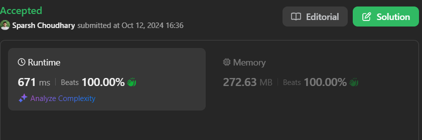

# 🔥BEATS 💯 % 🎯 |✨SUPER EASY BEGINNERS 👏

**Author:** CodeWithSparsh
**Votes:** 2
**Link:** [https://leetcode.com/problems/divide-intervals-into-minimum-number-of-groups/solutions/5902900/](https://leetcode.com/problems/divide-intervals-into-minimum-number-of-groups/solutions/5902900/)

---



# Intuition
The problem asks to find the minimum number of groups that can accommodate overlapping intervals. This can be thought of as an interval scheduling problem where we need to track how many intervals overlap at any given point in time. Each overlapping interval would require its own group.

# Approach
1. **Event-based approach**:
   - Convert each interval into two events: a start event and an end event.
   - For the start of an interval, it indicates an interval is beginning, and for the end of an interval, it indicates an interval is ending.
   
2. **Processing events**:
   - We process all events in chronological order. For overlapping intervals, the number of ongoing intervals at a particular time would increase.
   - To maintain the correct sequence of events, we sort the events by their time, and in case of a tie (same time), we prioritize the end event.
   
3. **Track the maximum number of active intervals**:
   - As we iterate through the sorted events, we track how many intervals are active at any point. The maximum number of active intervals at any given time is the number of groups we need.

# Complexity
- **Time Complexity**: 
  - Creating the events list takes \\(O(n)\\), where `n` is the number of intervals.
  - Sorting the events takes \\(O(n \\log n)\\) due to sorting.
  - Processing the events takes \\(O(n)\\).
  - Overall time complexity is \\(O(n \\log n)\\).
  
- **Space Complexity**: 
  - We use an additional list to store the events, which takes \\(O(n)\\) space.

```dart []
class Solution {
  int minGroups(List<List<int>> intervals) {
    List<List<int>> events = [];

    // Create events for the start and end of each interval
    for (var interval in intervals) {
      int start = interval[0];
      int end = interval[1];
      events.add([start, 1]);     // 1 indicates an interval is starting
      events.add([end + 1, -1]);  // -1 indicates an interval is ending
    }

    // Sort events: first by time, and in case of a tie, by type of event
    events.sort((a, b) {
      if (a[0] == b[0]) {
        return a[1].compareTo(b[1]);
      }
      return a[0].compareTo(b[0]);
    });

    int maxGroups = 0;
    int activeIntervals = 0;

    // Process all events
    for (var event in events) {
      activeIntervals += event[1];  // Add or subtract based on event type
      maxGroups = maxGroups < activeIntervals ? activeIntervals : maxGroups;
    }

    return maxGroups;
  }
}
```


```python []
class Solution:
    def minGroups(self, intervals: List[List[int]]) -> int:
        events = []
        
        # Create events for the start and end of each interval
        for interval in intervals:
            start, end = interval
            events.append((start, 1))     # 1 indicates an interval is starting
            events.append((end + 1, -1))  # -1 indicates an interval is ending
        
        # Sort events by time, and in case of tie, by type of event
        events.sort(key=lambda x: (x[0], x[1]))

        max_groups = 0
        active_intervals = 0

        # Process all events
        for event in events:
            active_intervals += event[1]
            max_groups = max(max_groups, active_intervals)

        return max_groups
```

```java []
import java.util.*;

class Solution {
    public int minGroups(int[][] intervals) {
        List<int[]> events = new ArrayList<>();
        
        // Create events for the start and end of each interval
        for (int[] interval : intervals) {
            events.add(new int[]{interval[0], 1});     // 1 indicates interval is starting
            events.add(new int[]{interval[1] + 1, -1}); // -1 indicates interval is ending
        }
        
        // Sort events: first by time, and in case of tie, by type of event
        Collections.sort(events, (a, b) -> {
            if (a[0] == b[0]) return Integer.compare(a[1], b[1]);
            return Integer.compare(a[0], b[0]);
        });

        int maxGroups = 0;
        int activeIntervals = 0;

        // Process all events
        for (int[] event : events) {
            activeIntervals += event[1];
            maxGroups = Math.max(maxGroups, activeIntervals);
        }

        return maxGroups;
    }
}
```
```javascript []
var minGroups = function(intervals) {
    let events = [];

    // Create events for the start and end of each interval
    for (let [start, end] of intervals) {
        events.push([start, 1]);     // 1 indicates interval is starting
        events.push([end + 1, -1]);  // -1 indicates interval is ending
    }

    // Sort events: first by time, and in case of tie, by type of event
    events.sort((a, b) => {
        if (a[0] === b[0]) return a[1] - b[1];
        return a[0] - b[0];
    });

    let maxGroups = 0;
    let activeIntervals = 0;

    // Process all events
    for (let [time, type] of events) {
        activeIntervals += type;
        maxGroups = Math.max(maxGroups, activeIntervals);
    }

    return maxGroups;
};
```
```cpp []
class Solution {
public:
    int minGroups(vector<vector<int>>& intervals) {
        vector<pair<int, int>> events;
        
        // Create events for the start and end of each interval
        for (auto& interval : intervals) {
            events.push_back({interval[0], 1});     // 1 indicates interval is starting
            events.push_back({interval[1] + 1, -1});  // -1 indicates interval is ending
        }

        // Sort events: first by time, and in case of tie, by type of event
        sort(events.begin(), events.end(), [](pair<int, int>& a, pair<int, int>& b) {
            if (a.first == b.first) return a.second < b.second;
            return a.first < b.first;
        });

        int maxGroups = 0;
        int activeIntervals = 0;

        // Process all events
        for (auto& event : events) {
            activeIntervals += event.second;
            maxGroups = max(maxGroups, activeIntervals);
        }

        return maxGroups;
    }
};
```

 {:style='width:250px'}
