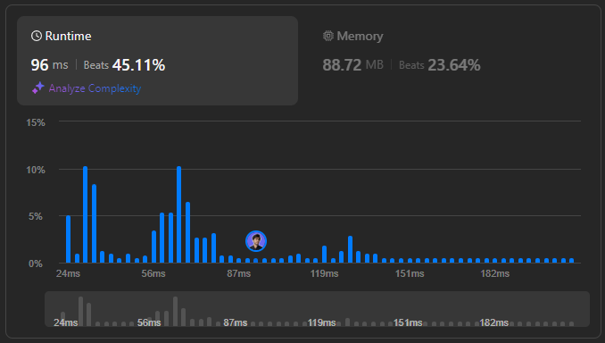

# 🌟 Step-by-Step Guide to Minimizing Interval Groups 🔥💯

**Author:** withaarzoo
**Votes:** 37
**Link:** [https://leetcode.com/problems/divide-intervals-into-minimum-number-of-groups/solutions/5901143/](https://leetcode.com/problems/divide-intervals-into-minimum-number-of-groups/solutions/5901143/)

---


## \uD83C\uDF1F **Access Daily LeetCode Solutions Repo :** [click here](https://github.com/withaarzoo/LeetCode-Solutions)

---



---

# Intuition
The problem asks us to group overlapping intervals such that no two intervals in the same group overlap. Intuitively, the number of groups will be determined by the maximum number of overlapping intervals at any given time.

If multiple intervals overlap at a particular point, they must go into different groups. So, the core idea is to calculate the maximum number of overlaps at any time.

---

# Approach
1. **Sort the intervals** by their start times to process them in chronological order.
2. Use a **priority queue (min-heap)** to track the end times of the intervals. The heap will help us manage the intervals that are currently active.
   - If the start time of the new interval is greater than the earliest end time in the heap, this means the interval can be placed in an existing group. So, we remove the top of the heap and replace it with the new interval's end time.
   - If the start time of the interval is earlier than all end times in the heap, it means we need a new group, and we add the new end time to the heap.
3. At the end of processing all intervals, the size of the heap represents the number of groups needed, as each element in the heap corresponds to an active group.

---

# Complexity
- **Time complexity**: 
  - Sorting the intervals takes \\(O(n \\log n)\\), where \\(n\\) is the number of intervals.
  - Each heap operation (insert or remove) takes \\(O(\\log n)\\), and since we process each interval, the total complexity is \\(O(n \\log n)\\).
  
- **Space complexity**: 
  - The space complexity is \\(O(n)\\) for storing the intervals and the heap.

---

# Code
```C++ []
#include <vector>
#include <queue>
#include <algorithm>
using namespace std;

class Solution {
public:
    int minGroups(vector<vector<int>>& intervals) {
        sort(intervals.begin(), intervals.end());
        priority_queue<int, vector<int>, greater<int>> pq;
        for (const auto& interval : intervals) {
            int start = interval[0], end = interval[1];
            if (!pq.empty() && pq.top() < start) {
                pq.pop();
            }
            pq.push(end);
        }
        return pq.size();
    }
};

```
```Java []
import java.util.*;

class Solution {
    public int minGroups(int[][] intervals) {
        Arrays.sort(intervals, (a, b) -> a[0] - b[0]);
        PriorityQueue<Integer> pq = new PriorityQueue<>();
        for (int[] interval : intervals) {
            int start = interval[0], end = interval[1];
            if (!pq.isEmpty() && pq.peek() < start) {
                pq.poll();
            }
            pq.add(end);
        }
        return pq.size();
    }
}

```
```JavaScript []
/**
 * @param {number[][]} intervals
 * @return {number}
 */
var minGroups = function(intervals) {
    const events = [];
    for (const [start, end] of intervals) {
        events.push([start, 1]);
        events.push([end + 1, -1]);
    }
    events.sort((a, b) => a[0] === b[0] ? a[1] - b[1] : a[0] - b[0]);
    let maxGroups = 0, currentGroups = 0;
    for (const [time, type] of events) {
        currentGroups += type;
        maxGroups = Math.max(maxGroups, currentGroups);
    }
    return maxGroups;
};

```
```Python []
import heapq

class Solution:
    def minGroups(self, intervals: List[List[int]]) -> int:
        intervals.sort()
        pq = []
        for start, end in intervals:
            if pq and pq[0] < start:
                heapq.heappop(pq)
            heapq.heappush(pq, end)
        return len(pq)

```
```Go []
import (
    "container/heap"
    "sort"
)
type MinHeap []int
func (h MinHeap) Len() int           { return len(h) }
func (h MinHeap) Less(i, j int) bool { return h[i] < h[j] }
func (h MinHeap) Swap(i, j int)      { h[i], h[j] = h[j], h[i] }
func (h *MinHeap) Push(x interface{}) {
    *h = append(*h, x.(int))
}
func (h *MinHeap) Pop() interface{} {
    old := *h
    n := len(old)
    x := old[n-1]
    *h = old[0 : n-1]
    return x
}
func minGroups(intervals [][]int) int {
    sort.Slice(intervals, func(i, j int) bool {
        return intervals[i][0] < intervals[j][0]
    })
    pq := &MinHeap{}
    heap.Init(pq)
    for _, interval := range intervals {
        start, end := interval[0], interval[1]
        if pq.Len() > 0 && (*pq)[0] < start {
            heap.Pop(pq)
        }
        heap.Push(pq, end)
    }
    return pq.Len()
}

```


---

# Step-by-Step Detailed Explanation

1. **Sorting the Intervals**: 
   - First, we sort the intervals by their start times. This allows us to process them in order and ensures that we always consider earlier intervals first.

2. **Using a Priority Queue**: 
   - The min-heap (or priority queue) helps us track the end times of the currently active intervals. The heap ensures that the interval with the earliest end time is always accessible at the top.
   
3. **Checking Overlaps**: 
   - For each interval, if its start time is greater than the smallest end time (top of the heap), we know that this interval doesn't overlap with the earliest ending interval, and we can reuse that group. We remove the earliest end time from the heap.
   - Otherwise, if there's an overlap, we need to create a new group for this interval. We add its end time to the heap.

4. **Final Count of Groups**: 
   - After processing all intervals, the number of active intervals (i.e., the size of the heap) gives us the number of groups required, as each interval in the heap represents an active group.

---


