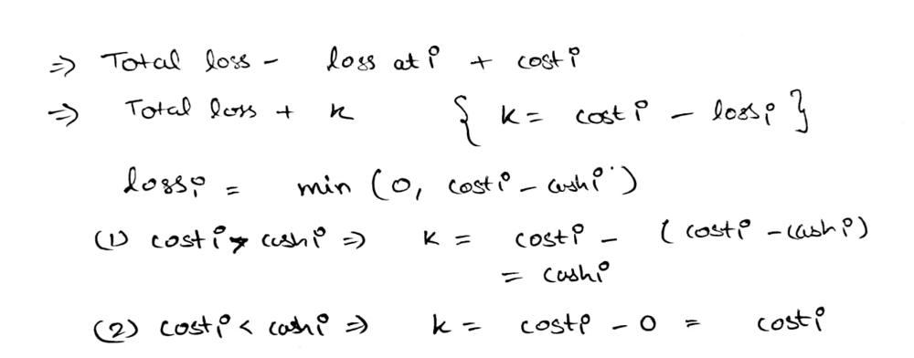

# C++ Greedy Explanation

**Author:** anis23
**Votes:** 7
**Link:** [https://leetcode.com/problems/minimum-money-required-before-transactions/solutions/2589010/](https://leetcode.com/problems/minimum-money-required-before-transactions/solutions/2589010/)

---

**Approach:**

* first find out the total money that we can lose.
* i.e the sum of lost money is
* ```sum_lose = sum(max(0, cost[i] - cashback[i]))```
* let the last transaction be at i
* now, the money we would have lost before the last transaction would be
	* ``` total_loss - loss at i```
* in order to perform the last transaction we want ```money>=cost[i]```
* so money should be atleast 
	* ```money = total_loss - loss at i + cost[i]```
* now, ```loss at i = min(0,cost[i]-cashback[i])```
* consider the below equations to understand better
	* 
* from the above equations we can say that 
	* ```k = min(cost[i],cashback[i])```
* we will consider the worst case so take maximum value of k
* ```k =max(k, min(v[0], v[1]));```

**Code:**

```
class Solution
{
public:
    long long minimumMoney(vector<vector<int>> &transactions)
    {
        long long total_loss = 0;
        int k = 0;
        for (auto &v : transactions)
        {
            k = max(k, min(v[0], v[1])); // v[0] = cost[i], v[1] = cashback[i]
            total_loss += max(v[0] - v[1], 0);
        }
        return total_loss + k;
    }
};
```
