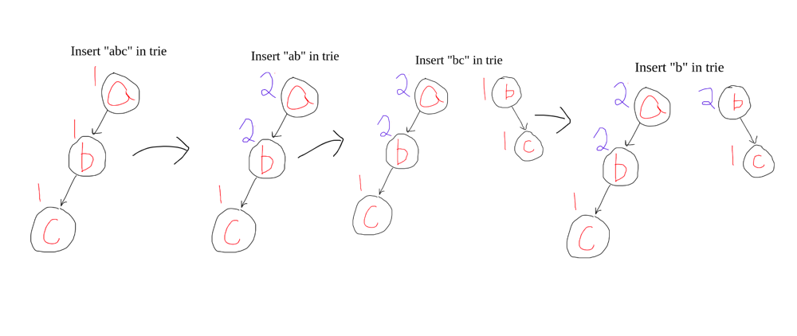

# C++ | Trie | Related Problems

**Author:** kiranpalsingh1806
**Votes:** 66
**Link:** [https://leetcode.com/problems/sum-of-prefix-scores-of-strings/solutions/2590087/](https://leetcode.com/problems/sum-of-prefix-scores-of-strings/solutions/2590087/)

---

- Store each string in trie and **add 1 to each prefix of string while inserting**.
- Then, for each string, **we sum up the count for all its prefixes**.



```cpp
struct TrieNode {
    TrieNode *next[26] = {};
    int cnt = 0;
};

class Solution {
    TrieNode root;
public:
    void insert(string word) {
        auto node = &root;
        for(char c : word) {
            if(!node->next[c - 'a']) {
                node->next[c - 'a'] = new TrieNode();
            } 
            node->next[c - 'a']->cnt++;
            node = node->next[c - 'a'];   
        }
    }

    int prefixCnt(string s) {
        auto node = &root;
        int ans = 0;
        for(char c : s) {
            ans += node->next[c - 'a']->cnt;
            node = node->next[c - 'a'];
        }
        return ans;
    }
    
    vector<int> sumPrefixScores(vector<string>& words) {
        int N = words.size();
		// Insert words in trie.
        for (int i = 0; i < N; i++) {
                insert(words[i]);
        }
        vector<int> ans(N, 0);
        for (int i = 0; i < N; i++) {
			// Get the count of all prefixes of given string.
            ans[i] = prefixCnt(words[i]); 
        }
        return ans;
    }
};
```

**Trie Related Problems**
[1. Implement Trie (Prefix Tree) ](https://leetcode.com/problems/implement-trie-prefix-tree/)
[2. Palindrome Pairs ](https://leetcode.com/problems/palindrome-pairs/)
[3. Maximum XOR of Two Numbers in an Array ](https://leetcode.com/problems/maximum-xor-of-two-numbers-in-an-array/)
[4. Concatenated Words ](https://leetcode.com/problems/concatenated-words/)
[5. Search Suggestions System ](https://leetcode.com/problems/search-suggestions-system/)
