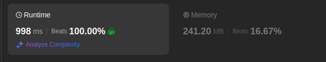
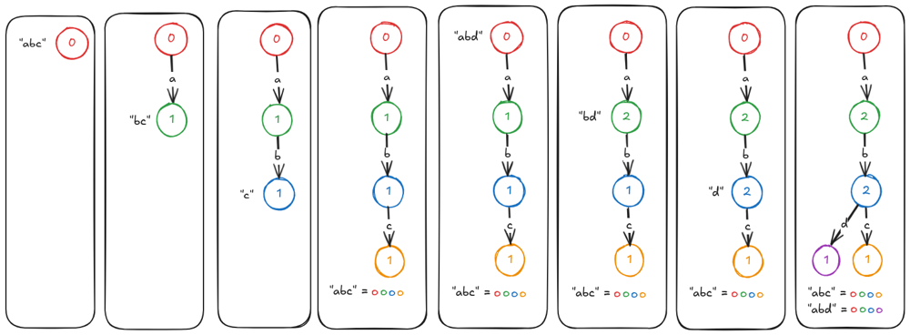

# Small & Simple Graph Count Traversal in Kotlin (Beats 100%)

**Author:** mdekaste
**Votes:** 2
**Link:** [https://leetcode.com/problems/sum-of-prefix-scores-of-strings/solutions/5831794/](https://leetcode.com/problems/sum-of-prefix-scores-of-strings/solutions/5831794/)

---



# Intuition
The question that was asked; to sum up all the prefixes and occurences for every seperate word, can be achieved by simply counting how many times a character reaches a node in a graph.

# Approach
By letting every word traverse character for character from the same root, and keeping track of its traversal order, you could simply sum up the counts per node.


```
input = ["abc", "abd"]
"abc" = 0 + 2 + 2 + 1 = 5
"abd" = 0 + 2 + 2 + 1 = 5
result = [5, 5]
```

- Create a root Node that every word will use as a start.
- Traverse and build from the root, character per character
   - Keep track of traversed nodes per word
   - Increment a nodecounter every time it is visited by the algorithm
- Afterwards, for every word, count up the nodecounters


# Complexity
- Time complexity:
  - Building the graph: O(wordsCount * maxLengthOfWord) = O(n * m)
  - Traversing the graph: O(wordsCount * maxLengtOfWord) = O(n * m)

- Space complexity:
    - Root node graph: O(wordscount * maxLengthOfWord) = O(n * m)
    - Traversal List: O(wordscount * maxLengthOfWord) = O(n * m)


# Code
```kotlin []
class Solution {
    fun sumPrefixScores(words: Array<String>): IntArray {
        val root = Node()
        fun traversal(word: String) = word.runningFold(root, Node::traverse)
        return words
            .map(::traversal)
            .map { node -> node.sumOf(Node::count) }
            .toIntArray()
    }

    private class Node {
        val next = mutableMapOf<Char, Node>()
        var count = 0
        fun traverse(char: Char): Node = next.getOrPut(char, ::Node).apply { count++ }
    }
}
```