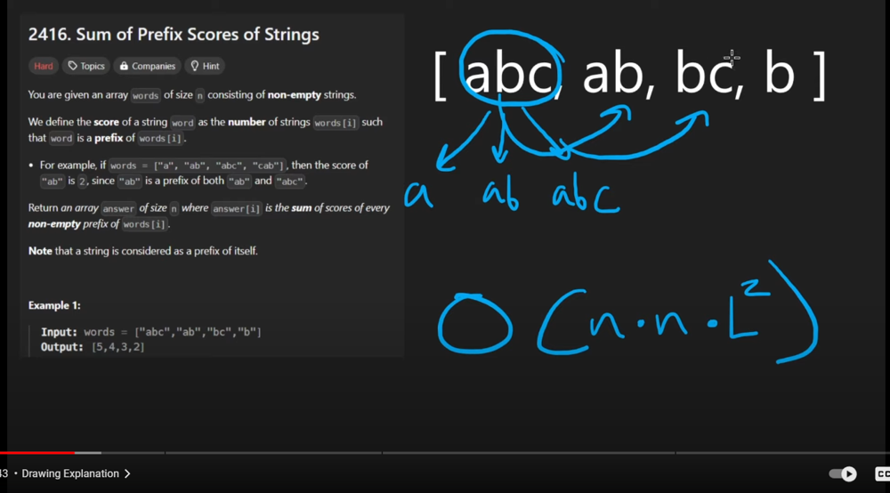
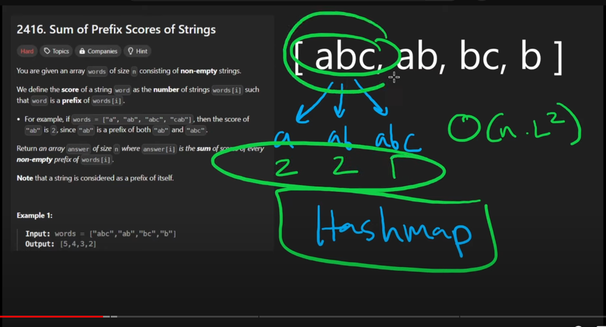
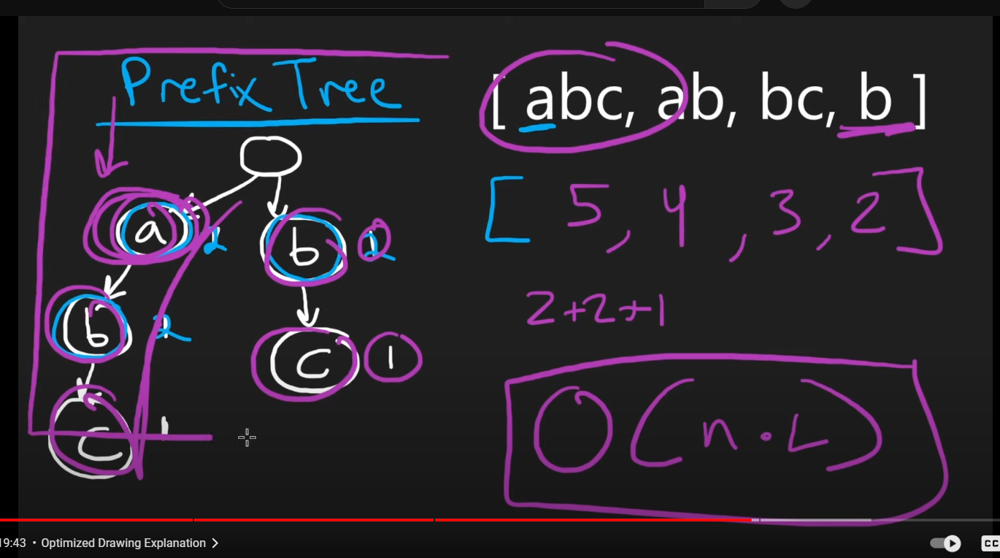

# Hashmap --> Trie

**Author:** abhiHegde28
**Votes:** 1
**Link:** [https://leetcode.com/problems/sum-of-prefix-scores-of-strings/solutions/5830461/](https://leetcode.com/problems/sum-of-prefix-scores-of-strings/solutions/5830461/)

---










# Intuition
The key insight for this problem is recognizing that we need an efficient way to count and retrieve prefix occurrences. A trie (prefix tree) is an ideal data structure for this task because it allows us to store and traverse prefixes efficiently.

# Approach
1. Build a trie from all the input words:
   - Each node in the trie represents a character.
   - Each node maintains a count of how many words pass through it.
   - Inserting a word increments the count for each node along its path.

2. Calculate scores:
   - For each word, traverse the trie along its path.
   - Sum the counts of each node visited.
   - This sum gives us the score for that word.

3. Return an array of scores corresponding to each input word.

# Complexity
- Time complexity: O(N * L)
  - N is the number of words
  - L is the total length of all words combined
  - We traverse each character of each word twice: once for building the trie and once for calculating scores.

- Space complexity: O(K)
  - K is the total number of unique characters across all words
  - In the worst case (when there are no common prefixes), this could be equal to the total length of all words (L).
  - However, in practice, it's often much less due to shared prefixes.

This approach is efficient because:
1. We only store each unique prefix once in the trie.
2. Retrieval of prefix counts is O(length of the prefix) for each word.
3. We avoid redundant calculations by storing counts in the trie nodes.


# Hashmap - bruteforce 
```typescript []
function sumPrefixScores(words: string[]): number[] {
    // Create a Map to store the count of prefixes
    const count = new Map<string, number>();

    // Count the prefixes
    for (const word of words) {
        for (let i = 1; i <= word.length; i++) {
            const prefix = word.slice(0, i);
            count.set(prefix, (count.get(prefix) || 0) + 1);
        }
    }

    // Calculate scores
    const ans: number[] = [];

    for (const word of words) {
        let score = 0;
        for (let i = 1; i <= word.length; i++) {
            const prefix = word.slice(0, i);
            score += count.get(prefix) || 0;
        }
        ans.push(score);
    }

    return ans;
}
```
```python []
class Solution:
    def sumPrefixScores(self, words: List[str]) -> List[int]:
        # "abc" -> a, ab , abc
        # letscreate a hashmap -> default it iwth int

        count = defaultdict(int)

        for word in words:
            for i in range(len(word)):
                count[word[:i+1]] += 1
        # print(f"count = {count}")

        ans = []

        for word in words:
            #  again now to count the score, 
            score = 0

            for i in range(len(word)):
                score += count[word[:i+1]]
            
            ans.append(score)

        return ans
        
```

# Trie - optimal

```typescript []
class TrieNode {
    children: Map<string, TrieNode>;
    count: number;

    constructor() {
        this.children = new Map();
        this.count = 0;
    }
}

class Trie {
    root: TrieNode;

    constructor(words: string[]) {
        this.root = new TrieNode();
        this.insertWords(words);
    }

    private insertWords(words: string[]): void {
        for (const word of words) {
            let node = this.root;
            for (const char of word) {
                if (!node.children.has(char)) {
                    node.children.set(char, new TrieNode());
                }
                node = node.children.get(char)!;
                node.count++;
            }
        }
    }

    getScore(word: string): number {
        let score = 0;
        let node = this.root;
        for (const char of word) {
            if (!node.children.has(char)) {
                break;
            }
            node = node.children.get(char)!;
            score += node.count;
        }
        return score;
    }
}

function sumPrefixScores(words: string[]): number[] {
    const trie = new Trie(words);
    return words.map(word => trie.getScore(word));
}
```
```python []
class TreeNode:
    def __init__(self):
        self.children = {}
        self.count = 0

class PrefixTree:
    def __init__(self, words):
        self.root = TreeNode()
        self.insert(words)
    
    def insert(self, words):
        for word in words:
            curr_node = self.root
            for ch in word:
                if ch not in curr_node.children:
                    curr_node.children[ch] = TreeNode()
                curr_node = curr_node.children[ch]
                curr_node.count += 1
    
    def get_score(self, word):
        score = 0
        curr_node = self.root
        for ch in word:
            if ch not in curr_node.children:
                break
            curr_node = curr_node.children[ch]
            score += curr_node.count
        return score

class Solution:
    def sumPrefixScores(self, words: List[str]) -> List[int]:
        trie = PrefixTree(words)
        return [trie.get_score(word) for word in words]
```

