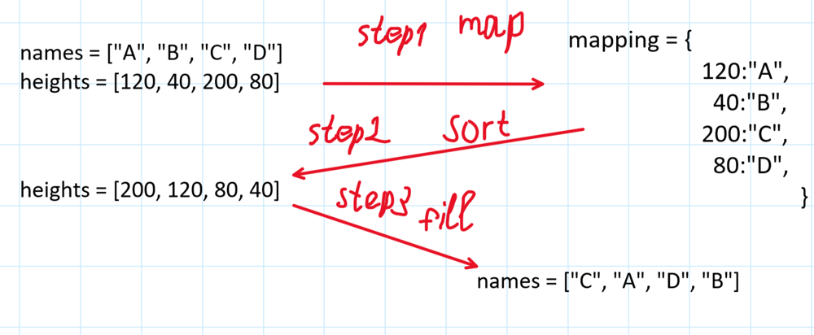

# ✅💯🔥Explanations No One Will Give You🎓🧠Very Detailed Approach🎯🔥Extremely Simple And Effective🔥

**Author:** heir-of-god
**Votes:** 91
**Link:** [https://leetcode.com/problems/sort-the-people/solutions/5514673/](https://leetcode.com/problems/sort-the-people/solutions/5514673/)

---

<blockquote>
        <p>
            <b>
                A dead end is just a good place to turn around.
            </b>        
        </p>
        <p>
            --- Naomi Judd ---
        </p>
</blockquote>

# \uD83D\uDC51Problem Explanation and Understanding:

## \uD83C\uDFAF Problem Description
You are given two arrays `names` and `heights`, the person `i` is defined by `names[i]` name and `heights[i]` height. You want to return the `names` array sorted by `heights` (you can create new array)

## \uD83D\uDCE5\u2935\uFE0F Input:
- String array `names`
- Integer array `heights` | Every integer is distinct

## \uD83D\uDCE4\u2934\uFE0F Output:
The `names` sorted by `heights` in DESCENDING order

---

# 1\uFE0F\u20E3\uD83E\uDDE0 Approach: Height-Name Mapping

# \uD83E\uDD14 Intuition
- This problem has only one problem to solve (though not in Python, lol) - you need to somehow connect `heights` and `names` in order to order `names` by sorting `heights`
- The easiest way to achive this - use hashmap to map person's height to name and then just fill new array with names according to `heihts` sorting
- This is whole problem, in fact, let's look at the example and move on to the code



# \uD83D\uDC69\uD83C\uDFFB\u200D\uD83D\uDCBB Coding 
- Determine the number of elements in `names` and store it in `n`.
- Create a dictionary `mapping` to store height-name pairs.
- Populate `mapping` by iterating through the range `n`:
  - Assign each height as a key and corresponding name as its value.
- Sort the `heights` array in descending order.
- Iterate through the sorted `heights`:
  - Retrieve the name associated with each height from `mapping`.
  - Update the `names` array with the sorted names based on height.
- Return the sorted `names` array.

# \uD83D\uDCD8 Complexity Analysis
- \u23F0 Time complexity: O(n\\*log n), since we use built-in sort functions which usually O(n\\*log n)
- \uD83E\uDDFA Space complexity: O(n), since additional hashmap `mapping` is used

# \uD83D\uDCBB Code
``` python []
class Solution:
    def sortPeople(self, names: list[str], heights: list[int]) -> list[str]:
        n: int = len(names)
        mapping: dict[int, str] = {}  # height -> name (heights are distinct)
        for ind in range(n):
            mapping[heights[ind]] = names[ind]

        heights.sort(reverse=True)
        for ind in range(n):
            h: int = heights[ind]
            names[ind] = mapping[h]

        return names
```
``` C++ []
class Solution {
public:
    vector<std::string> sortPeople(vector<string>& names, vector<int>& heights) {
        int n = names.size();
        unordered_map<int, string> mapping;

        for (int i = 0; i < n; ++i) {
            mapping[heights[i]] = names[i];
        }

        sort(heights.rbegin(), heights.rend());

        for (int i = 0; i < n; ++i) {
            names[i] = mapping[heights[i]];
        }

        return names;
    }
};
```
``` JavaScript []
var sortPeople = function(names, heights) {
    let n = names.length;
    let mapping = {};

    for (let i = 0; i < n; ++i) {
        mapping[heights[i]] = names[i];
    }

    heights.sort((a, b) => b - a);

    for (let i = 0; i < n; ++i) {
        names[i] = mapping[heights[i]];
    }

    return names;
};

```
``` Java []
class Solution {
    public String[] sortPeople(String[] names, int[] heights) {
        int n = names.length;
        Map<Integer, String> mapping = new HashMap<>();

        for (int i = 0; i < n; ++i) {
            mapping.put(heights[i], names[i]);
        }

        Arrays.sort(heights);
        for (int i = 0; i < n / 2; ++i) {
            int temp = heights[i];
            heights[i] = heights[n - 1 - i];
            heights[n - 1 - i] = temp;
        }

        for (int i = 0; i < n; ++i) {
            names[i] = mapping.get(heights[i]);
        }

        return names;
    }
}
```
``` C []
int compare(const void* a, const void* b) {
    return (*(int*)b - *(int*)a);
}

char** sortPeople(char** names, int namesSize, int* heights, int heightsSize, int* returnSize) {
    char** result = (char**)malloc(namesSize * sizeof(char*));
    int* sortedHeights = (int*)malloc(heightsSize * sizeof(int));
    memcpy(sortedHeights, heights, heightsSize * sizeof(int));

    qsort(sortedHeights, heightsSize, sizeof(int), compare);

    for (int i = 0; i < namesSize; ++i) {
        for (int j = 0; j < heightsSize; ++j) {
            if (heights[j] == sortedHeights[i]) {
                result[i] = names[j];
                break;
            }
        }
    }

    free(sortedHeights);
    *returnSize = namesSize;
    return result;
}
```

# \uD83D\uDCBB Additional Code (coscise C++ and one-line Python)
```python []
class Solution:
    def sortPeople(self, names: list[str], heights: list[int]) -> list[str]:
        return [p[0] for p in sorted(zip(names, heights), key=lambda person: -person[1])]
```
```C++ []
class Solution {
public:
    vector<string> sortPeople(vector<string>& names, vector<int>& heights) {
        vector<int> indices(heights.size());
        iota(indices.begin(), indices.end(), 0);
        sort(indices.begin(), indices.end(), [&](int i, int j) { return heights[i] > heights[j]; });
        vector<string> sortedNames(indices.size());
        transform(indices.begin(), indices.end(), sortedNames.begin(), [&](int i) { return names[i]; });
        return sortedNames;
    }
};

```

## \uD83D\uDCA1\uD83D\uDCA1\uD83D\uDCA1I encourage you to check out [my profile](https://leetcode.com/heir-of-god/) and [Project-S](https://github.com/Heir-of-God/Project-S) project for detailed explanations and code for different problems (not only Leetcode). Happy coding and learning!\uD83D\uDCDA

### Please consider *upvote*\u2B06\uFE0F\u2B06\uFE0F\u2B06\uFE0F because I try really hard not just to put here my code and rewrite testcase to show that it works but explain you WHY it works and HOW. Thank you\u2764\uFE0F

## If you have any doubts or questions feel free to ask them in comments. I will be glad to help you with understanding\u2764\uFE0F\u2764\uFE0F\u2764\uFE0F


