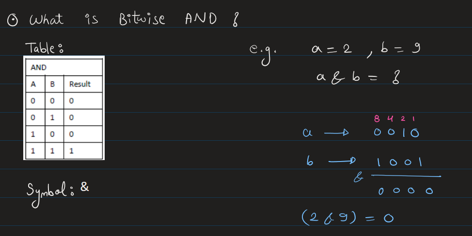
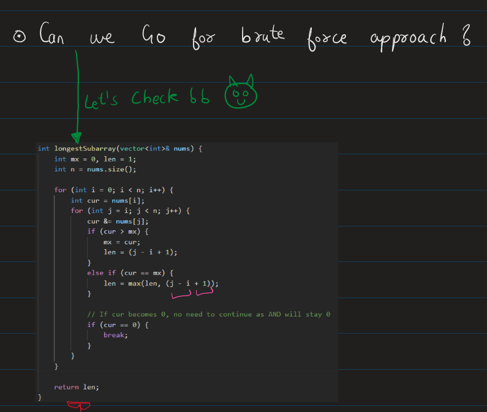
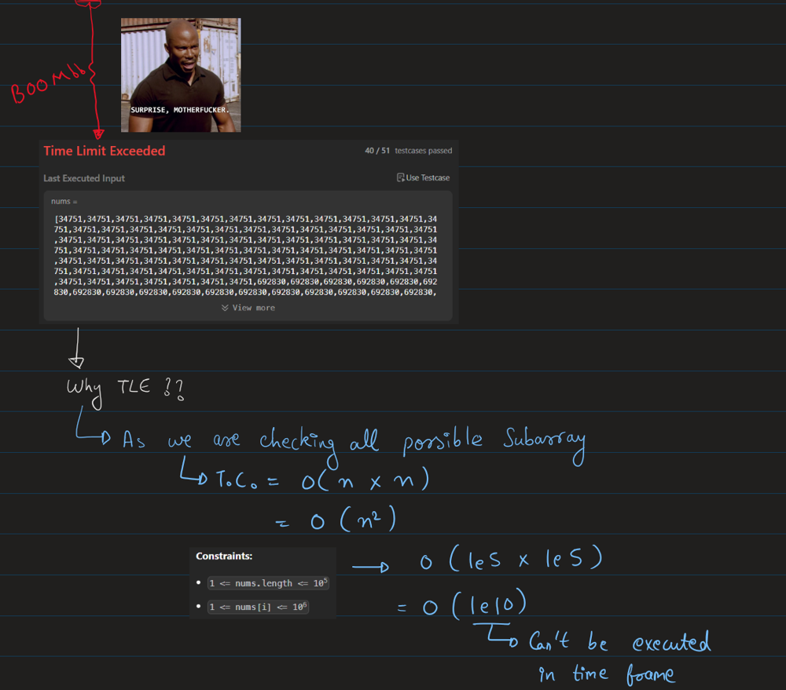
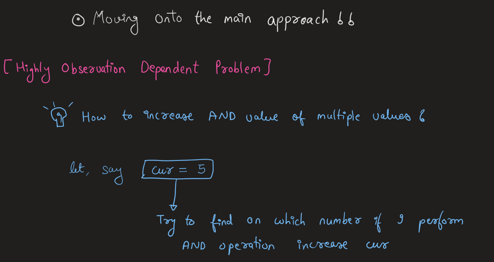
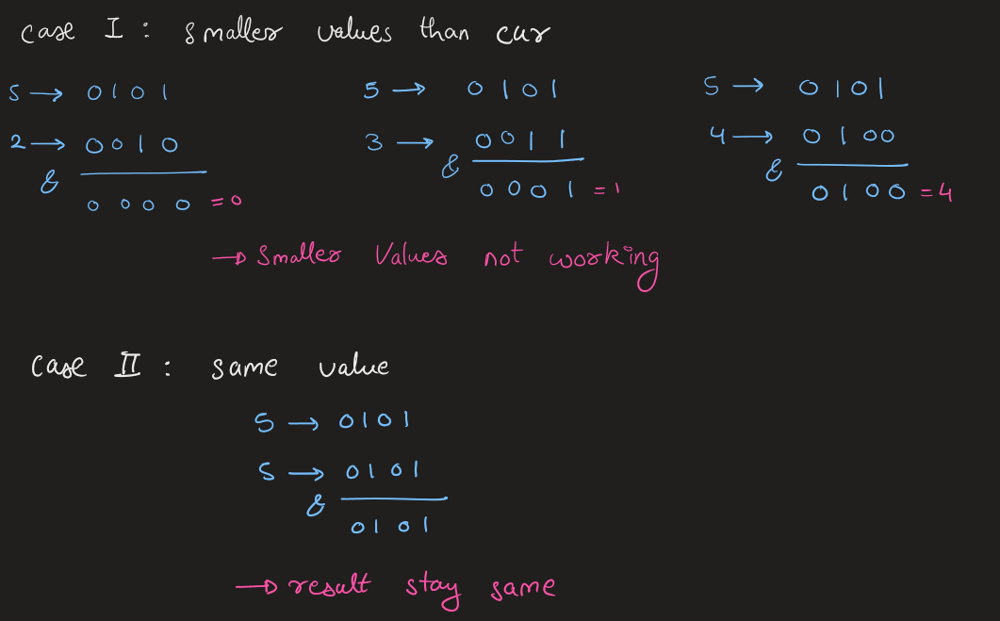
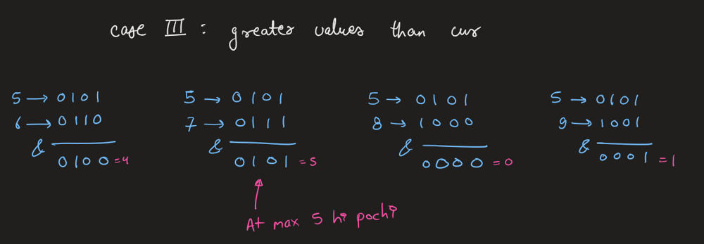
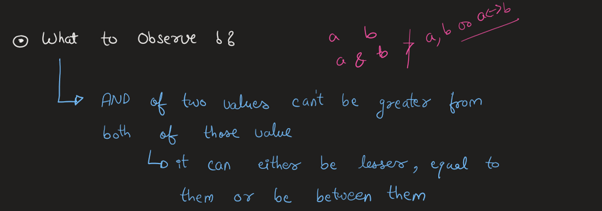
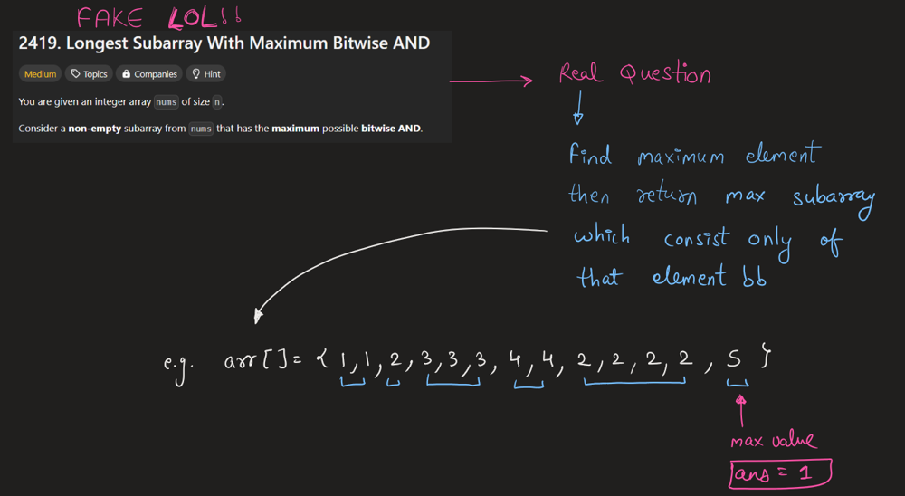
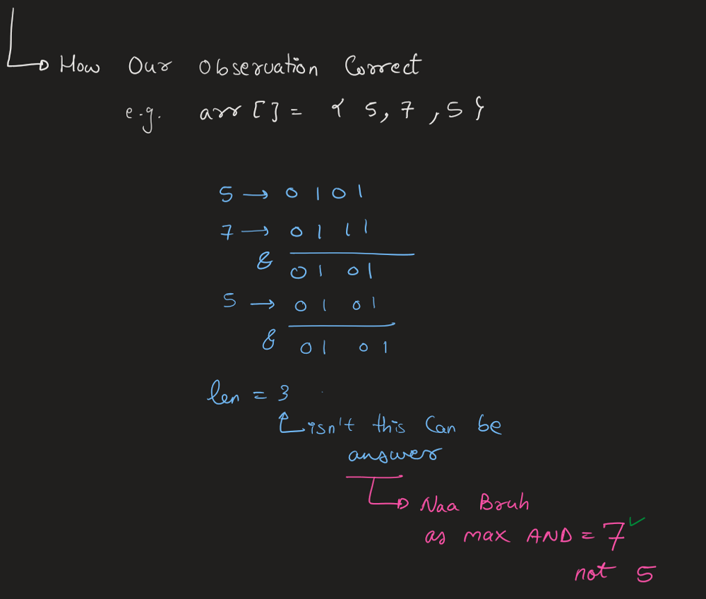

# Nakab Posh Question, Chalo deduce kre Observation ko!!

**Author:** Rarma
**Votes:** 147
**Link:** [https://leetcode.com/problems/longest-subarray-with-maximum-bitwise-and/solutions/5783565/](https://leetcode.com/problems/longest-subarray-with-maximum-bitwise-and/solutions/5783565/)

---

# Youtube Explanation
-> Coming Soon On Youtube Channel : https://www.youtube.com/@Intuit_and_Code
Edited:
> For Coders > Beginners : Start from 09:05
For People Who Truly want to Understand Concept : Start from 00:00

https://youtu.be/lhCVyoAvFrY?si=raKeLcL2GRbiEQPo
# Intuition & Approach














# Complexity
- Time complexity: O(n)
<!-- Add your time complexity here, e.g. $$O(n)$$ -->

- Space complexity: O(1)
<!-- Add your space complexity here, e.g. $$O(n)$$ -->

# Code
```cpp []
class Solution {
public:
    int longestSubarray(vector<int>& nums) {
        int len = 1;

        // step 01
        int mx = *max_element(nums.begin(),nums.end()); //O(n)

        // step 02
        int tmp_len=0;
        for(int i=0;i<nums.size();i++){ // O(n)
            if(nums[i]==mx){
                tmp_len++; // 3
            }
            else{
                len = max(len, tmp_len);
                tmp_len=0;
            }
        }

        len = max(len, tmp_len);

        return len;
    }
};
```
``` java []
class Solution {
    public int longestSubarray(int[] nums) {
        int len = 1;

        // Step 1: Find the maximum element in the array
        int mx = Integer.MIN_VALUE;
        for (int num : nums) {
            mx = Math.max(mx, num);  // O(n)
        }

        // Step 2: Find the longest subarray consisting of the maximum element
        int tmp_len = 0;
        for (int num : nums) {  // O(n)
            if (num == mx) {
                tmp_len++;
            } else {
                len = Math.max(len, tmp_len);
                tmp_len = 0;
            }
        }

        // Update len in case the longest subarray is at the end
        len = Math.max(len, tmp_len);

        return len;
    }
}

```