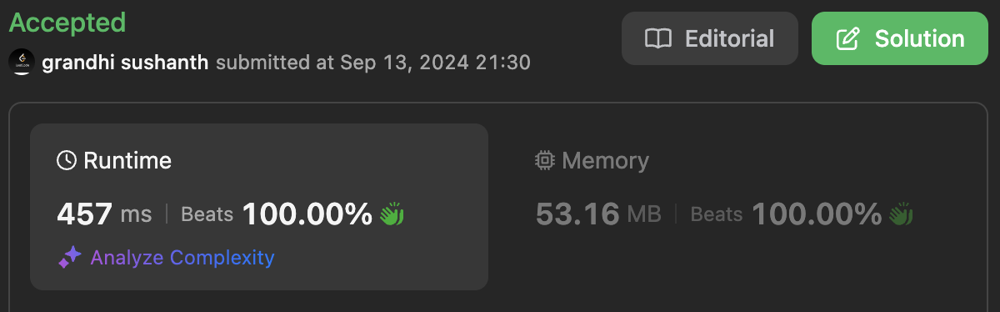

# Beats 100% time || Detailed Explanation || Clear code with comments

**Author:** sushanth_grandhi
**Votes:** 2
**Link:** [https://leetcode.com/problems/longest-subarray-with-maximum-bitwise-and/solutions/5783339/](https://leetcode.com/problems/longest-subarray-with-maximum-bitwise-and/solutions/5783339/)

---




---

# Intuition:

=> The question is asking to find the length of sub-array which results in maximum bitwise 'AND'. And if there are 
multiple such sub-array's with maximum bitwise and return the length of longest one.

- **BruteForce Approach:**
  - We find out all the possible sub-arrays and take the bitwise and of each sub array by keeping track of 
  maximum bitwise-and, length of the sub array.
  - This is going to take: `O(n^3)` time. => TLE
  - No extra space is required.
- The intuition for optimized approach for the problem is based on the hint that: 
  - Bitwise-And of 2 numbers (one large, one small) will always result in a number lower-than or equal to the smaller number.
    - [a, b, c, d, ...] => a & b & c & d & ... <= min(a, b, c, d, ...)
  - So maximum possible bitwise-and of 2 numbers can only be achieved when both the numbers are equal.
    - [a, a, a, ...] => a & a & a & ... = min(a, a, a, ...) = a
  - So the problem boils down to finding the longest subarray where all the values are equal and the value is maximum of the array.
- Basically, we have to **"Find longest consecutive length of the maximum element of nums."**


# Approach:

1. The maximum bitwise-and for any possible sub array is equal to maximum value of the array.
2. And now we are going to find out maximum contiguous occurrences of this maximum value.

## Time Complexity:

1. Finding max of nums => O(n)
2. Then we traverse over the nums array once to find the maximum length => O(n)
3. Total time: O(n) + O(n) = `O(n)`

## Space Complexity:

1. No extra space is required.

# Code
```kotlin []
class Solution {
    fun longestSubarray(nums: IntArray): Int {
        // max bitwise-and for any possible sub array
        val maxBitwiseAnd = nums.max()

        // check if first value is equal to max value
        // max contiguous max value length till now
        var maxLength = if (nums[0] == maxBitwiseAnd) 1 else 0
        // current contiguous max value length
        var curLength = maxLength
        
        // for each index from 1 till end of array
        for (idx in 1..<nums.size) {
            // check if the value pointed to is equal to max value and 
            // the previous index values is equal to max value 
            // the increment current contiguous length
            if (nums[idx] == maxBitwiseAnd && nums[idx] == nums[idx-1]) {
                curLength += 1
            } else if (nums[idx] == maxBitwiseAnd) {
                // if previous index values is not equal to max value 
                // And current index value is max value
                // initialize current contiguous length to 1
                curLength = 1
            } else {
                curLength = 0
            }

            // update max contiguous length
            maxLength = max(maxLength, curLength)
        }

        return maxLength
    }
}
```