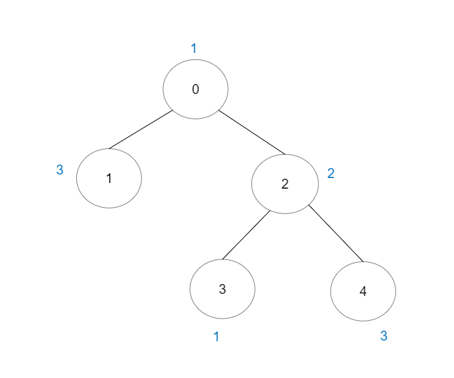

# [2421. Number of Good Paths](https://leetcode.com/problems/number-of-good-paths/)

| Category | Difficulty | Likes | Dislikes |
| :------: | :--------: | :---: | :------: |
| Algorithms | Hard | 2420 | 113 |

**Tags:** [`array`](https://leetcode.com/tag/array), [`hash-table`](https://leetcode.com/tag/hash-table), [`tree`](https://leetcode.com/tag/tree), [`union-find`](https://leetcode.com/tag/union-find), [`graph`](https://leetcode.com/tag/graph), [`sorting`](https://leetcode.com/tag/sorting)

**Companies:** `google`

## Description

There is a tree (i.e. a connected, undirected graph with no cycles) consisting of `n` nodes numbered from `0` to `n - 1` and exactly `n - 1` edges.

You are given a **0-indexed** integer array `vals` of length `n` where `vals[i]` denotes the value of the `i^th` node. You are also given a 2D integer array `edges` where `edges[i] = [a_i, b_i]` denotes that there exists an **undirected** edge connecting nodes `a_i` and `b_i`.

A **good path** is a simple path that satisfies the following conditions:

	- The starting node and the ending node have the **same** value.

	- All nodes between the starting node and the ending node have values **less than or equal to** the starting node (i.e. the starting node's value should be the maximum value along the path).

Return *the number of distinct good paths*.

Note that a path and its reverse are counted as the **same** path. For example, `0 -> 1` is considered to be the same as `1 -> 0`. A single node is also considered as a valid path.

 

**Example 1:**


```

Input: vals = [1,3,2,1,3], edges = [[0,1],[0,2],[2,3],[2,4]]
Output: 6
Explanation: There are 5 good paths consisting of a single node.
There is 1 additional good path: 1 -&gt; 0 -&gt; 2 -&gt; 4.
(The reverse path 4 -&gt; 2 -&gt; 0 -&gt; 1 is treated as the same as 1 -&gt; 0 -&gt; 2 -&gt; 4.)
Note that 0 -&gt; 2 -&gt; 3 is not a good path because vals[2] &gt; vals[0].

```

**Example 2:**


```

Input: vals = [1,1,2,2,3], edges = [[0,1],[1,2],[2,3],[2,4]]
Output: 7
Explanation: There are 5 good paths consisting of a single node.
There are 2 additional good paths: 0 -&gt; 1 and 2 -&gt; 3.

```

**Example 3:**


```

Input: vals = [1], edges = []
Output: 1
Explanation: The tree consists of only one node, so there is one good path.

```

 

**Constraints:**

	- `n == vals.length`

	- `1 <= n <= 3 * 10^4`

	- `0 <= vals[i] <= 10^5`

	- `edges.length == n - 1`

	- `edges[i].length == 2`

	- `0 <= a_i, b_i < n`

	- `a_i != b_i`

	- `edges` represents a valid tree.

---

**Links:** [Submissions](https://leetcode.com/problems/number-of-good-paths/) | [Solutions](https://leetcode.com/problems/number-of-good-paths/)
