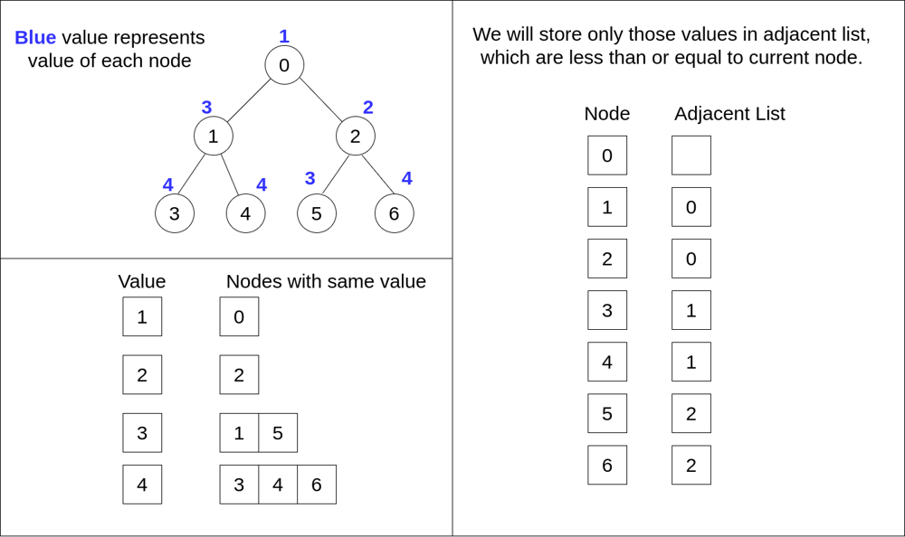
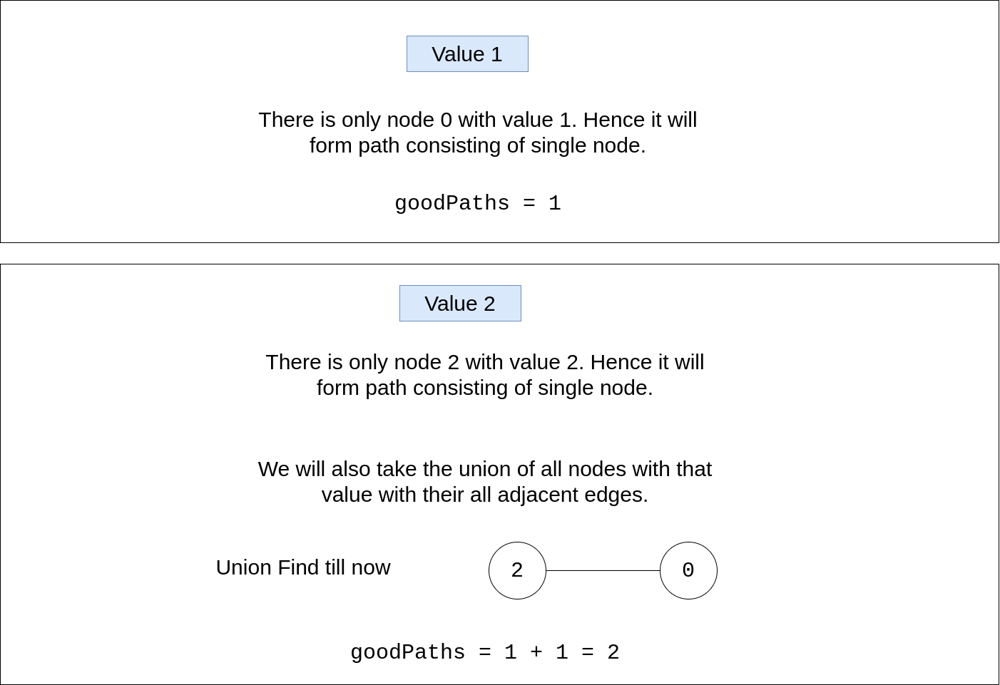
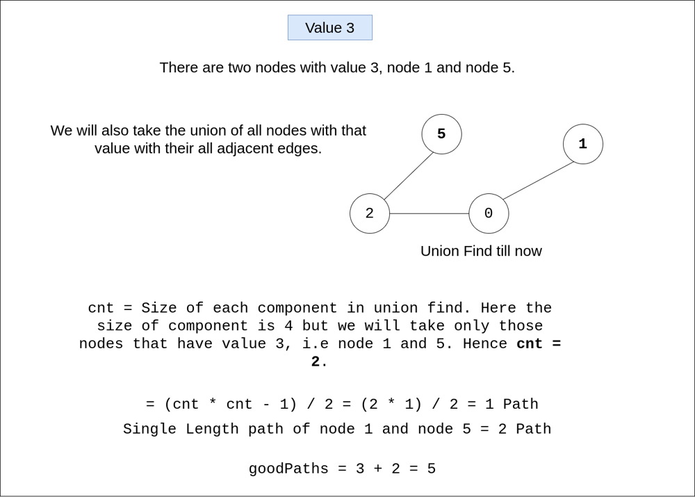
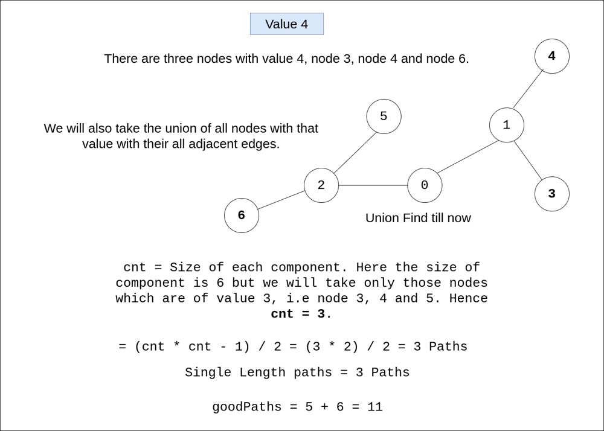

# C++ | Java | Diagram | Union-Find

**Author:** kiranpalsingh1806
**Votes:** 388
**Link:** [https://leetcode.com/problems/number-of-good-paths/solutions/2621772/](https://leetcode.com/problems/number-of-good-paths/solutions/2621772/)

---

**Approach**
1. We will create `adjacent list` for each node where we will store `only those edges which are less than or equal to current node`.
2. Then we will create another `map` where we will put all the nodes with same value in one vector. As map stores in `sorted order`, we will look at `smaller values first`.
3. We will use `Union Find` data structure to create components of edges.
4. Then we will use `cnt * (cnt - 1) / 2` to count the number of good paths in each component.

**Edit 1**
**Why we are storing equal values in map and checking smaller values first**? 
 Because we need to check value from small to large. For each value vector group to connect to the current union, so that they are the the largest nodes which meets both conditions for a good path.

**Diagram Example**










**C++ Code**

```cpp
class UnionFind {
    private:
        vector<int> id, rank;
        int cnt;
    public:
        UnionFind(int cnt) : cnt(cnt) {
            id = vector<int>(cnt);
            rank = vector<int>(cnt, 0);
            for (int i = 0; i < cnt; ++i) id[i] = i;
        }
        int find(int p) {
            if (id[p] == p) return p;
            return id[p] = find(id[p]);
        }
        bool connected(int p, int q) { 
            return find(p) == find(q); 
        }
        void connect(int p, int q) {
            int i = find(p), j = find(q);
            if (i == j) return;
            if (rank[i] < rank[j]) {
                id[i] = j;  
            } else {
                id[j] = i;
                if (rank[i] == rank[j]) rank[j]++;
            }
            --cnt;
        }
};

class Solution {
public:
    int numberOfGoodPaths(vector<int>& vals, vector<vector<int>>& edges) {
        int N = vals.size(), goodPaths = 0;
        vector<vector<int>> adj(N);
        map<int, vector<int>> sameValues;
        
        for (int i = 0; i < N; i++) {
            sameValues[vals[i]].push_back(i);
        }
        
        for (auto &e : edges) {
            int u = e[0], v = e[1];
            
            if (vals[u] >= vals[v]) {
                adj[u].push_back(v);
            } else if (vals[v] >= vals[u]) {
                adj[v].push_back(u);
            }
        }
        
        UnionFind uf(N);
        
        for (auto &[value, allNodes] : sameValues) {
            
            for (int u : allNodes) {
                for (int v : adj[u]) {
                    uf.connect(u, v);
                }
            }
            
            unordered_map<int, int> group;
            
            for (int u : allNodes) {
                group[uf.find(u)]++;
            }
            
            goodPaths += allNodes.size();
            
            for (auto &[_, size] : group) {
                goodPaths += (size * (size - 1) / 2);
            }
        }
        
        return goodPaths;
    }
};
```

<details>
<summary> Java Code (Credits : @ssmegentle) </summary>

```java
public int numberOfGoodPaths(int[] vals, int[][] edges) {
    int N = vals.length;
    ArrayList<Integer>[] adj = new ArrayList[N];
    TreeMap<Integer, ArrayList<Integer>> sameValues = new TreeMap<>();
    int ans = 0;
    
    for(int i=0; i<N; i++) {
        adj[i] = new ArrayList<>();
        
        if(!sameValues.containsKey(vals[i])) sameValues.put(vals[i], new ArrayList<>());
        sameValues.get(vals[i]).add(i);
    }
    
    for(int[] e : edges) {
        int u = e[0];
        int v = e[1];
        
        if(vals[u] >= vals[v]) {
            adj[u].add(v);
        } else {
            adj[v].add(u);
        }
    }
    
    UF uf = new UF(N);
    
    for(int val : sameValues.entrySet()) {
        for(int u : sameValues.get(val)) {
            for(int v : adj[u]) {
                uf.union(u, v);
            }
        }
        
        HashMap<Integer, Integer> group = new HashMap<>();
        
        for(int u : sameValues.get(val)) {
            group.put(uf.find(u), group.getOrDefault(uf.find(u), 0) + 1);
        }
        
        ans += sameValues.get(val).size();
        
        for(int key : group.keySet()) {
            int size = group.get(key);
            ans += size * (size-1) / 2;
        }
    }
    
    return ans;
    
}

class UF {

    int[] parent;

    public UF(int len) {
        parent = new int[len];
        Arrays.fill(parent, -1);
    }

    public int find(int a) {
        if(parent[a] >= 0) {
            return parent[a] = find(parent[a]);    
        }
        return a;
    }

    public boolean union(int a, int b) {
        int pa = find(a);
        int pb = find(b);

        if(pa == pb) return false;

        if(parent[pa] <= parent[pb]) {
            parent[pa] += parent[pb];
            parent[pb] = pa;
        } else {
            parent[pb] += parent[pa];
            parent[pa] = pb;
        }
        
        return true;
    }
}
```

</details>

<details>
<summary> Python Code (Credits : @Himanshu3889) </summary>

```py
class UnionFind:
    def __init__(self, n):
        self.parent = list(range(n))
        self.size = [1] * n

    def findAP(self, curr) :
        if self.parent[curr] == curr :  
            return curr
        self.parent[curr] = self.findAP(self.parent[curr])  
        return self.parent[curr]

    def union(self, u, v) :
        uap = self.findAP(u)
        vap = self.findAP(v)
        if uap == vap : 
            return False
        if self.size[uap] > self.size[vap]:
            uap , vap = vap, uap
        self.parent[uap] = vap
        self.size[vap] += self.size[uap]  

class Solution:
    def numberOfGoodPaths(self, vals: List[int], edges: List[List[int]]) -> int:        
        n = len(vals)

        adjList = defaultdict(list)
        for u, v in edges:
            adjList[v].append(u)
            adjList[u].append(v)

        valNodes = defaultdict(list)
        for i in range(n):
            valNodes[vals[i]].append(i)
        
        uf = UnionFind(n)
                
        res = n
        for val in sorted(valNodes):
            for curr in valNodes[val]:
                for adj in adjList[curr]:
                    if vals[adj] <= vals[curr]:
                        uf.union(curr, adj) # add edges with smaller/equal val
            
            group = defaultdict(int)  # no of different groups for curr valNodes
            for curr in valNodes[val]:
                group[uf.findAP(curr)] += 1
                
            for _, cnt in group.items():
                if cnt >= 2:        # more than 1 same val nodes in same group 
                    res += cnt * (cnt - 1) // 2
        return res
```

</details>