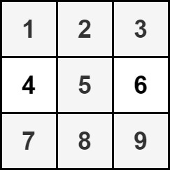

# [2428. Maximum Sum of an Hourglass](https://leetcode.com/problems/maximum-sum-of-an-hourglass/)

| Category | Difficulty | Likes | Dislikes |
| :------: | :--------: | :---: | :------: |
| Algorithms | Medium | 483 | 72 |

**Tags:** [`array`](https://leetcode.com/tag/array), [`matrix`](https://leetcode.com/tag/matrix), [`prefix-sum`](https://leetcode.com/tag/prefix-sum)

**Companies:** `nutanix`

## Description

You are given an `m x n` integer matrix `grid`.

We define an **hourglass** as a part of the matrix with the following form:


Return *the **maximum** sum of the elements of an hourglass*.

**Note** that an hourglass cannot be rotated and must be entirely contained within the matrix.

 

**Example 1:**


```

Input: grid = [[6,2,1,3],[4,2,1,5],[9,2,8,7],[4,1,2,9]]
Output: 30
Explanation: The cells shown above represent the hourglass with the maximum sum: 6 + 2 + 1 + 2 + 9 + 2 + 8 = 30.

```

**Example 2:**


```

Input: grid = [[1,2,3],[4,5,6],[7,8,9]]
Output: 35
Explanation: There is only one hourglass in the matrix, with the sum: 1 + 2 + 3 + 5 + 7 + 8 + 9 = 35.

```

 

**Constraints:**

	- `m == grid.length`

	- `n == grid[i].length`

	- `3 <= m, n <= 150`

	- `0 <= grid[i][j] <= 10^6`

---

**Links:** [Submissions](https://leetcode.com/problems/maximum-sum-of-an-hourglass/) | [Solutions](https://leetcode.com/problems/maximum-sum-of-an-hourglass/)
