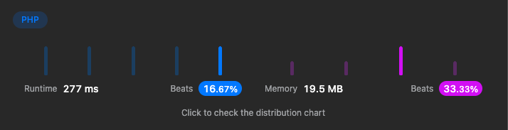

# PHP

**Author:** stuu
**Votes:** 0
**Link:** [https://leetcode.com/problems/the-employee-that-worked-on-the-longest-task/solutions/2709992/](https://leetcode.com/problems/the-employee-that-worked-on-the-longest-task/solutions/2709992/)

---




# Code
```

class Solution
{

  /**
   * @param int $n
   * @param int[][] $logs
   * @return int
   */
  function hardestWorker($n, $logs)
  {
    $work_times = [];
    $highest_work_time = 0;
    foreach ($logs as $key => $log) {

      $last_end_time = isset($logs[$key - 1]) ? $logs[$key - 1][1] : 0;

      $time_worked = $log[1] - $last_end_time;

      if($time_worked >= $highest_work_time){

        $work_times[$log[0]] = $highest_work_time = $time_worked;

      }
    }


    $workers_with_highest_work_time = array_keys($work_times, $highest_work_time);
    $worker = min($workers_with_highest_work_time);
    return $worker;
  }
}
```