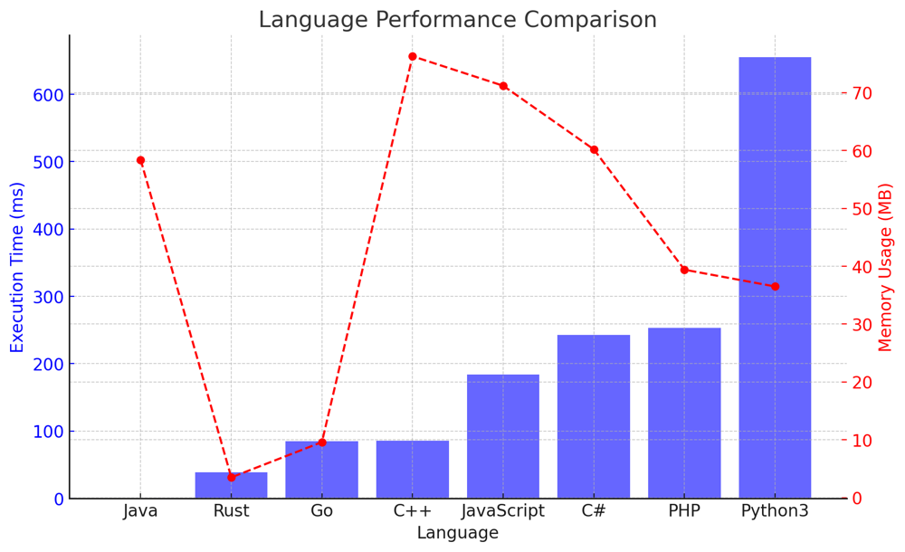

# ✅ 92.93% One Line XORing

**Author:** vanAmsen
**Votes:** 31
**Link:** [https://leetcode.com/problems/find-the-original-array-of-prefix-xor/solutions/4228428/](https://leetcode.com/problems/find-the-original-array-of-prefix-xor/solutions/4228428/)

---

# Intuition
Upon reading the problem, the first thing that might come to mind is how the XOR operation behaves. Since the prefix XOR array is essentially an accumulation of XOR operations, the inverse process would involve 'undoing' the XOR operation. We remember that XOR has the following properties:

1. $ a \\oplus a = 0 $
2. $ a \\oplus 0 = a $
3. XOR operation is both associative and commutative.

These properties hint towards the approach of using previous prefix values to deduce the current value.

## Live Coding in Python & Go?
https://youtu.be/nyRgqGYnAf4?si=8YeN7ukMB6uEdXSi

# Approach
1. The first observation is that the first element of the original array is equal to the first element of the prefix array. This is because there's no prior value to XOR with.
2. For every subsequent element in the prefix array, we can obtain the corresponding element in the original array by XORing the current prefix value with the previous prefix value. This is derived from the properties of XOR, which allows us to 'cancel out' values, essentially 'undoing' the accumulation.

Using this approach, we iterate through the prefix array and populate our original array.

# Complexity
- Time complexity: $O(n)$
  - We iterate through the prefix array exactly once, resulting in a linear time complexity.

- Space complexity: $O(n)$
  - We are creating a new list that has the same size as the input prefix array, resulting in a linear space complexity.

# Code
```python []
class Solution:
    def findArray(self, pref: List[int]) -> List[int]:
        return [pref[0]] + [pref[i] ^ pref[i-1] for i in range(1, len(pref))]
```
``` Java []
public class Solution {
    public int[] findArray(int[] pref) {
        int[] result = new int[pref.length];
        result[0] = pref[0];
        for(int i = 1; i < pref.length; i++) {
            result[i] = pref[i] ^ pref[i-1];
        }
        return result;
    }
}
```
``` Go []
func findArray(pref []int) []int {
    result := make([]int, len(pref))
    result[0] = pref[0]
    for i := 1; i < len(pref); i++ {
        result[i] = pref[i] ^ pref[i-1]
    }
    return result
}
```
``` Rust []
impl Solution {
    pub fn find_array(pref: Vec<i32>) -> Vec<i32> {
        let mut result = Vec::with_capacity(pref.len());
        result.push(pref[0]);
        for i in 1..pref.len() {
            result.push(pref[i] ^ pref[i-1]);
        }
        result
    }
}
```
``` C++ []
class Solution {
public:
    vector<int> findArray(vector<int>& pref) {
        vector<int> result(pref.size());
        result[0] = pref[0];
        for(int i = 1; i < pref.size(); i++) {
            result[i] = pref[i] ^ pref[i-1];
        }
        return result;
    }
};
```
``` C# []
public class Solution {
    public int[] FindArray(int[] pref) {
        int[] result = new int[pref.Length];
        result[0] = pref[0];
        for(int i = 1; i < pref.Length; i++) {
            result[i] = pref[i] ^ pref[i-1];
        }
        return result;
    }
}
```
``` JavaScript []
var findArray = function(pref) {
        let result = [pref[0]];
        for(let i = 1; i < pref.length; i++) {
            result.push(pref[i] ^ pref[i-1]);
        }
        return result;
    }
```
``` PHP []
class Solution {
    function findArray($pref) {
        $result = [];
        $result[] = $pref[0];
        for($i = 1; $i < count($pref); $i++) {
            $result[] = $pref[$i] ^ $pref[$i-1];
        }
        return $result;
    }
}
```

---

## Performance

| Language   | Execution Time (ms) | Memory Usage (MB) |
|------------|---------------------|-------------------|
| Java       | 1                   | 58.4              |
| Rust       | 39                  | 3.5               |
| Go         | 85                  | 9.6               |
| C++        | 86                  | 76.3              |
| JavaScript | 184                 | 71.2              |
| C#         | 243                 | 60.2              |
| PHP        | 253                 | 39.4              |
| Python3    | 655                 | 36.5              |




## What We Have Learned?

From this problem, we've reinforced our understanding of the XOR operation and its properties, particularly how it can be used to deduce information from accumulated data. The solution is optimal because it utilizes the inherent properties of XOR to deduce the original values in a single pass through the prefix array. The approach is both space and time efficient, and showcases how sometimes, understanding the underlying mathematics or logic (in this case, bitwise operations) can lead to very efficient solutions.