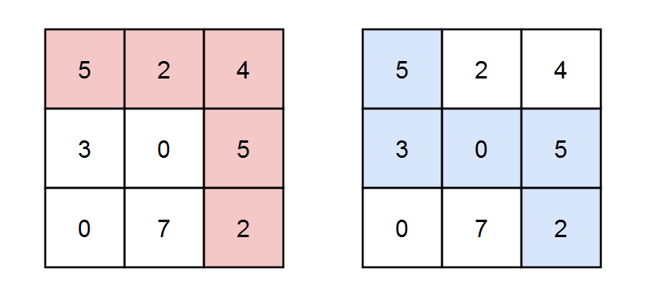
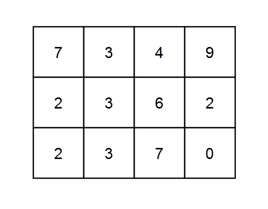

# [2435. Paths in Matrix Whose Sum Is Divisible by K](https://leetcode.com/problems/paths-in-matrix-whose-sum-is-divisible-by-k/)

| Category | Difficulty | Likes | Dislikes |
| :------: | :--------: | :---: | :------: |
| Algorithms | Hard | 1323 | 46 |

**Tags:** [`array`](https://leetcode.com/tag/array), [`dynamic-programming`](https://leetcode.com/tag/dynamic-programming), [`matrix`](https://leetcode.com/tag/matrix)

**Companies:** `microsoft`, `google`, `amazon`

## Description

You are given a **0-indexed** `m x n` integer matrix `grid` and an integer `k`. You are currently at position `(0, 0)` and you want to reach position `(m - 1, n - 1)` moving only **down** or **right**.

Return* the number of paths where the sum of the elements on the path is divisible by *`k`. Since the answer may be very large, return it **modulo** `10^9 + 7`.

 

**Example 1:**


```

Input: grid = [[5,2,4],[3,0,5],[0,7,2]], k = 3
Output: 2
Explanation: There are two paths where the sum of the elements on the path is divisible by k.
The first path highlighted in red has a sum of 5 + 2 + 4 + 5 + 2 = 18 which is divisible by 3.
The second path highlighted in blue has a sum of 5 + 3 + 0 + 5 + 2 = 15 which is divisible by 3.

```

**Example 2:**


```

Input: grid = [[0,0]], k = 5
Output: 1
Explanation: The path highlighted in red has a sum of 0 + 0 = 0 which is divisible by 5.

```

**Example 3:**


```

Input: grid = [[7,3,4,9],[2,3,6,2],[2,3,7,0]], k = 1
Output: 10
Explanation: Every integer is divisible by 1 so the sum of the elements on every possible path is divisible by k.

```

 

**Constraints:**

	- `m == grid.length`

	- `n == grid[i].length`

	- `1 <= m, n <= 5 * 10^4`

	- `1 <= m * n <= 5 * 10^4`

	- `0 <= grid[i][j] <= 100`

	- `1 <= k <= 50`

---

**Links:** [Submissions](https://leetcode.com/problems/paths-in-matrix-whose-sum-is-divisible-by-k/) | [Solutions](https://leetcode.com/problems/paths-in-matrix-whose-sum-is-divisible-by-k/)
