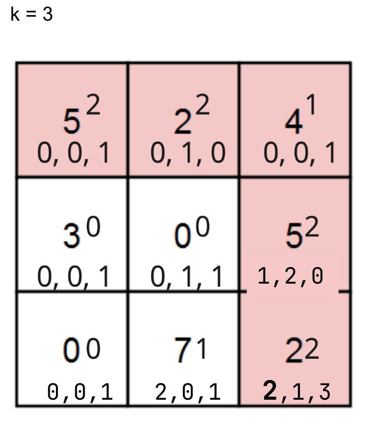

# Kotlin Easy to Understand DP ✅

**Author:** Z3ROsum
**Votes:** 6
**Link:** [https://leetcode.com/problems/paths-in-matrix-whose-sum-is-divisible-by-k/solutions/2683382/](https://leetcode.com/problems/paths-in-matrix-whose-sum-is-divisible-by-k/solutions/2683382/)

---

```
class Solution {
    fun numberOfPaths(grid: Array<IntArray>, k: Int): Int {
        val m = grid.size
        val n = grid[0].size
        val mod = (1e9+7).toInt()
        val rem = Array(m) { i: Int ->
            IntArray(n) { j: Int ->
                grid[i][j] % k
            }
        }
        val dp = Array(m) { Array(n) { IntArray(k) } }
        dp[0][0][rem[0][0]] = 1
        for (i in 0 until m) {
            for (j in 0 until n) {
                if (i + j == 0) continue
                val remainder = rem[i][j]
                val arr = dp[i][j]
                if (i > 0) {
                    val up = dp[i - 1][j]
                    val dup = up.toList()
                    Collections.rotate(dup, remainder)
                    for (u in dup.indices) {
                        arr[u] += dup[u]
                        arr[u] %= mod
                    }
                }
                if (j > 0) {
                    val left = dp[i][j - 1]
                    val dup = left.toList()
                    Collections.rotate(dup, remainder)
                    for (u in dup.indices) {
                        arr[u] += dup[u]
                        arr[u] %= mod
                    }
                }
            }
        }
        return dp[m - 1][n - 1][0]
    }
}
```
Picture of DP:


