# Image Explanation🏆- [Brute -> Better O(nlogM) -> Optimal O(n) ] - C++/Java/Python

**Author:** aryan_0077
**Votes:** 176
**Link:** [https://leetcode.com/problems/minimize-maximum-of-array/solutions/3381323/](https://leetcode.com/problems/minimize-maximum-of-array/solutions/3381323/)

---

# Video Solution (`Aryan Mittal`) - Link in LeetCode Profile
`Reducing Dishes` by `Aryan Mittal`
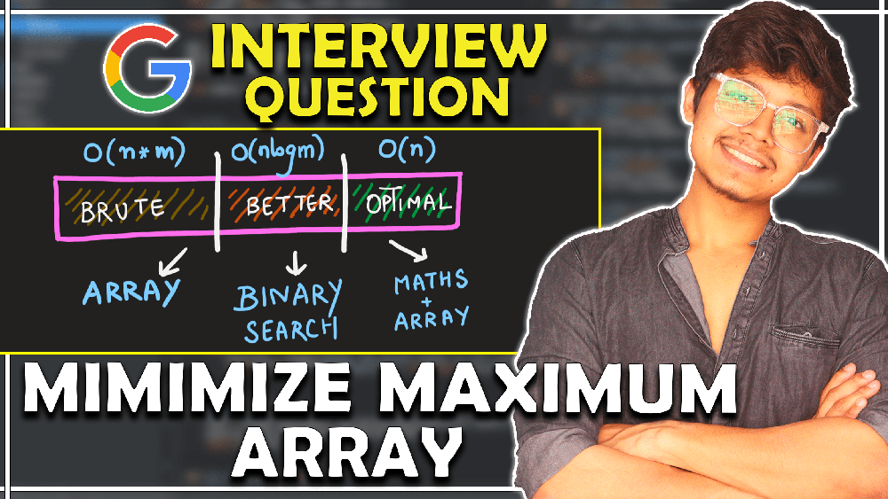


# Approach & Intution
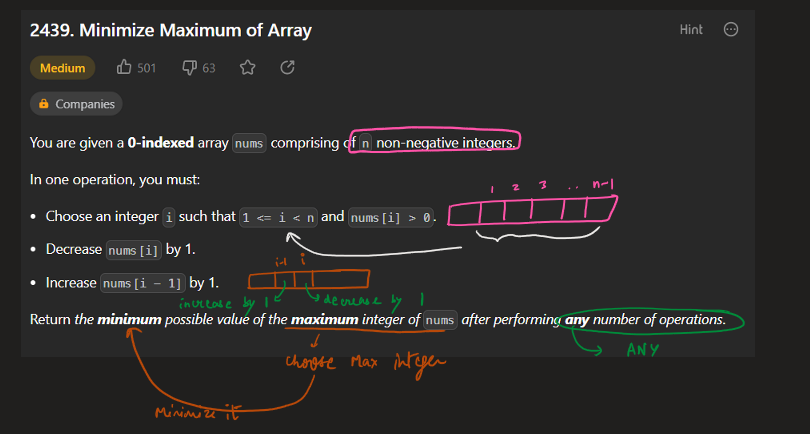
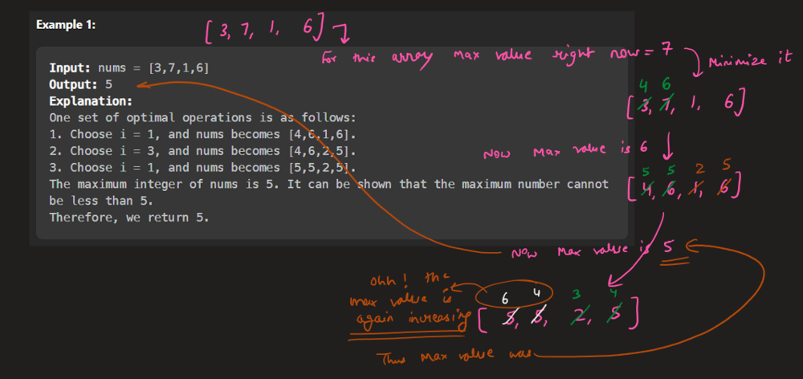
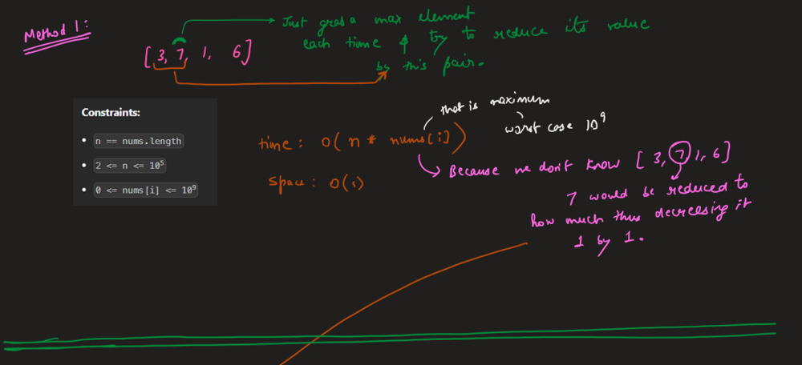
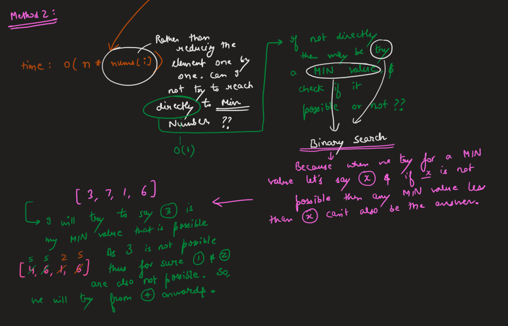
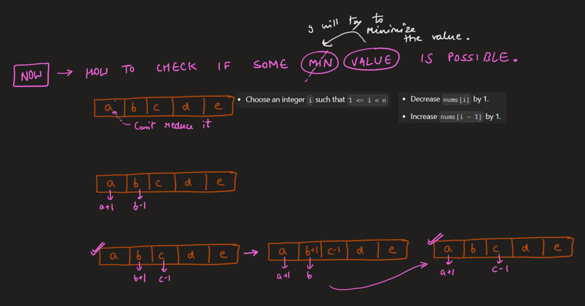
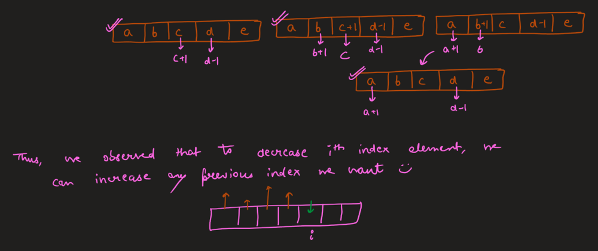
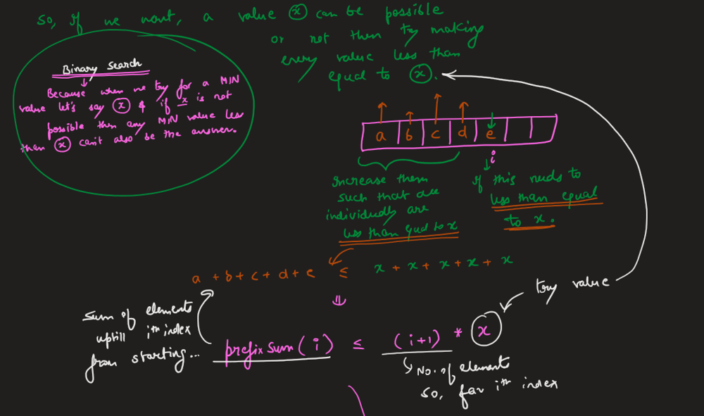
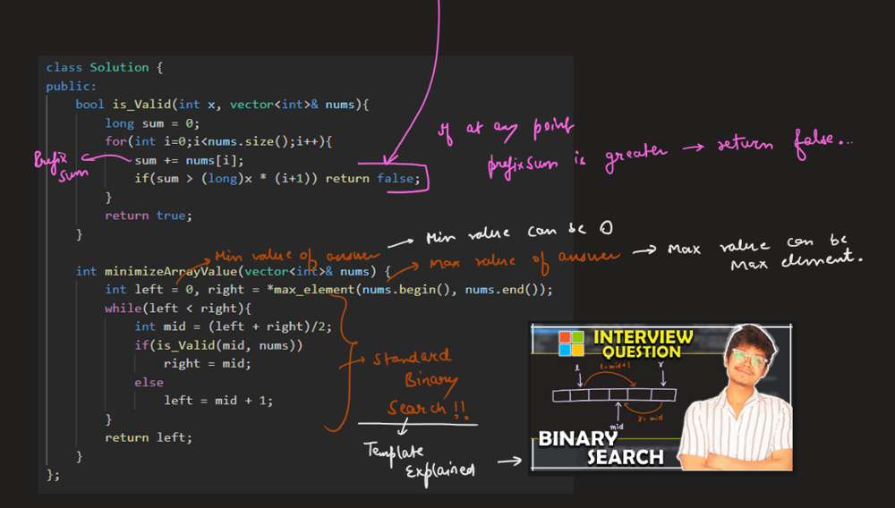
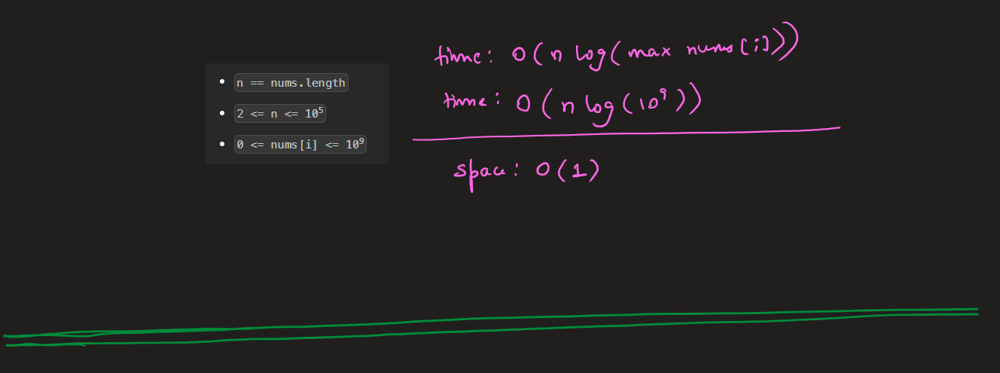
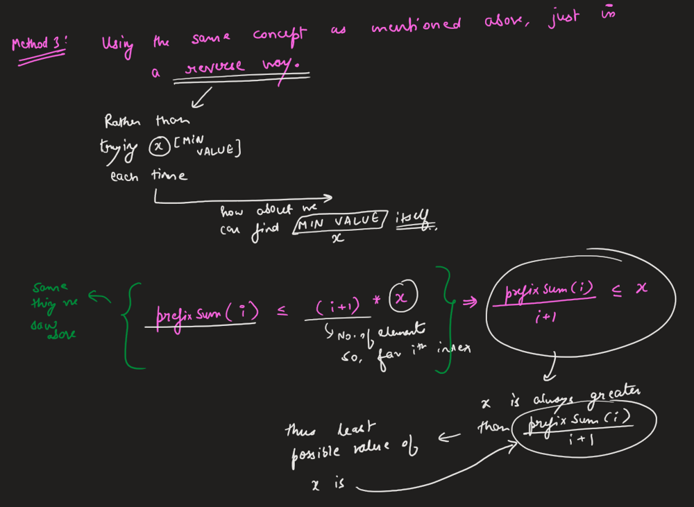
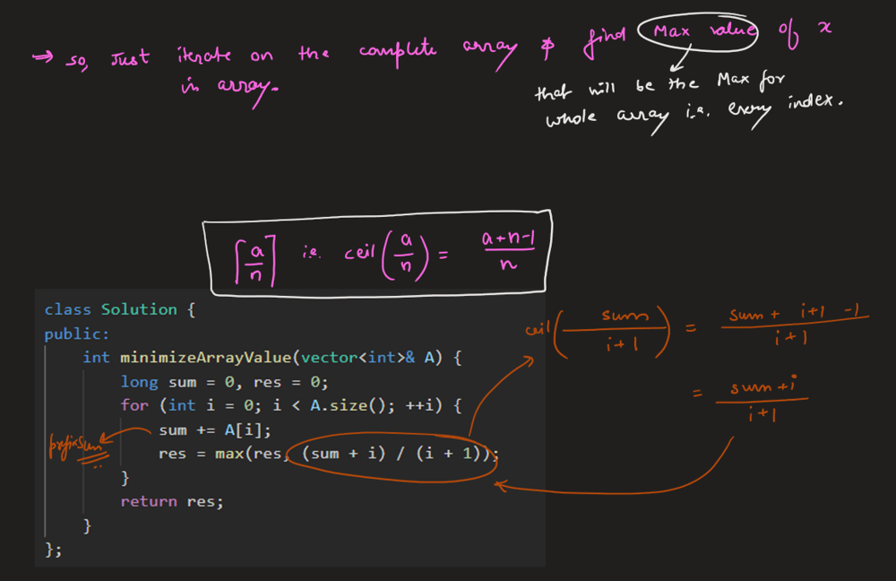
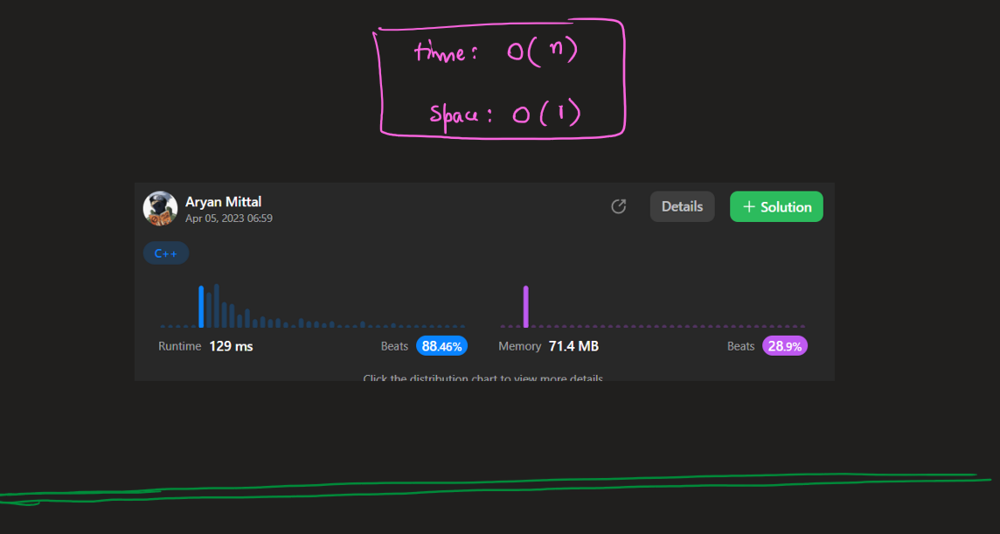


# Optimal Code
```C++ []
class Solution {
public:
    int minimizeArrayValue(vector<int>& A) {
        long sum = 0, res = 0;
        for (int i = 0; i < A.size(); ++i) {
            sum += A[i];
            res = max(res, (sum + i) / (i + 1));
        }
        return res;
    }
};
```
```Java []
class Solution {
    public int minimizeArrayValue(int[] A) {
        long sum = 0, res = 0;
        for (int i = 0; i < A.length; ++i) {
            sum += A[i];
            res = Math.max(res, (sum + i) / (i + 1));
        }
        return (int)res;
    }
}
```
```Python []
class Solution:
    def minimizeArrayValue(self, A: List[int]) -> int:
        return max((a + i) // (i + 1) for i,a in enumerate(accumulate(A)))
```
