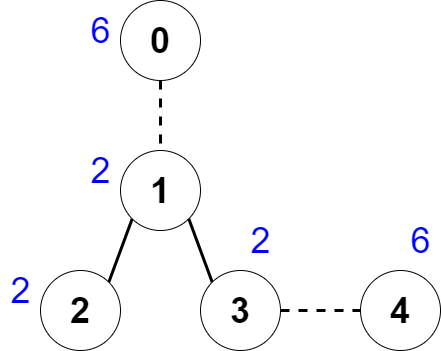

# [2440. Create Components With Same Value](https://leetcode.com/problems/create-components-with-same-value/)

| Category | Difficulty | Likes | Dislikes |
| :------: | :--------: | :---: | :------: |
| Algorithms | Hard | 434 | 7 |

**Tags:** [`array`](https://leetcode.com/tag/array), [`math`](https://leetcode.com/tag/math), [`tree`](https://leetcode.com/tag/tree), [`depth-first-search`](https://leetcode.com/tag/depth-first-search), [`enumeration`](https://leetcode.com/tag/enumeration)

**Companies:** `sprinklr`

## Description

There is an undirected tree with `n` nodes labeled from `0` to `n - 1`.

You are given a **0-indexed** integer array `nums` of length `n` where `nums[i]` represents the value of the `i^th` node. You are also given a 2D integer array `edges` of length `n - 1` where `edges[i] = [a_i, b_i]` indicates that there is an edge between nodes `a_i` and `b_i` in the tree.

You are allowed to **delete** some edges, splitting the tree into multiple connected components. Let the **value** of a component be the sum of **all** `nums[i]` for which node `i` is in the component.

Return* the **maximum** number of edges you can delete, such that every connected component in the tree has the same value.*

 

**Example 1:**


```

Input: nums = [6,2,2,2,6], edges = [[0,1],[1,2],[1,3],[3,4]] 
Output: 2 
Explanation: The above figure shows how we can delete the edges [0,1] and [3,4]. The created components are nodes [0], [1,2,3] and [4]. The sum of the values in each component equals 6. It can be proven that no better deletion exists, so the answer is 2.

```

**Example 2:**

```

Input: nums = [2], edges = []
Output: 0
Explanation: There are no edges to be deleted.

```

 

**Constraints:**

	- `1 <= n <= 2 * 10^4`

	- `nums.length == n`

	- `1 <= nums[i] <= 50`

	- `edges.length == n - 1`

	- `edges[i].length == 2`

	- `0 <= edges[i][0], edges[i][1] <= n - 1`

	- `edges` represents a valid tree.

---

**Links:** [Submissions](https://leetcode.com/problems/create-components-with-same-value/) | [Solutions](https://leetcode.com/problems/create-components-with-same-value/)
