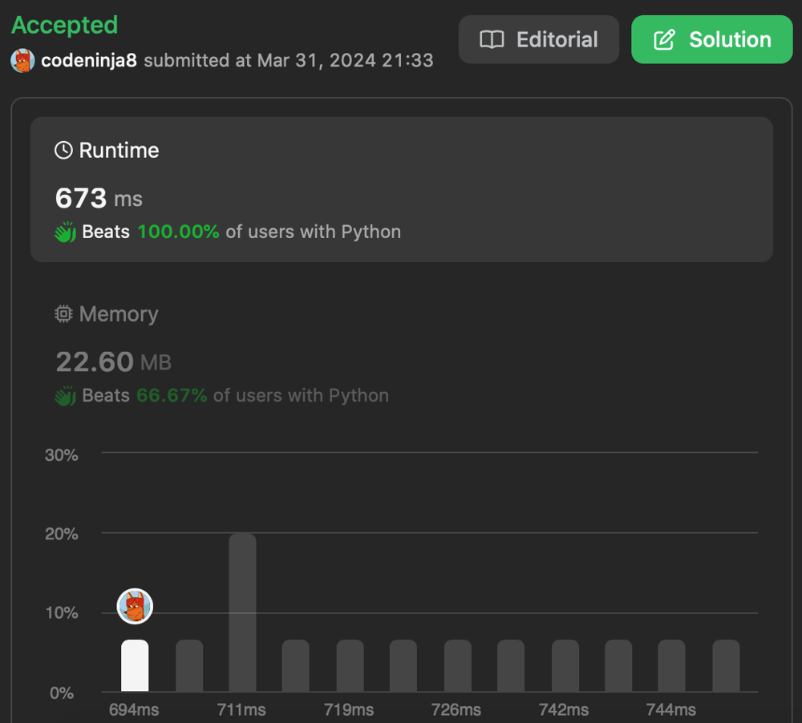

# ✅ O(n) one pass in java | python | c | javascript | go | php | ruby (explained)

**Author:** codeninja8
**Votes:** 0
**Link:** [https://leetcode.com/problems/count-subarrays-with-fixed-bounds/solutions/4953654/](https://leetcode.com/problems/count-subarrays-with-fixed-bounds/solutions/4953654/)

---

# Intuition
1. find subarrays where `minK >= nums[i] <= maxK`
2. for these subarrays find subarrays where both `minK` and `maxK` are present at least once
**for this purpose, use slinding window algorithm**
2.1 find all subarrays. The result is calculated like this `res += right + 1`
2.2 find bad subarrays where at least one of `minK` and `maxK` are absent. The result is calculated like this `res += right - left + 1`
2.3 Subtract all subarrays and bad subarrays. `good subarrays = all subarrays - bad subarrays` There should be something like `res += left` solution. 
3. sum up the results

**The full solution will be in the end; please bear with me**

# Approach
After several hours, I used the described above algorithm and got the working code.
``` python 
class Solution(object):
    def countSubarrays(self, nums, minK, maxK):
        left = res = 0
        start = -1
        countMaxK = countMinK = 0

        for right in range(0, len(nums)):
            val = nums[right]
            if val == maxK:
                countMaxK += 1
            if val == minK:
                countMinK += 1

            if val >= minK and val <= maxK:
                if start < 0:
                    start = right
                    left = start
                while countMinK > 0 and countMaxK > 0:
                    leftVal = nums[left]
                    if leftVal == maxK:
                        countMaxK -= 1
                    if leftVal == minK:
                        countMinK -= 1
                    left += 1
                res += left - start
            else:
                start = -1
                countMinK = countMaxK = 0
                

        return res
```
Note that I calculate the count of occurrences of `minK` and `maxK`, and take into account the `start` variable.

`start` is the beginning of a subarray where `minK >= nums[i] <= maxK`.

This code is good enough, but it can be even better. We can get rid of `while countMinK > 0 and countMaxK > 0:` All we need to do is remember `lastMaxK` and `lastMinK` and get the minimum of them

``` python
class Solution(object):
    def countSubarrays(self, nums, minK, maxK):
        left = res = 0
        start = -1
        countMaxK = countMinK = 0
        lastMinK = lastMaxK = 0

        for right in range(0, len(nums)):
            val = nums[right]
            if val == maxK:
                countMaxK += 1
                lastMaxK = right
            if val == minK:
                countMinK += 1
                lastMinK = right

            if val >= minK and val <= maxK:
                if start < 0:
                    start = left = right
                    lastMaxK = lastMinK = start
                if countMinK > 0 and countMaxK > 0:
                    left = min(lastMaxK, lastMinK) + 1
                res += left - start
            else:
                start = -1
                countMinK = countMaxK = 0
                

        return res
```

Good. Let's remove `countMinK` and `countMaxK`. They are no longer needed.

``` python
class Solution(object):
    def countSubarrays(self, nums, minK, maxK):
        left = res = 0
        start = -1
        lastMinK = lastMaxK = -1

        for right in range(len(nums)):
            val = nums[right]
            if val == maxK:
                lastMaxK = right
            if val == minK:
                lastMinK = right

            if val >= minK and val <= maxK:
                if start < 0:
                    start = left = right
                if lastMinK >= 0 and lastMaxK >= 0:
                    left = min(lastMaxK, lastMinK) + 1
                res += left - start
            else:
                start = lastMinK = lastMaxK = -1
                

        return res
```

We can do better
``` python
class Solution(object):
    def countSubarrays(self, nums, minK, maxK):
        res = 0
        start = 0
        lastMinK = lastMaxK = -1

        for right in range(len(nums)):
            val = nums[right]
            if val < minK or val > maxK:
                start = right + 1
                lastMinK = lastMaxK = -1
            else:                                   
                if val == maxK:
                    lastMaxK = right
                if val == minK:
                    lastMinK = right
                    
                if lastMinK != -1 and lastMaxK != -1:
                    res += min(lastMaxK, lastMinK) + 1 - start             

        return res
```

Wow. We've got the best code for python \uD83E\uDD29


Let's work on the solutions for other languages

# Complexity
- Time complexity:
$$O(n)$$

- Space complexity:
$$O(1)$$

# Code
``` java []
class Solution {
    public long countSubarrays(int[] nums, int minK, int maxK) {
        int start = 0;
        int lastMinK = -1, lastMaxK = -1;
        long res = 0;

        for (int right = 0; right < nums.length; right++) {
            int val = nums[right];

            if (val < minK || val > maxK) {
                start = right + 1;
                lastMinK = -1;
                lastMaxK = -1;
            } else {
                if (val == minK) {
                    lastMinK = right;
                }
                if (val == maxK) {
                    lastMaxK = right;
                }

                if (lastMinK != -1 && lastMaxK != -1) {
                    res += Math.min(lastMinK, lastMaxK) + 1 - start;
                }
            }
        }

        return res;
    }
}
```
``` c []
long long countSubarrays(int* nums, int numsSize, int minK, int maxK) {
    int start = 0;
    int lastMaxK = -1;
    int lastMinK = -1;
    long res = 0;

    for (int right = 0; right < numsSize; right++) {
        int val = nums[right];

        if (val < minK || val > maxK) {
            start = right + 1;
            lastMinK = -1;
            lastMaxK = -1;
        } else {
            if (val == minK) {
                lastMinK = right;
            }
            if (val == maxK) {
                lastMaxK = right;
            }

            if (lastMaxK != -1 && lastMinK != -1) {
                res += (lastMaxK > lastMinK ? lastMinK : lastMaxK) + 1 - start;
            }
        }
    }

    return res;
}
```
``` javascript []
var countSubarrays = function(nums, minK, maxK) {
    var start = 0;
    var lastMinK = -1, lastMaxK = -1;
    var res = 0;

    for (var right = 0; right < nums.length; right++) {
        var val = nums[right];

        if (val < minK || val > maxK) {
            start = right + 1;
            lastMinK = -1;
            lastMaxK = -1;
        } else {
            if (val == minK) lastMinK = right;
            if (val == maxK) lastMaxK = right;

            if (lastMinK != -1 && lastMaxK != -1) {
                res += Math.min(lastMinK, lastMaxK) + 1 - start;
            }
        }
    }

    return res;
};
```
``` python []
class Solution(object):
    def countSubarrays(self, nums, minK, maxK):
        res = 0
        start = 0
        lastMinK = lastMaxK = -1

        for right in range(len(nums)):
            val = nums[right]
            if val < minK or val > maxK:
                start = right + 1
                lastMinK = lastMaxK = -1
            else:                                   
                if val == maxK:
                    lastMaxK = right
                if val == minK:
                    lastMinK = right
                    
                if lastMinK != -1 and lastMaxK != -1:
                    res += min(lastMaxK, lastMinK) + 1 - start             

        return res   
```
``` php []
class Solution {
    function countSubarrays($nums, $minK, $maxK) {
        $start = 0;
        $lastMinK = $lastMaxK = -1;
        $res = 0;

        for ($right = 0; $right < count($nums); $right++) {
            $val = $nums[$right];

            if ($val < $minK || $val > $maxK) {
                $start = $right + 1;
                $lastMinK = $lastMaxK = -1;
            } else {
                if ($val == $minK) $lastMinK = $right;
                if ($val == $maxK) $lastMaxK = $right;

                if ($lastMaxK != -1 && $lastMinK != -1) {
                    $res += min($lastMaxK, $lastMinK) + 1 - $start;
                }
            }
        }

        return $res;
    }
}
```
``` golang []
func min(a, b int) int {
    if a < b {
        return a
    }
    return b
}

func countSubarrays(nums []int, minK int, maxK int) int64 {
    start := 0
    lastMinK, lastMaxK := -1, -1
    var res int64 = 0

    for right, val := range nums {
        if val < minK || val > maxK {
            start = right + 1
            lastMinK, lastMaxK = -1, -1
        } else {
            if val == minK {
                lastMinK = right
            }

            if val == maxK {
                lastMaxK = right
            }

            if lastMinK != -1 && lastMaxK != -1 {
                res += int64(min(lastMinK, lastMaxK) + 1 - start)
            }
        }
    }

    return res
}
```
``` ruby []
def count_subarrays(nums, min_k, max_k)
    start = 0
    lastMinK = lastMaxK = -1
    res = 0

    nums.each_with_index do |val, right|
        if val < min_k || val > max_k then
            start = right + 1
            lastMinK = lastMaxK = -1
        end

        lastMinK = right if val == min_k
        lastMaxK = right if val == max_k

        res += [lastMaxK, lastMinK].min + 1 - start if lastMaxK != -1 && lastMinK != -1
    end

    return res
end
```
