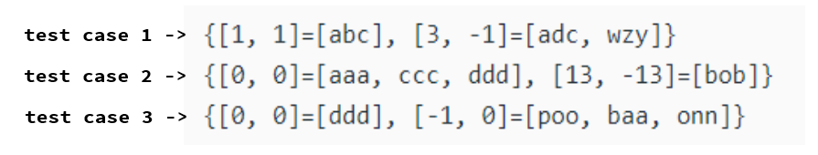

# JAVA | HashMap | Explained ✅

**Author:** sourin_bruh
**Votes:** 24
**Link:** [https://leetcode.com/problems/odd-string-difference/solutions/2756780/](https://leetcode.com/problems/odd-string-difference/solutions/2756780/)

---

# **Please Upvote** :D
The aim of this approach is to get hashmaps like these for every input:


For each **difference list** that we come up with, we **map all the strings** as a list to that difference list **which gives that particular difference list**.

Like in the image:
In **test case 1**:
Difference list **`[1, 1]`** was given by **`"abc"`** while **`[3, -1]`** was given by **`"adc"`** and **`"wzy"`**.

So this way, for all test cases, there is going to be only 1 string that will give a different list (as mentioned in the problem statement).
So at the end we iterate through the map and return that value where there is only 1 string mapped to the key.
*(if only 1 string as a list is mapped to a key then the length of that list (containing that single string) will be 1)*.

``` java []
class Solution {
    public String oddString(String[] words) {
        Map<List<Integer>, List<String>> map = new HashMap<>();

        for (int i = 0; i < words.length; i++) {
            char[] ch = words[i].toCharArray();
            List<Integer> list = new ArrayList<>();

            for (int j = 0; j < ch.length - 1; j++) {
                list.add(ch[j + 1] - ch[j]);
            }

            if (map.containsKey(list)) {
                map.get(list).add(words[i]);
            }
            else {
                List<String> l = new ArrayList<>();
                l.add(words[i]);
                map.put(list, l);
            }
        }

        for (List<Integer> key : map.keySet()) {
            if (map.get(key).size() == 1) {
                return map.get(key).get(0);
            }
        }

        return "";
    }
}

// TC: O(n * k) => O(n) because k is constant
// n -> length of input array
// k -> length of strings in input array

// SC: O(n)
```