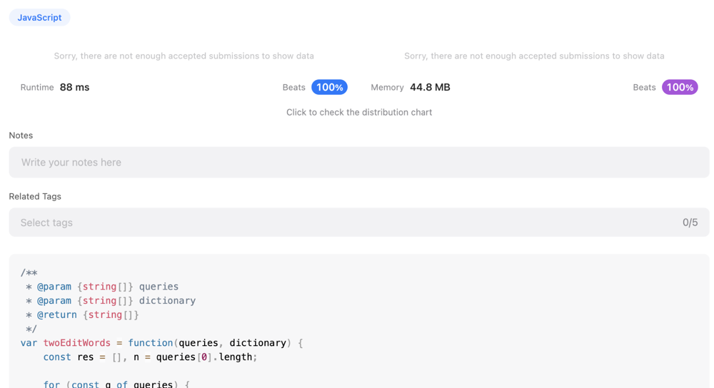

# Beats 100% JS

**Author:** masha-nv
**Votes:** 3
**Link:** [https://leetcode.com/problems/words-within-two-edits-of-dictionary/solutions/2757564/](https://leetcode.com/problems/words-within-two-edits-of-dictionary/solutions/2757564/)

---


```
/**
 * @param {string[]} queries
 * @param {string[]} dictionary
 * @return {string[]}
 */
var twoEditWords = function(queries, dictionary) {
    const res = [], n = queries[0].length;

    for (const q of queries) {
        if (helper(q)) res.push(q)
    }
    return res;

    function helper(q_word) {
        for (const w of dictionary) {
            if (diffLessThanTwo(q_word, w)) return true;
        }
        return false;
    }

    function diffLessThanTwo(w1, w2) {
        let cnt = 0;
        for (let i = 0; i<n; i++) {
            if (cnt > 2) return false;
            if (w1[i]!==w2[i]) cnt++;
        }
        return cnt <= 2;
    }
};
```


