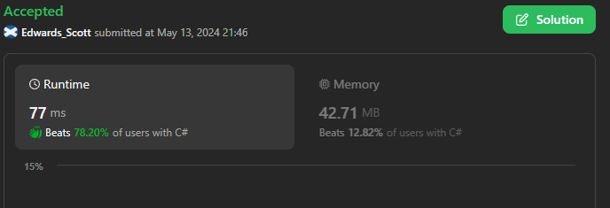
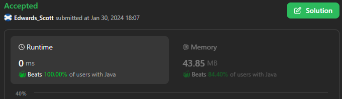
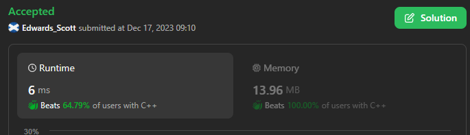

# 🏆💢💯 Faster✅💯 Lesser🧠 🎯 C++✅Python3🐍✅Java✅C✅Python🐍✅C#✅💥🔥💫Explained☠💥🔥 Beats 💯

**Author:** Edwards310
**Votes:** 2
**Link:** [https://leetcode.com/problems/average-value-of-even-numbers-that-are-divisible-by-three/solutions/4649064/](https://leetcode.com/problems/average-value-of-even-numbers-that-are-divisible-by-three/solutions/4649064/)

---

# Intuition






---

1. ***Nothing fancy it's just simple math's logic***
2. ***Store all elements that are divisible by 6 in a list***
3. ***Check if storing list length is 0 then return 0***
4. ***Else return sum of elements in a list / it's size***
```C++ []
class Solution {
public:
    int averageValue(vector<int>& nums) {
        vector<int> result;
        int sum = 0;
        for (int i = 0; i < nums.size(); i++) {
            if (nums[i] % 2 == 0 && nums[i] % 3 == 0)
                result.push_back(nums[i]);
        }
        if (result.size() == 0)
            return 0;
        for (int i = 0; i < result.size(); i++)
            sum += result[i];
        return floor(sum / result.size());
    }
};
```
```Java []
class Solution {
    public int averageValue(int[] nums) {
        int sum = 0;
        int count = 0;
        for (int num : nums)
            if (num % 6 == 0) {
                sum += num;
                count++;
            }
        return count == 0 ? 0 : sum / count;
    }
}
```
```Python []
class Solution(object):
    def averageValue(self, nums):
        """
        :type nums: List[int]
        :rtype: int
        """
        store = [v for v in nums if v % 6 == 0]
        return sum(store) // len(store) if len(store) != 0 else 0
```
```C []
int averageValue(int* nums, int numsSize) {
    int sum = 0;
    int count = 0;
    for (int i = 0; i < numsSize; i++)
        if (nums[i] % 6 == 0) {
            sum += nums[i];
            count++;
        }
    return count == 0 ? 0 : sum / count;
}
```
```Python3 []
class Solution:
    def averageValue(self, nums: List[int]) -> int:
        lst = [x for x in nums if x % 6 == 0]
        return sum(lst) // len(lst) if len(lst) != 0 else 0
```
```C# []
public class Solution {
    public int AverageValue(int[] nums) {
        int sum = 0;
        int count = 0;
        for (int i = 0; i < nums.Length; i++)
            if (nums[i] % 6 == 0) {
                sum += nums[i];
                count++;
            }
        return count == 0 ? 0 : sum / count;
    }
}
```
<!-- Describe your first thoughts on how to solve this problem. -->

# Approach
<!-- Describe your approach to solving the problem. -->

# Complexity
- Time complexity:
<!-- Add your time complexity here, e.g. $$O(n)$$ -->
     O(n)
- Space complexity:
<!-- Add your space complexity here, e.g. $$O(n)$$ -->
     O(1)
# Code
```
int averageValue(int* nums, int numsSize) {
    int sum = 0;
    int count = 0;
    for (int i = 0; i < numsSize; i++)
        if (nums[i] % 6 == 0) {
            sum += nums[i];
            count++;
        }
    return count == 0 ? 0 : sum / count;
}
```

# Please upvote if it's helpful

