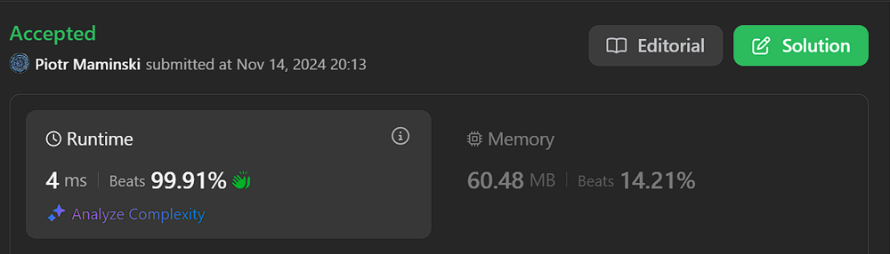

# ✅Beats 100% | Video | List Most Common Array Interview

**Author:** Piotr_Maminski
**Votes:** 88
**Link:** [https://leetcode.com/problems/maximum-sum-of-distinct-subarrays-with-length-k/solutions/6060159/](https://leetcode.com/problems/maximum-sum-of-distinct-subarrays-with-length-k/solutions/6060159/)

---



https://youtu.be/pT-lOE1on3M?si=Is4cuon79QdAnZiX


# #1 Sliding Window + HashSet (Beats 95-99,9%)
```python3 []
class Solution:
    def maximumSubarraySum(self, nums: List[int], k: int) -> int:
        n = len(nums)
        elements = set()
        current_sum = 0
        max_sum = 0
        begin = 0

        for end in range(n): 
            if nums[end] not in elements:
                current_sum += nums[end]
                elements.add(nums[end])

                if end - begin + 1 == k:
                    if current_sum > max_sum:
                        max_sum = current_sum
                    
                    current_sum -= nums[begin]
                    elements.remove(nums[begin])
                    begin += 1
            else:
                while nums[begin] != nums[end]:
                    current_sum -= nums[begin]
                    elements.remove(nums[begin])
                    begin += 1
                
                begin += 1

        return max_sum
```
```cpp []
class Solution {
public:
    long long maximumSubarraySum(vector<int>& nums, int k) {
        int n = nums.size();
        unordered_set<int> elements;
        long long current_sum = 0;
        long long max_sum = 0;
        int begin = 0;
        
        for (int end = 0; end < n; end++) {
            if (elements.find(nums[end]) == elements.end()) {
                current_sum += nums[end];
                elements.insert(nums[end]);
                
                if (end - begin + 1 == k) {
                    max_sum = max(max_sum, current_sum);
                    current_sum -= nums[begin];
                    elements.erase(nums[begin]);
                    begin++;
                }
            } else {
                while (nums[begin] != nums[end]) {
                    current_sum -= nums[begin];
                    elements.erase(nums[begin]);
                    begin++;
                }
                begin++;
            }
        }
        
        return max_sum;
    }
};
```
```java []
class Solution {
    public long maximumSubarraySum(int[] nums, int k) {
        int n = nums.length;
        Set<Integer> elements = new HashSet<>();
        long currentSum = 0;
        long maxSum = 0;
        int begin = 0;
        
        for (int end = 0; end < n; end++) {
            if (!elements.contains(nums[end])) {
                currentSum += nums[end];
                elements.add(nums[end]);
                
                if (end - begin + 1 == k) {
                    maxSum = Math.max(maxSum, currentSum);
                    currentSum -= nums[begin];
                    elements.remove(nums[begin]);
                    begin++;
                }
            } else {
                while (nums[begin] != nums[end]) {
                    currentSum -= nums[begin];
                    elements.remove(nums[begin]);
                    begin++;
                }
                begin++;
            }
        }
        
        return maxSum;
    }
}
```
```csharp []
public class Solution {
    public long MaximumSubarraySum(int[] nums, int k) {
        int n = nums.Length;
        HashSet<int> elements = new HashSet<int>();
        long currentSum = 0;
        long maxSum = 0;
        int begin = 0;
        
        for (int end = 0; end < n; end++) {
            if (!elements.Contains(nums[end])) {
                currentSum += nums[end];
                elements.Add(nums[end]);
                
                if (end - begin + 1 == k) {
                    maxSum = Math.Max(maxSum, currentSum);
                    
                    currentSum -= nums[begin];
                    elements.Remove(nums[begin]);
                    begin++;
                }
            } else {
                while (nums[begin] != nums[end]) {
                    currentSum -= nums[begin];
                    elements.Remove(nums[begin]);
                    begin++;
                }
                begin++;
            }
        }
        
        return maxSum;
    }
}
```
```golang []
func maximumSubarraySum(nums []int, k int) int64 {
    n := len(nums)
    elements := make(map[int]bool)
    currentSum := int64(0)
    maxSum := int64(0)
    begin := 0

    for end := 0; end < n; end++ {
        if !elements[nums[end]] {
            currentSum += int64(nums[end])
            elements[nums[end]] = true

            if end-begin+1 == k {
                if currentSum > maxSum {
                    maxSum = currentSum
                }
                currentSum -= int64(nums[begin])
                delete(elements, nums[begin])
                begin++
            }
        } else {
            for begin < end && nums[begin] != nums[end] {
                currentSum -= int64(nums[begin])
                delete(elements, nums[begin])
                begin++
            }
            begin++
        }
    }
    return maxSum
}
```
```swift []
class Solution {
    func maximumSubarraySum(_ nums: [Int], _ k: Int) -> Int {
        let n = nums.count
        var elements = Set<Int>()
        var currentSum = 0
        var maxSum = 0
        var begin = 0
        
        for end in 0..<n {
            if !elements.contains(nums[end]) {
                currentSum += nums[end]
                elements.insert(nums[end])
                
                if end - begin + 1 == k {
                    maxSum = max(maxSum, currentSum)
                    currentSum -= nums[begin]
                    elements.remove(nums[begin])
                    begin += 1
                }
            } else {
                while nums[begin] != nums[end] {
                    currentSum -= nums[begin]
                    elements.remove(nums[begin])
                    begin += 1
                }
                begin += 1
            }
        }
        return maxSum
    }
}

```
```javascript [JS]
// JavaScript

var maximumSubarraySum = function(nums, k) {
    const n = nums.length;
    const elements = new Set();
    let currentSum = 0;
    let maxSum = 0;
    let begin = 0;

    for (let end = 0; end < n; end++) {
        if (!elements.has(nums[end])) {
            currentSum += nums[end];
            elements.add(nums[end]);

            if (end - begin + 1 === k) {
                maxSum = Math.max(maxSum, currentSum);
                currentSum -= nums[begin];
                elements.delete(nums[begin]);
                begin++;
            }
        } else {
            while (nums[begin] !== nums[end]) {
                currentSum -= nums[begin];
                elements.delete(nums[begin]);
                begin++;
            }
            begin++;
        }
    }
    
    return maxSum;
};
```
```typescript [TS]
// TypeScript

function maximumSubarraySum(nums: number[], k: number): number {
    const n: number = nums.length;
    const elements: Set<number> = new Set();
    let currentSum: number = 0;
    let maxSum: number = 0;
    let begin: number = 0;

    for (let end = 0; end < n; end++) {
        if (!elements.has(nums[end])) {
            currentSum += nums[end];
            elements.add(nums[end]);

            if (end - begin + 1 === k) {
                maxSum = Math.max(maxSum, currentSum);
                currentSum -= nums[begin];
                elements.delete(nums[begin]);
                begin++;
            }
        } else {
            while (nums[begin] !== nums[end]) {
                currentSum -= nums[begin];
                elements.delete(nums[begin]);
                begin++;
            }
            begin++;
        }
    }
    return maxSum;
}

```
```rust []
use std::collections::HashSet;

impl Solution {
    pub fn maximum_subarray_sum(nums: Vec<i32>, k: i32) -> i64 {
        let n = nums.len();
        let k = k as usize;
        let mut elements = HashSet::new();
        let mut current_sum: i64 = 0;
        let mut max_sum: i64 = 0;
        let mut begin = 0;

        for end in 0..n {
            if !elements.contains(&nums[end]) {
                current_sum += nums[end] as i64;
                elements.insert(nums[end]);

                if end - begin + 1 == k {
                    max_sum = max_sum.max(current_sum);
                    current_sum -= nums[begin] as i64;
                    elements.remove(&nums[begin]);
                    begin += 1;
                }
            } else {
                while nums[begin] != nums[end] {
                    current_sum -= nums[begin] as i64;
                    elements.remove(&nums[begin]);
                    begin += 1;
                }
                begin += 1;
            }
        }

        max_sum
    }
}
```
```ruby []
def maximum_subarray_sum(nums, k)
    n = nums.length
    elements = Set.new
    current_sum = 0
    max_sum = 0
    begin_idx = 0
    
    (0...n).each do |end_idx|
        if !elements.include?(nums[end_idx])
            current_sum += nums[end_idx]
            elements.add(nums[end_idx])
            
            if end_idx - begin_idx + 1 == k
                max_sum = [max_sum, current_sum].max
                current_sum -= nums[begin_idx]
                elements.delete(nums[begin_idx])
                begin_idx += 1
            end
        else
            while nums[begin_idx] != nums[end_idx]
                current_sum -= nums[begin_idx]
                elements.delete(nums[begin_idx])
                begin_idx += 1
            end
            begin_idx += 1
        end
    end
    
    max_sum
end

```
- Complexity: Time O(n) & Space O(k)


# #2 Sliding Window ( Simplest, from video 1st)


```python3 []
class Solution:
    def maximumSubarraySum(self, nums: List[int], k: int) -> int:
        res = 0
        count = defaultdict(int)
        cur_sum = 0

        l = 0
        for r in range(len(nums)):
            cur_sum += nums[r]
            count[nums[r]] += 1

            if r - l + 1 > k:
                count[nums[l]] -= 1
                if count[nums[l]] == 0:
                    count.pop(nums[l])
                cur_sum -= nums[l]
                l += 1

            if len(count) == r - l + 1 == k:
                res = max(res, cur_sum)

        return res
```
```cpp []
class Solution {
public:
    long long maximumSubarraySum(vector<int>& nums, int k) {
        long long res = 0;
        unordered_map<int, int> count;
        long long curSum = 0;
        
        int l = 0;
        for (int r = 0; r < nums.size(); r++) {
            curSum += nums[r];
            count[nums[r]]++;
            
            if (r - l + 1 > k) {
                count[nums[l]]--;
                if (count[nums[l]] == 0) {
                    count.erase(nums[l]);
                }
                curSum -= nums[l];
                l++;
            }
            
            if (count.size() == k && (r - l + 1) == k) {
                res = max(res, curSum);
            }
        }
        
        return res;
    }
};
```
```java []
class Solution {
    public long maximumSubarraySum(int[] nums, int k) {
        long res = 0;
        Map<Integer, Integer> count = new HashMap<>();
        long curSum = 0;
        
        int l = 0;
        for (int r = 0; r < nums.length; r++) {
            curSum += nums[r];
            count.put(nums[r], count.getOrDefault(nums[r], 0) + 1);
            
            if (r - l + 1 > k) {
                count.put(nums[l], count.get(nums[l]) - 1);
                if (count.get(nums[l]) == 0) {
                    count.remove(nums[l]);
                }
                curSum -= nums[l];
                l++;
            }
            
            if (count.size() == r - l + 1 && r - l + 1 == k) {
                res = Math.max(res, curSum);
            }
        }
        
        return res;
    }
}
```
```csharp []
public class Solution {
    public long MaximumSubarraySum(int[] nums, int k) {
        long res = 0;
        var count = new Dictionary<int, int>();
        long curSum = 0;
        
        int l = 0;
        for (int r = 0; r < nums.Length; r++) {
            curSum += nums[r];
            count[nums[r]] = count.GetValueOrDefault(nums[r], 0) + 1;
            
            if (r - l + 1 > k) {
                count[nums[l]]--;
                if (count[nums[l]] == 0) {
                    count.Remove(nums[l]);
                }
                curSum -= nums[l];
                l++;
            }
            
            if (count.Count == r - l + 1 && r - l + 1 == k) {
                res = Math.Max(res, curSum);
            }
        }
        
        return res;
    }
}
```
```golang []
func maximumSubarraySum(nums []int, k int) int64 {
    res := int64(0)
    count := make(map[int]int)
    curSum := int64(0)
    
    l := 0
    for r := 0; r < len(nums); r++ {
        curSum += int64(nums[r])
        count[nums[r]]++
        
        if r - l + 1 > k {
            count[nums[l]]--
            if count[nums[l]] == 0 {
                delete(count, nums[l])
            }
            curSum -= int64(nums[l])
            l++
        }
        
        if len(count) == r - l + 1 && r - l + 1 == k {
            if curSum > res {
                res = curSum
            }
        }
    }
    
    return res
}
```
```swift []
class Solution {
    func maximumSubarraySum(_ nums: [Int], _ k: Int) -> Int {
        var res = 0
        var count: [Int: Int] = [:]
        var curSum = 0
        
        var l = 0
        for r in 0..<nums.count {
            curSum += nums[r]
            count[nums[r], default: 0] += 1
            
            if r - l + 1 > k {
                count[nums[l], default: 0] -= 1
                if count[nums[l]] == 0 {
                    count.removeValue(forKey: nums[l])
                }
                curSum -= nums[l]
                l += 1
            }
            
            if count.count == r - l + 1 && r - l + 1 == k {
                res = max(res, curSum)
            }
        }
        
        return res
    }
}
```
```javascript [JS]
// JavaScript

var maximumSubarraySum = function(nums, k) {
    let res = 0;
    const count = new Map();
    let curSum = 0;
    
    let l = 0;
    for (let r = 0; r < nums.length; r++) {
        curSum += nums[r];
        count.set(nums[r], (count.get(nums[r]) || 0) + 1);
        
        if (r - l + 1 > k) {
            count.set(nums[l], count.get(nums[l]) - 1);
            if (count.get(nums[l]) === 0) {
                count.delete(nums[l]);
            }
            curSum -= nums[l];
            l++;
        }
        
        if (count.size === r - l + 1 && r - l + 1 === k) {
            res = Math.max(res, curSum);
        }
    }
    
    return res;
};
```
```typescript [TS]
// TypeScript

function maximumSubarraySum(nums: number[], k: number): number {
    let res = 0;
    const count = new Map<number, number>();
    let curSum = 0;
    
    let l = 0;
    for (let r = 0; r < nums.length; r++) {
        curSum += nums[r];
        count.set(nums[r], (count.get(nums[r]) || 0) + 1);
        
        if (r - l + 1 > k) {
            count.set(nums[l], count.get(nums[l])! - 1);
            if (count.get(nums[l]) === 0) {
                count.delete(nums[l]);
            }
            curSum -= nums[l];
            l++;
        }
        
        if (count.size === r - l + 1 && r - l + 1 === k) {
            res = Math.max(res, curSum);
        }
    }
    
    return res;
}
```
```rust []
use std::collections::HashMap;

impl Solution {
    pub fn maximum_subarray_sum(nums: Vec<i32>, k: i32) -> i64 {
        let mut res: i64 = 0;
        let mut count: HashMap<i32, i32> = HashMap::new();
        let mut cur_sum: i64 = 0;
        
        let mut l = 0;
        for r in 0..nums.len() {
            cur_sum += nums[r] as i64;
            *count.entry(nums[r]).or_insert(0) += 1;
            
            if r - l + 1 > k as usize {
                let count_l = count.entry(nums[l]).or_insert(0);
                *count_l -= 1;
                if *count_l == 0 {
                    count.remove(&nums[l]);
                }
                cur_sum -= nums[l] as i64;
                l += 1;
            }
            
            if count.len() == r - l + 1 && r - l + 1 == k as usize {
                res = res.max(cur_sum);
            }
        }
        
        res
    }
}
```
```ruby []
def maximum_subarray_sum(nums, k)
    res = 0
    count = Hash.new(0)
    cur_sum = 0
    
    l = 0
    nums.each_with_index do |num, r|
        cur_sum += num
        count[num] += 1
        
        if r - l + 1 > k
            count[nums[l]] -= 1
            count.delete(nums[l]) if count[nums[l]] == 0
            cur_sum -= nums[l]
            l += 1
        end
        
        if count.size == r - l + 1 && r - l + 1 == k
            res = [res, cur_sum].max
        end
    end
    
    res
end
```

- Complexity: Time O(n) & Space O(k)

# #3 Sliding Window + HashMap (from video 2nd)


```python3 []
class Solution:
    def maximumSubarraySum(self, nums: List[int], k: int) -> int:
        res = 0
        prev_idx = {}  # num -> prev index of num
        cur_sum = 0

        l = 0

        for r in range(len(nums)):
            cur_sum += nums[r]

            i = prev_idx.get(nums[r], -1)

            while l <= i or r - l + 1 > k:
                cur_sum -= nums[l]
                l += 1

            if r - l + 1 == k:
                res = max(res, cur_sum)

            prev_idx[nums[r]] = r

        return res
```
```cpp []
class Solution {
public:
    long long maximumSubarraySum(vector<int>& nums, int k) {
        long long res = 0;
        unordered_map<int, int> prev_idx;  // num -> prev index of num
        long long cur_sum = 0;
        
        int l = 0;
        
        for (int r = 0; r < nums.size(); r++) {
            cur_sum += nums[r];
            
            int i = -1;
            if (prev_idx.find(nums[r]) != prev_idx.end()) {
                i = prev_idx[nums[r]];
            }
            
            while (l <= i || r - l + 1 > k) {
                cur_sum -= nums[l];
                l++;
            }
            
            if (r - l + 1 == k) {
                res = max(res, cur_sum);
            }
            
            prev_idx[nums[r]] = r;
        }
        
        return res;
    }
};
```
```java []
class Solution {
    public long maximumSubarraySum(int[] nums, int k) {
        long res = 0;
        Map<Integer, Integer> prevIdx = new HashMap<>();
        long curSum = 0;
        
        int l = 0;
        
        for (int r = 0; r < nums.length; r++) {
            curSum += nums[r];
            
            int i = prevIdx.getOrDefault(nums[r], -1);
            
            while (l <= i || r - l + 1 > k) {
                curSum -= nums[l];
                l++;
            }
            
            if (r - l + 1 == k) {
                res = Math.max(res, curSum);
            }
            
            prevIdx.put(nums[r], r);
        }
        
        return res;
    }
}
```
```csharp []
public class Solution {
    public long MaximumSubarraySum(int[] nums, int k) {
        long res = 0;
        Dictionary<int, int> prevIdx = new Dictionary<int, int>();
        long curSum = 0;
        
        int l = 0;
        
        for (int r = 0; r < nums.Length; r++) {
            curSum += nums[r];
            
            int i = -1;
            if (prevIdx.ContainsKey(nums[r])) {
                i = prevIdx[nums[r]];
            }
            
            while (l <= i || r - l + 1 > k) {
                curSum -= nums[l];
                l++;
            }
            
            if (r - l + 1 == k) {
                res = Math.Max(res, curSum);
            }
            
            if (prevIdx.ContainsKey(nums[r])) {
                prevIdx[nums[r]] = r;
            } else {
                prevIdx.Add(nums[r], r);
            }
        }
        
        return res;
    }
}
```
```golang []
func maximumSubarraySum(nums []int, k int) int64 {
    res := int64(0)
    prevIdx := make(map[int]int)
    curSum := int64(0)
    l := 0
    
    for r := 0; r < len(nums); r++ {
        curSum += int64(nums[r])
        
        i, exists := prevIdx[nums[r]]
        if !exists {
            i = -1
        }
        
        for l <= i || r-l+1 > k {
            curSum -= int64(nums[l])
            l++
        }
        
        if r-l+1 == k {
            if curSum > res {
                res = curSum
            }
        }
        
        prevIdx[nums[r]] = r
    }
    
    return res
}
```
```swift []
class Solution {
    func maximumSubarraySum(_ nums: [Int], _ k: Int) -> Int {
        var res = 0
        var prevIdx: [Int: Int] = [:] // num -> prev index of num
        var curSum = 0
        var l = 0
        
        for r in 0..<nums.count {
            curSum += nums[r]
            
            let i = prevIdx[nums[r]] ?? -1
            
            while l <= i || r - l + 1 > k {
                curSum -= nums[l]
                l += 1
            }
            
            if r - l + 1 == k {
                res = max(res, curSum)
            }
            
            prevIdx[nums[r]] = r
        }
        
        return res
    }
}
```
```javascript [JS]
// JavaScript

var maximumSubarraySum = function(nums, k) {
    let res = 0;
    const prevIdx = new Map(); // num -> prev index of num
    let curSum = 0;
    let l = 0;
    
    for (let r = 0; r < nums.length; r++) {
        curSum += nums[r];
        
        const i = prevIdx.has(nums[r]) ? prevIdx.get(nums[r]) : -1;
        
        while (l <= i || r - l + 1 > k) {
            curSum -= nums[l];
            l++;
        }
        
        if (r - l + 1 === k) {
            res = Math.max(res, curSum);
        }
        
        prevIdx.set(nums[r], r);
    }
    
    return res;
};
```
```typescript [TS]
// TypeScript

function maximumSubarraySum(nums: number[], k: number): number {
    let res = 0;
    const prevIdx = new Map<number, number>(); // num -> prev index of num
    let curSum = 0;
    let l = 0;
    
    for (let r = 0; r < nums.length; r++) {
        curSum += nums[r];
        
        const i = prevIdx.get(nums[r]) ?? -1;
        
        while (l <= i || r - l + 1 > k) {
            curSum -= nums[l];
            l++;
        }
        
        if (r - l + 1 === k) {
            res = Math.max(res, curSum);
        }
        
        prevIdx.set(nums[r], r);
    }
    
    return res;
}
```
```rust []
use std::collections::HashMap;

impl Solution {
    pub fn maximum_subarray_sum(nums: Vec<i32>, k: i32) -> i64 {
        let k = k as usize;
        let mut res: i64 = 0;
        let mut prev_idx: HashMap<i32, usize> = HashMap::new();
        let mut cur_sum: i64 = 0;
        let mut l: usize = 0;

        for r in 0..nums.len() {
            cur_sum += nums[r] as i64;

            if let Some(&i) = prev_idx.get(&nums[r]) {
                while l <= i || r - l + 1 > k {
                    cur_sum -= nums[l] as i64;
                    l += 1;
                }
            } else {
                while r - l + 1 > k {
                    cur_sum -= nums[l] as i64;
                    l += 1;
                }
            }

            if r - l + 1 == k {
                res = res.max(cur_sum);
            }

            prev_idx.insert(nums[r], r);
        }

        res
    }
}
```
```ruby []
def maximum_subarray_sum(nums, k)
    res = 0
    prev_idx = {} # num -> prev index of num
    cur_sum = 0
    l = 0
    
    nums.each_with_index do |num, r|
        cur_sum += num
        
        i = prev_idx[num] || -1
        
        while l <= i || r - l + 1 > k
            cur_sum -= nums[l]
            l += 1
        end
        
        res = [res, cur_sum].max if r - l + 1 == k
        
        prev_idx[num] = r
    end
    
    res
end
```
- Complexy: Time O(n) & Space O(n)

- Similar and Easier problem: 
[[3254. Find the Power of K-Size Subarrays I]](https://leetcode.com/problems/find-the-power-of-k-size-subarrays-i/solutions/6049232/beats-100-video-simple-to-understand-explained-step-by-step-3-approaches)

---

## Aproach #1

- We need to find a sliding window of size k where all elements are distinct
- For each valid window, we trac the sum and keep updating the maximum sum found
- When we encounter duplicates, we need to adjust our window by removing elements until we eliminate the duplicate

## Execution

1. Use a sliding window technique with two pointers: 'begin' and 'end'
2. Maintain a set to track unique elements in current window
3. Keep track of current sum and maximum sum found so far
4. For each element at 'end' pointer:
    - If element is unique:
        - Add it to sum and set
        - If window size reaches k, update max_sum if needed and slide window
    - If element is duplicate:
        - Remove elements from start until duplicate is removed
        - Adjust window start accordingly

Done. 

UpVote. Its just one click for U 

---


# Most common Array Interview Problems
List based on my research (interviews, reddit, github) Probably not 100% accurate but very close to my recruitments. Leetcode Premium is probably more accurate [I don't have]


**Easy:** [[1. Two Sum]](https://leetcode.com/problems/two-sum/solutions/5999466/beats-100-explained-step-by-step-list-most-common-array-inverview) **(common warm-up)** [[121. Best Time to Buy and Sell Stock]](https://leetcode.com/discuss/topic/6027720/solution/) [[88. Merge Sorted Array]](https://leetcode.com/problems/merge-sorted-array/solutions/6031394/beats-100-explained-step-by-step-list-most-common-string-interview-problems) [[27. Remove Element]](https://leetcode.com/problems/remove-element/solutions/6031528/beats-100-explained-step-by-step-list-most-common-array-interview-problems) [[929. Unique Email Addresses]](https://leetcode.com/problems/unique-email-addresses/solutions/6031687/explained-step-by-step-video-list-most-common-array-interview-problems) 


**Medium/Hard:** [[15. 3Sum]](https://leetcode.com/problems/3sum?envType=problem-list-v2&envId=atbyk0mj) [[42. Trapping Rain Water]](https://leetcode.com/problems/trapping-rain-water?envType=problem-list-v2&envId=atbyk0mj) [[56. Merge Intervals]](https://leetcode.com/problems/merge-intervals?envType=problem-list-v2&envId=atbyk0mj) [[57. Insert Interval]](https://leetcode.com/problems/insert-interval?envType=problem-list-v2&envId=atbyk0mj) [[46. Permutations]](https://leetcode.com/problems/permutations?envType=problem-list-v2&envId=atbyk0mj) [[53. Maximum Subarray]](https://leetcode.com/problems/maximum-subarray?envType=problem-list-v2&envId=atbyk0mj) [[73. Set Matrix Zeroes]](https://leetcode.com/problems/set-matrix-zeroes?envType=problem-list-v2&envId=atbyk0mj) [[284. Peeking Iterator]](https://leetcode.com/problems/peeking-iterator?envType=problem-list-v2&envId=atbyk0mj)

####  [Interview Questions and Answers Repository](https://github.com/RooTinfinite/Interview-questions-and-answers)


