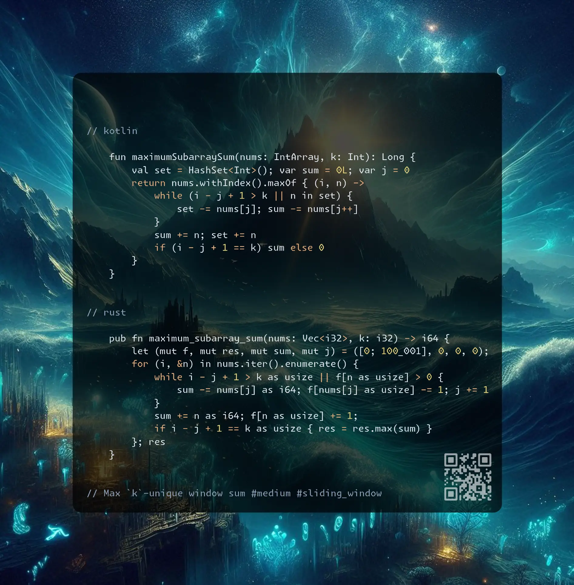

# Kotlin | Rust

**Author:** SamoylenkoDmitry
**Votes:** 3
**Link:** [https://leetcode.com/problems/maximum-sum-of-distinct-subarrays-with-length-k/solutions/6061409/](https://leetcode.com/problems/maximum-sum-of-distinct-subarrays-with-length-k/solutions/6061409/)

---



https://youtu.be/6ZmznDt13tI

#### Join me on Telegram

https://t.me/leetcode_daily_unstoppable/805

#### Problem TLDR

Max `k`-unique window sum #medium #sliding_window

#### Intuition

Maintain two pointers, shrink the window until it contains duplicate or bigger than `k`.

#### Approach

* arrays are much faster than a HashSet

#### Complexity

- Time complexity:
$$O(n)$$

- Space complexity:
$$O(n)$$

#### Code

```kotlin []

    fun maximumSubarraySum(nums: IntArray, k: Int): Long {
        val set = HashSet<Int>(); var sum = 0L; var j = 0
        return nums.withIndex().maxOf { (i, n) ->
            while (i - j + 1 > k || n in set) {
                set -= nums[j]; sum -= nums[j++]
            }
            sum += n; set += n
            if (i - j + 1 == k) sum else 0
        }
    }

```
```rust []

    pub fn maximum_subarray_sum(nums: Vec<i32>, k: i32) -> i64 {
        let (mut f, mut res, mut sum, mut j) = ([0; 100_001], 0, 0, 0);
        for (i, &n) in nums.iter().enumerate() {
            while i - j + 1 > k as usize || f[n as usize] > 0 {
                sum -= nums[j] as i64; f[nums[j] as usize] -= 1; j += 1
            }
            sum += n as i64; f[n as usize] += 1;
            if i - j + 1 == k as usize { res = res.max(sum) }
        }; res
    }

```
```c++ []

    long long maximumSubarraySum(vector<int>& nums, int k) {
        long long res = 0, sum = 0; int f[100001] = {0};
        for (int i = 0, j = 0; i < nums.size(); ++i) {
            while (i - j + 1 > k || f[nums[i]])
                sum -= nums[j], f[nums[j++]]--;
            sum += nums[i]; f[nums[i]]++;
            if (i - j + 1 == k) res = max(res, sum);
        }
        return res;
    }

```