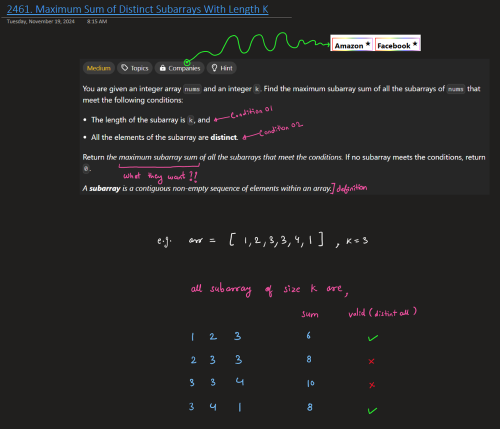
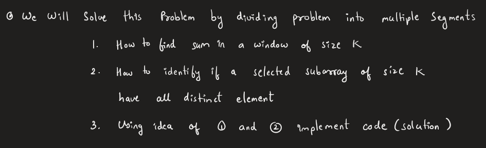
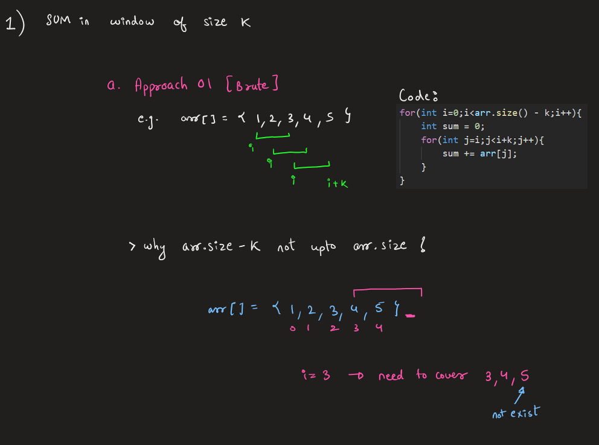
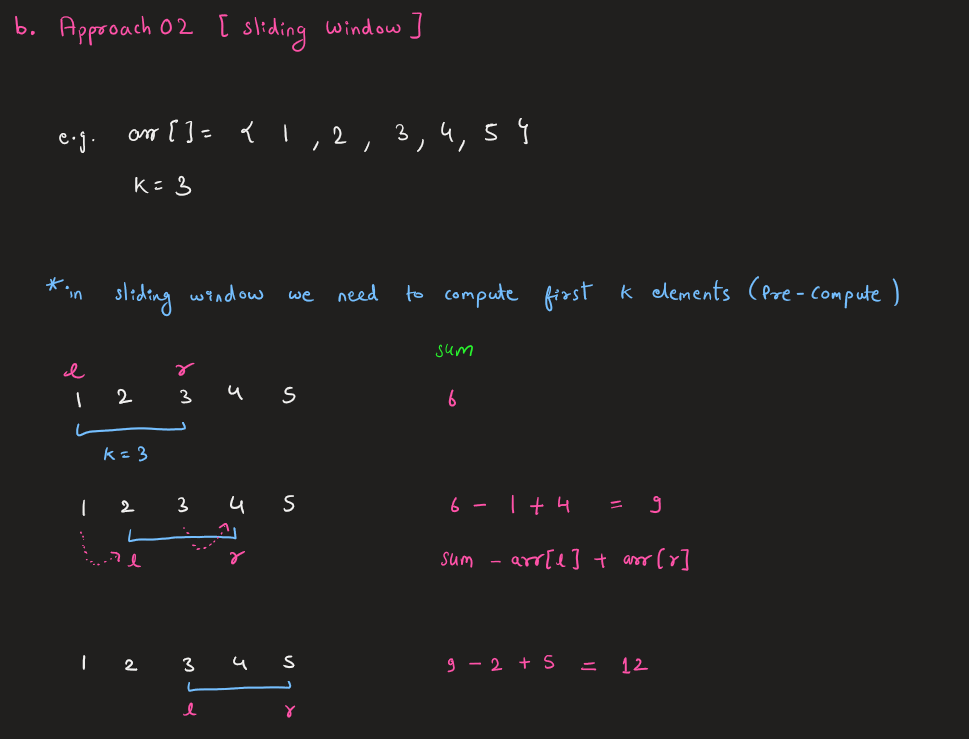
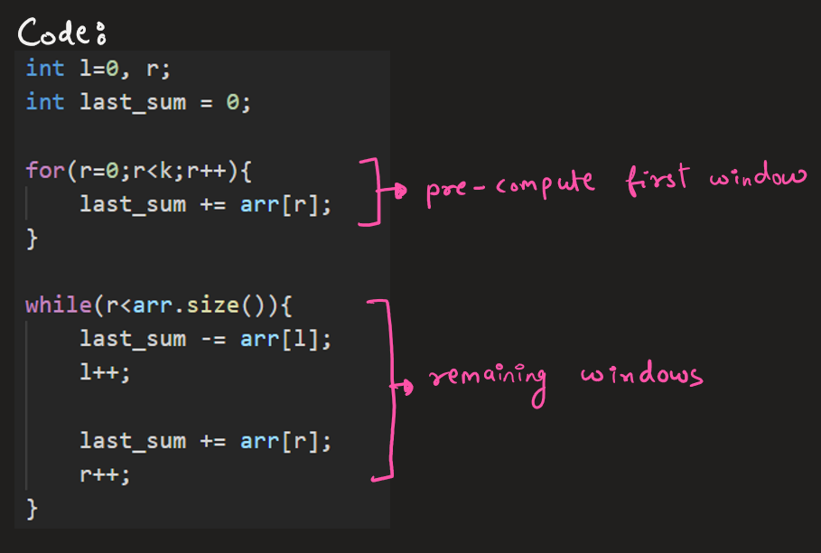
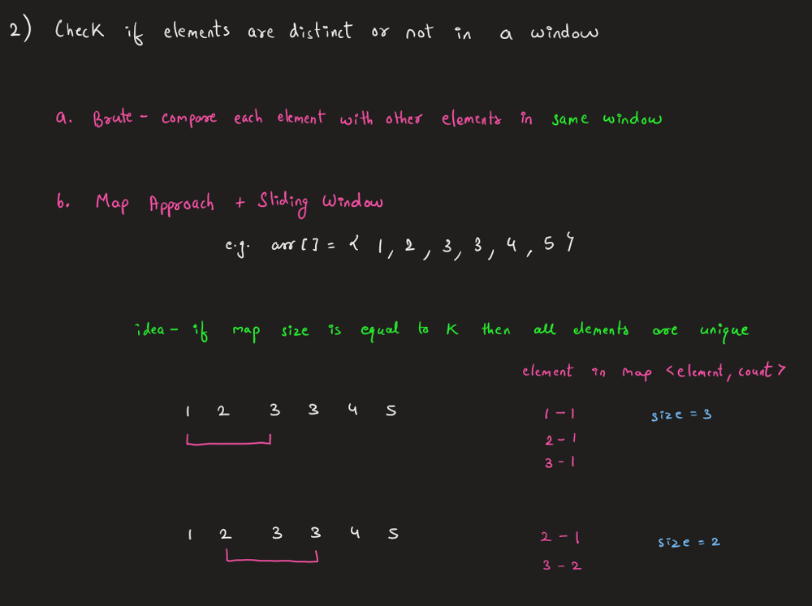
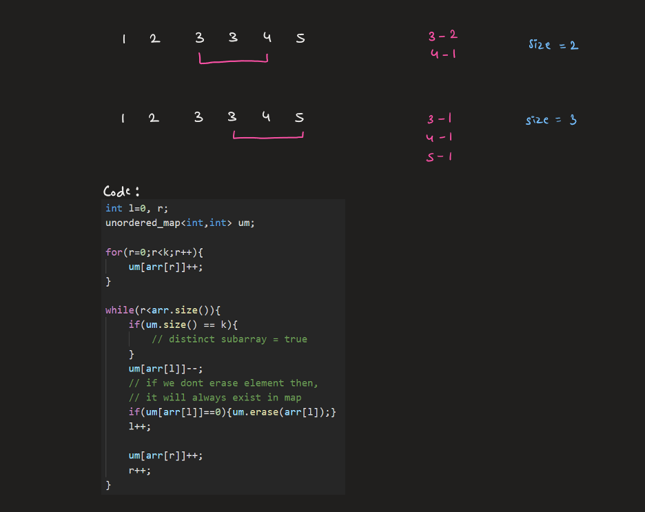
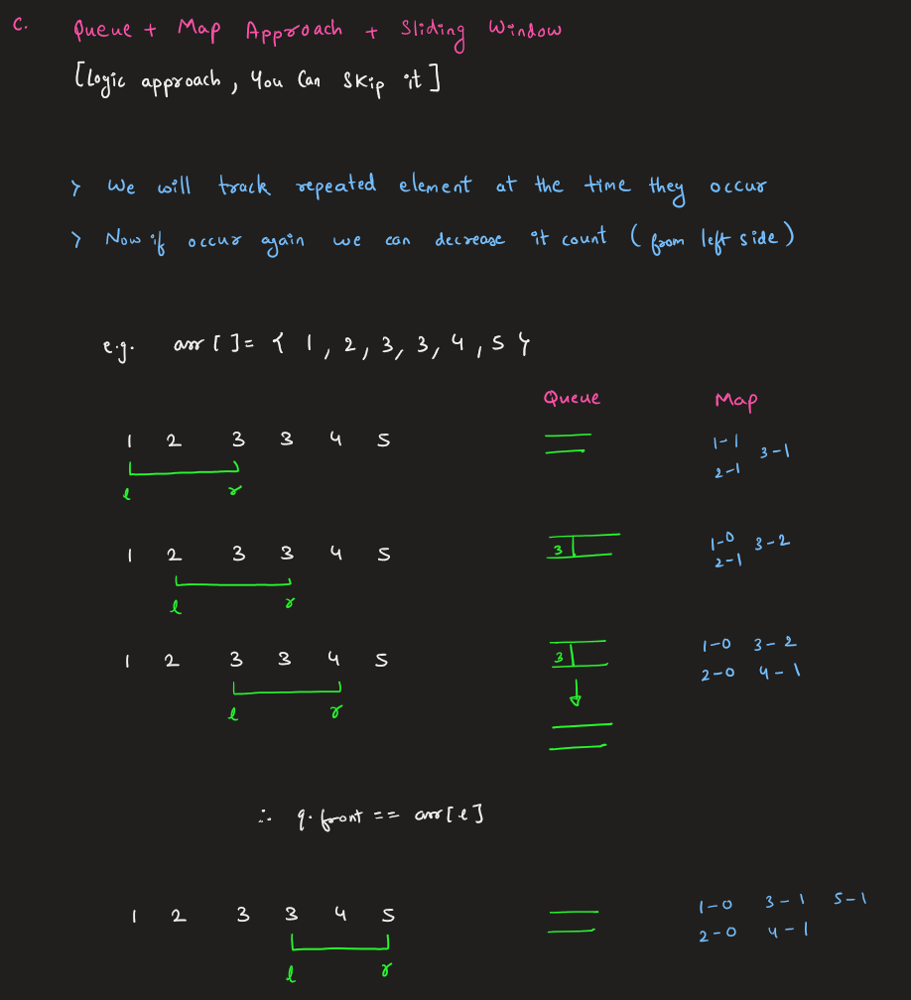
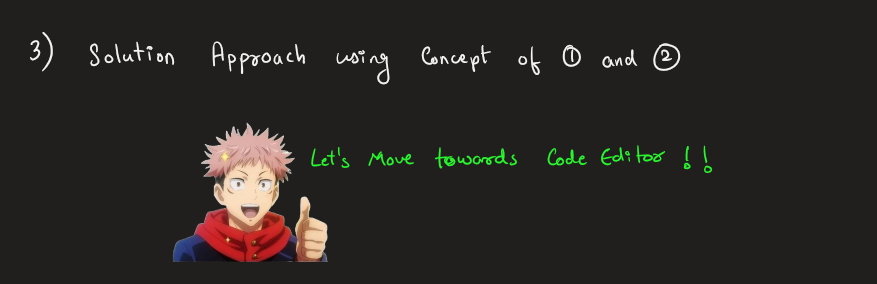

# 🔥Combine Two Different Idea into One || illustration || Beginner Friendly Explanation

**Author:** Rarma
**Votes:** 16
**Link:** [https://leetcode.com/problems/maximum-sum-of-distinct-subarrays-with-length-k/solutions/6060654/](https://leetcode.com/problems/maximum-sum-of-distinct-subarrays-with-length-k/solutions/6060654/)

---

# Youtube Explanation
Soon to be on Channel : https://www.youtube.com/@Intuit_and_Code
Edited:
https://youtu.be/TBCx7LhzuYk?si=r0QSomeQzWVYG-UL
# Intuition & Approach













# Complexity
- Time complexity: *O(n)*, *O(n)*
- Space complexity: *O(n)*, *O(n+k)*

# Code
``` C++ [ ]
#define ll long long
class Solution {
public:
    ll maximumSubarraySum(vector<int>& arr, int k) {
        unordered_map<int,int> um;

        int l=0, r;
        ll last_sum = 0;
        for(r=0;r<k;r++){
            um[arr[r]]++;
            last_sum += arr[r];
        }

        ll sum = 0ll;
        while(r<=arr.size()){
            if(um.size() == k){ // chk if window is distinct ?
                sum = max(last_sum, sum);
            }

            if(l<arr.size()){
                um[arr[l]]--;
                if(um[arr[l]]==0){um.erase(arr[l]);}
                last_sum -= arr[l];
                l++;
            }

            if(r<arr.size()){
                um[arr[r]]++;
                last_sum += arr[r];
            }
            r++;
        }

        return sum;
    }
};
```
```cpp []
#define ll long long
class Solution {
public:
    ll maximumSubarraySum(vector<int>& arr, int k) {
        unordered_map<int,int> um;
        queue<int> q;

        int l=0, r=0;
        ll sum = 0ll, last_sum = 0;
        for(;r<k;r++){
            um[arr[r]]++;
            last_sum+=arr[r];

            if(um[arr[r]]>1){q.push(arr[r]);}
        }

        while(r<=arr.size()){
            // cout<<last_sum<<" ";
            if(q.empty()){
                sum = max(last_sum, sum);
            }

            if(q.front() == arr[l]){
                q.pop();
            }
            um[arr[l]]--;
            last_sum -= arr[l];
            l++;

            if(r<arr.size()){
                um[arr[r]]++;
                last_sum += arr[r];
            }
            
            if(r<arr.size() and um[arr[r]]>1){
                q.push(arr[r]);
            }            
            r++;
        }

        return sum;
    }
};
```
``` java [ ]
class Solution {
    public long maximumSubarraySum(int[] arr, int k) {
        Map<Integer, Integer> um = new HashMap<>();
        int l = 0, r;
        long lastSum = 0;

        for (r = 0; r < k; r++) {
            um.put(arr[r], um.getOrDefault(arr[r], 0) + 1);
            lastSum += arr[r];
        }

        long sum = 0;
        while (r <= arr.length) {
            if (um.size() == k) { // Check if window is distinct
                sum = Math.max(lastSum, sum);
            }

            if (l < arr.length) {
                um.put(arr[l], um.get(arr[l]) - 1);
                if (um.get(arr[l]) == 0) {
                    um.remove(arr[l]);
                }
                lastSum -= arr[l];
                l++;
            }

            if (r < arr.length) {
                um.put(arr[r], um.getOrDefault(arr[r], 0) + 1);
                lastSum += arr[r];
            }
            r++;
        }

        return sum;
    }
}
```
``` JAVA [ ]
class Solution {
    public long maximumSubarraySum(int[] arr, int k) {
        Map<Integer, Integer> um = new HashMap<>();
        Queue<Integer> q = new LinkedList<>();
        int l = 0, r = 0;
        long sum = 0, lastSum = 0;

        for (; r < k; r++) {
            um.put(arr[r], um.getOrDefault(arr[r], 0) + 1);
            lastSum += arr[r];

            if (um.get(arr[r]) > 1) {
                q.add(arr[r]);
            }
        }

        while (r <= arr.length) {
            if (q.isEmpty()) {
                sum = Math.max(lastSum, sum);
            }

            if (!q.isEmpty() && q.peek() == arr[l]) {
                q.poll();
            }
            um.put(arr[l], um.get(arr[l]) - 1);
            lastSum -= arr[l];
            l++;

            if (r < arr.length) {
                um.put(arr[r], um.getOrDefault(arr[r], 0) + 1);
                lastSum += arr[r];

                if (um.get(arr[r]) > 1) {
                    q.add(arr[r]);
                }
            }
            r++;
        }

        return sum;
    }
}
```
``` Python [ ]
class Solution:
    def maximumSubarraySum(self, nums: List[int], k: int) -> int:
        um = defaultdict(int)
        q = deque()
        l, r = 0, 0
        sum_val = 0
        last_sum = 0

        # Initialize the first window of size k
        for r in range(k):
            um[nums[r]] += 1
            last_sum += nums[r]

            if um[nums[r]] > 1:
                q.append(nums[r])

        # Slide the window across the array
        while r <= len(nums):
            if not q:
                sum_val = max(last_sum, sum_val)

            if q and q[0] == nums[l]:
                q.popleft()
            um[nums[l]] -= 1
            last_sum -= nums[l]
            l += 1

            if r < len(nums):
                um[nums[r]] += 1
                last_sum += nums[r]
                if um[nums[r]] > 1:
                    q.append(nums[r])
            r += 1

        return sum_val
```
