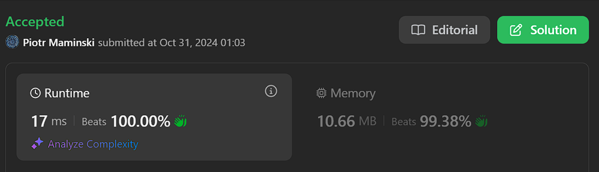
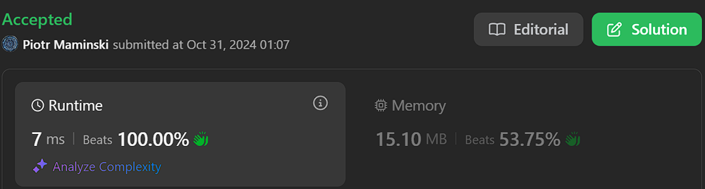

# ✅Beats 100% |  Working 31.10.2024 | Explained step by step

**Author:** Piotr_Maminski
**Votes:** 125
**Link:** [https://leetcode.com/problems/minimum-total-distance-traveled/solutions/5988185/](https://leetcode.com/problems/minimum-total-distance-traveled/solutions/5988185/)

---


# Code (all beats 100%)
```python3 []
class Solution:
    def minimumTotalDistance(self, robot: List[int], factory: List[List[int]]) -> int:
        # Sort positions to enable optimal matching
        robot.sort()
        factory.sort()
        
        m, n = len(robot), len(factory)
        # DP table initialization
        dp = [[0]*(n+1) for _ in range(m+1)]
        
        # Base case: if no factories left, distance is infinite
        for i in range(m): 
            dp[i][-1] = float('inf')
        
        # Process each factory from right to left
        for j in range(n-1, -1, -1):
            prefix = 0
            qq = deque([(m, 0)])
            
            # Process each robot from right to left
            for i in range(m-1, -1, -1):
                # Add distance to current factory
                prefix += abs(robot[i] - factory[j][0])
                
                # Remove elements outside factory limit window
                if qq[0][0] > i+factory[j][1]: 
                    qq.popleft()
                
                # Maintain monotonic queue property
                while qq and qq[-1][1] >= dp[i][j+1] - prefix:
                    qq.pop()
                    
                qq.append((i, dp[i][j+1] - prefix))
                dp[i][j] = qq[0][1] + prefix
                
        return dp[0][0]

```
```cpp []
class Solution {
public:
    long long minimumTotalDistance(vector<int>& robot, vector<vector<int>>& factory) {
        // Sort both robots and factories for optimal assignment
        sort(robot.begin(), robot.end());
        sort(factory.begin(), factory.end());
        
        int m = robot.size(), n = factory.size();
        // dp[i][j]: minimum total distance for robots[i:] using factories[j:]
        vector<vector<long long>> dp(m + 1, vector<long long>(n + 1));
        
        // Base case: if no factories are available, distance is infinity
        for (int i = 0; i < m; i++) {
            dp[i][n] = LLONG_MAX;
        }
        
        // Process each factory from right to left
        for (int j = n - 1; j >= 0; j--) {
            // Track cumulative distance from current factory to robots
            long long prefix = 0;
            // Deque stores pairs of (robot index, minimum distance)
            deque<pair<int, long long>> qq;
            // Initialize with base case
            qq.push_back({m, 0});
            
            // Process each robot from right to left
            for (int i = m - 1; i >= 0; i--) {
                // Add distance from current robot to current factory
                prefix += abs(robot[i] - factory[j][0]);
                
                // Remove entries that exceed factory capacity
                while (!qq.empty() && qq.front().first > i + factory[j][1]) {
                    qq.pop_front();
                }
                
                // Maintain monotonic property of deque
                while (!qq.empty() && qq.back().second >= dp[i][j + 1] - prefix) {
                    qq.pop_back();
                }
                
                // Add current state to deque
                qq.push_back({i, dp[i][j + 1] - prefix});
                // Calculate minimum distance for current state
                dp[i][j] = qq.front().second + prefix;
            }
        }
        
        // Return minimum total distance starting from first robot and first factory
        return dp[0][0];
    }
};
```
```java []
class Solution {
    public long minimumTotalDistance(List<Integer> robot, int[][] factory) {
        // Sort robots and factories by position for optimal assignment
        Collections.sort(robot);
        Arrays.sort(factory, (a, b) -> Integer.compare(a[0], b[0]));
        
        int m = robot.size();
        int n = factory.length; 
        
        // dp[i][j] represents min total distance for robots[i:] using factories[j:]
        long[][] dp = new long[m + 1][n + 1];
        
        // Set last column to MAX_VALUE as boundary condition
        for (int i = 0; i < m; i++) {
            dp[i][n] = Long.MAX_VALUE;
        }
        
        // Process each factory from right to left
        for (int j = n - 1; j >= 0; j--) {
            // Track cumulative distance from current factory to robots
            long prefix = 0;
            // Use deque to maintain potential optimal assignments
            Deque<Pair<Integer, Long>> qq = new ArrayDeque<>();
            // Initialize with boundary condition
            qq.offer(new Pair<>(m, 0L));
            
            // Process each robot from right to left
            for (int i = m - 1; i >= 0; i--) {
                // Add distance from current robot to current factory
                prefix += Math.abs(robot.get(i) - factory[j][0]);
                
                // Remove assignments that exceed factory capacity
                while (!qq.isEmpty() && qq.peekFirst().getKey() > i + factory[j][1]) {
                    qq.pollFirst();
                }
                
                // Remove suboptimal assignments
                while (!qq.isEmpty() && qq.peekLast().getValue() >= dp[i][j + 1] - prefix) {
                    qq.pollLast();
                }
                
                // Add current state to deque
                qq.offerLast(new Pair<>(i, dp[i][j + 1] - prefix));
                // Update dp with optimal assignment
                dp[i][j] = qq.peekFirst().getValue() + prefix;
            }
        }
        
        // Return minimum total distance for all robots
        return dp[0][0];
    }
    
    // Helper class to store key-value pairs
    private static class Pair<K, V> {
        private K key;
        private V value;
        
        public Pair(K key, V value) {
            this.key = key;
            this.value = value;
        }
        
        public K getKey() {
            return key;
        }
        
        public V getValue() {
            return value;
        }
    }
}
```
```csharp []
public class Solution {
    public long MinimumTotalDistance(IList<int> robot, IList<IList<int>> factory) {
        // Convert to lists and sort
        var robots = robot.ToList();
        var factories = factory.ToList();
        robots.Sort();
        factories.Sort((a, b) => a[0].CompareTo(b[0]));
        
        int m = robots.Count;
        int n = factories.Count;
        
        // DP table initialization
        long[,] dp = new long[m + 1, n + 1];
        
        // Base case: if no factories left, distance is infinite
        for (int i = 0; i < m; i++) {
            dp[i, n] = long.MaxValue;
        }
        
        // Process each factory from right to left
        for (int j = n - 1; j >= 0; j--) {
            long prefix = 0;
            var qq = new LinkedList<(int pos, long val)>();
            qq.AddLast((m, 0));
            
            // Process each robot from right to left
            for (int i = m - 1; i >= 0; i--) {
                // Add distance to current factory
                prefix += Math.Abs((long)robots[i] - factories[j][0]);
                
                // Remove elements outside factory limit window
                while (qq.Count > 0 && qq.First.Value.pos > i + factories[j][1]) {
                    qq.RemoveFirst();
                }
                
                // Maintain monotonic queue property
                while (qq.Count > 0 && qq.Last.Value.val >= dp[i, j + 1] - prefix) {
                    qq.RemoveLast();
                }
                
                qq.AddLast((i, dp[i, j + 1] - prefix));
                dp[i, j] = qq.First.Value.val + prefix;
            }
        }
        
        return dp[0, 0];
    }
}
```
```golang []
func minimumTotalDistance(robot []int, factory [][]int) int64 {
    // Sort positions for optimal matching
    sort.Ints(robot)
    sort.Slice(factory, func(i, j int) bool {
        return factory[i][0] < factory[j][0]
    })
    
    m, n := len(robot), len(factory)
    
    // Initialize DP table
    dp := make([][]int64, m+1)
    for i := range dp {
        dp[i] = make([]int64, n+1)
        if i < m {
            dp[i][n] = math.MaxInt64
        }
    }
    
    // Process each factory from right to left
    for j := n-1; j >= 0; j-- {
        var prefix int64
        qq := make([][2]int64, 0)
        qq = append(qq, [2]int64{int64(m), 0})
        
        // Process each robot from right to left
        for i := m-1; i >= 0; i-- {
            // Add distance to current factory
            prefix += int64(abs(robot[i] - factory[j][0]))
            
            // Remove elements outside factory limit window
            if qq[0][0] > int64(i+factory[j][1]) {
                qq = qq[1:]
            }
            
            // Maintain monotonic queue property
            curr := dp[i][j+1] - prefix
            for len(qq) > 0 && qq[len(qq)-1][1] >= curr {
                qq = qq[:len(qq)-1]
            }
            
            qq = append(qq, [2]int64{int64(i), curr})
            dp[i][j] = qq[0][1] + prefix
        }
    }
    
    return dp[0][0]
}

func abs(x int) int {
    if x < 0 {
        return -x
    }
    return x
}
```
```swift []
class Solution {
    func minimumTotalDistance(_ robot: [Int], _ factory: [[Int]]) -> Int {
        // Create mutable copies for sorting
        var robots = robot.sorted()
        var factories = factory.sorted { $0[0] < $1[0] }
        
        let m = robots.count
        let n = factories.count
        
        // DP table initialization
        var dp = Array(repeating: Array(repeating: 0, count: n + 1), count: m + 1)
        
        // Base case: if no factories left, distance is infinite
        for i in 0..<m {
            dp[i][n] = Int.max
        }
        
        // Process each factory from right to left
        for j in stride(from: n-1, through: 0, by: -1) {
            var prefix = 0
            var queue = [(Int, Int)]() // (index, value)
            queue.append((m, 0))
            
            // Process each robot from right to left
            for i in stride(from: m-1, through: 0, by: -1) {
                // Add distance to current factory
                prefix += abs(robots[i] - factories[j][0])
                
                // Remove elements outside factory limit window
                while !queue.isEmpty && queue[0].0 > i + factories[j][1] {
                    queue.removeFirst()
                }
                
                // Maintain monotonic queue property
                while !queue.isEmpty && queue.last!.1 >= dp[i][j+1] - prefix {
                    queue.removeLast()
                }
                
                queue.append((i, dp[i][j+1] - prefix))
                dp[i][j] = queue[0].1 + prefix
            }
        }
        
        return dp[0][0]
    }
}
```
```javascript [JS]
// JavaScript

var minimumTotalDistance = function(robot, factory) {
    // Sort positions
    robot.sort((a, b) => a - b);
    factory.sort((a, b) => a[0] - b[0]);
    
    const m = robot.length;
    const n = factory.length;
    
    // Create DP table
    const dp = Array(m + 1).fill().map(() => Array(n + 1).fill(0));
    
    // Base case initialization
    for (let i = 0; i < m; i++) {
        dp[i][n] = Infinity;
    }
    
    // Process each factory from right to left
    for (let j = n - 1; j >= 0; j--) {
        let prefix = 0;
        const qq = [[m, 0]];
        
        // Process each robot from right to left
        for (let i = m - 1; i >= 0; i--) {
            // Add distance to current factory
            prefix += Math.abs(robot[i] - factory[j][0]);
            
            // Remove elements outside factory limit window
            if (qq[0][0] > i + factory[j][1]) {
                qq.shift();
            }
            
            // Maintain monotonic queue property
            while (qq.length && qq[qq.length - 1][1] >= dp[i][j + 1] - prefix) {
                qq.pop();
            }
            
            qq.push([i, dp[i][j + 1] - prefix]);
            dp[i][j] = qq[0][1] + prefix;
        }
    }
    
    return dp[0][0];
};
```
```typescript [TS]
// TypeScript

function minimumTotalDistance(robot: number[], factory: number[][]): number {
    // Sort positions
    robot.sort((a, b) => a - b);
    factory.sort((a, b) => a[0] - b[0]);
    
    const m = robot.length;
    const n = factory.length;
    
    // DP table initialization
    const dp: number[][] = Array(m + 1).fill(0).map(() => Array(n + 1).fill(0));
    
    // Base case: if no factories left, distance is infinite
    for (let i = 0; i < m; i++) {
        dp[i][n] = Infinity;
    }
    
    // Process each factory from right to left
    for (let j = n - 1; j >= 0; j--) {
        let prefix = 0;
        const qq: [number, number][] = [[m, 0]];
        
        // Process each robot from right to left
        for (let i = m - 1; i >= 0; i--) {
            // Add distance to current factory
            prefix += Math.abs(robot[i] - factory[j][0]);
            
            // Remove elements outside factory limit window
            if (qq[0][0] > i + factory[j][1]) {
                qq.shift();
            }
            
            // Maintain monotonic queue property
            while (qq.length && qq[qq.length - 1][1] >= dp[i][j + 1] - prefix) {
                qq.pop();
            }
            
            qq.push([i, dp[i][j + 1] - prefix]);
            dp[i][j] = qq[0][1] + prefix;
        }
    }
    
    return dp[0][0];
}
```
```rust []
impl Solution {
    pub fn minimum_total_distance(mut robot: Vec<i32>, mut factory: Vec<Vec<i32>>) -> i64 {
        robot.sort_unstable();
        factory.sort_unstable();
        
        let (m, n) = (robot.len(), factory.len());
        let mut dp = vec![vec![0i64; n + 1]; m + 1];
        
        // Base case: if no factories left, distance is infinite
        for i in 0..m {
            dp[i][n] = i64::MAX;
        }
        
        // Process each factory from right to left
        for j in (0..n).rev() {
            let mut prefix = 0i64;
            let mut qq = std::collections::VecDeque::new();
            qq.push_back((m, 0i64));
            
            // Process each robot from right to left
            for i in (0..m).rev() {
                // Add distance to current factory
                prefix += (robot[i] - factory[j][0]).abs() as i64;
                
                // Remove elements outside factory limit window
                while !qq.is_empty() && qq[0].0 > i + factory[j][1] as usize {
                    qq.pop_front();
                }
                
                // Maintain monotonic queue property
                while !qq.is_empty() && qq.back().unwrap().1 >= dp[i][j + 1] - prefix {
                    qq.pop_back();
                }
                
                qq.push_back((i, dp[i][j + 1] - prefix));
                dp[i][j] = qq[0].1 + prefix;
            }
        }
        
        dp[0][0]
    }
}
```
```ruby []
def minimum_total_distance(robot, factory)
    robot.sort!
    factory.sort!
    
    m, n = robot.length, factory.length
    dp = Array.new(m + 1) { Array.new(n + 1, 0) }
    
    # Base case
    m.times { |i| dp[i][n] = Float::INFINITY }
    
    # Process each factory from right to left
    (n-1).downto(0) do |j|
        prefix = 0
        qq = [[m, 0]]
        
        # Process each robot from right to left
        (m-1).downto(0) do |i|
            prefix += (robot[i] - factory[j][0]).abs
            
            # Remove elements outside factory limit window
            qq.shift if qq[0][0] > i + factory[j][1]
            
            # Maintain monotonic queue property
            while !qq.empty? && qq[-1][1] >= dp[i][j+1] - prefix
                qq.pop
            end
            
            qq.push([i, dp[i][j+1] - prefix])
            dp[i][j] = qq[0][1] + prefix
        end
    end
    
    dp[0][0]
end
```
## Without Comments
```python3 []
class Solution:
    def minimumTotalDistance(self, robot: List[int], factory: List[List[int]]) -> int:
        robot.sort()
        factory.sort()
        m, n = len(robot), len(factory)
        dp = [[0]*(n+1) for _ in range(m+1)] 
        for i in range(m): dp[i][-1] = inf 
        for j in range(n-1, -1, -1): 
            prefix = 0 
            qq = deque([(m, 0)])
            for i in range(m-1, -1, -1): 
                prefix += abs(robot[i] - factory[j][0])
                if qq[0][0] > i+factory[j][1]: qq.popleft()
                while qq and qq[-1][1] >= dp[i][j+1] - prefix: qq.pop()
                qq.append((i, dp[i][j+1] - prefix))
                dp[i][j] = qq[0][1] + prefix
        return dp[0][0]
```
```cpp []
class Solution {
public:
    long long minimumTotalDistance(vector<int>& robot, vector<vector<int>>& factory) {
        sort(robot.begin(), robot.end());
        sort(factory.begin(), factory.end());
        
        int m = robot.size(), n = factory.size();
        vector<vector<long long>> dp(m + 1, vector<long long>(n + 1));
        
        for (int i = 0; i < m; i++) {
            dp[i][n] = LLONG_MAX;
        }
        
        for (int j = n - 1; j >= 0; j--) {
            long long prefix = 0;
            deque<pair<int, long long>> qq;
            qq.push_back({m, 0});
            
            for (int i = m - 1; i >= 0; i--) {
                prefix += abs(robot[i] - factory[j][0]);
                
                while (!qq.empty() && qq.front().first > i + factory[j][1]) {
                    qq.pop_front();
                }
                
                while (!qq.empty() && qq.back().second >= dp[i][j + 1] - prefix) {
                    qq.pop_back();
                }
                
                qq.push_back({i, dp[i][j + 1] - prefix});
                dp[i][j] = qq.front().second + prefix;
            }
        }
        
        return dp[0][0];
    }
};
```
```java []
class Solution {
    public long minimumTotalDistance(List<Integer> robot, int[][] factory) {
        Collections.sort(robot);
        Arrays.sort(factory, (a, b) -> Integer.compare(a[0], b[0]));
        
        int m = robot.size();
        int n = factory.length;
        
        long[][] dp = new long[m + 1][n + 1];
        
        for (int i = 0; i < m; i++) {
            dp[i][n] = Long.MAX_VALUE;
        }
        
        for (int j = n - 1; j >= 0; j--) {
            long prefix = 0;
            Deque<Pair<Integer, Long>> qq = new ArrayDeque<>();
            qq.offer(new Pair<>(m, 0L));
            
            for (int i = m - 1; i >= 0; i--) {
                prefix += Math.abs(robot.get(i) - factory[j][0]);
                
                while (!qq.isEmpty() && qq.peekFirst().getKey() > i + factory[j][1]) {
                    qq.pollFirst();
                }
                
                while (!qq.isEmpty() && qq.peekLast().getValue() >= dp[i][j + 1] - prefix) {
                    qq.pollLast();
                }
                
                qq.offerLast(new Pair<>(i, dp[i][j + 1] - prefix));
                dp[i][j] = qq.peekFirst().getValue() + prefix;
            }
        }
        
        return dp[0][0];
    }
    
    private static class Pair<K, V> {
        private K key;
        private V value;
        
        public Pair(K key, V value) {
            this.key = key;
            this.value = value;
        }
        
        public K getKey() {
            return key;
        }
        
        public V getValue() {
            return value;
        }
    }
}
```
```csharp []
public class Solution {
    public long MinimumTotalDistance(IList<int> robot, IList<IList<int>> factory) {
        var robots = robot.ToList();
        var factories = factory.ToList();
        robots.Sort();
        factories.Sort((a, b) => a[0].CompareTo(b[0]));
        
        int m = robots.Count;
        int n = factories.Count;
        
        long[,] dp = new long[m + 1, n + 1];
        
        for (int i = 0; i < m; i++) {
            dp[i, n] = long.MaxValue;
        }
        
        for (int j = n - 1; j >= 0; j--) {
            long prefix = 0;
            var qq = new LinkedList<(int pos, long val)>();
            qq.AddLast((m, 0));
            
            for (int i = m - 1; i >= 0; i--) {
                prefix += Math.Abs((long)robots[i] - factories[j][0]);
                
                while (qq.Count > 0 && qq.First.Value.pos > i + factories[j][1]) {
                    qq.RemoveFirst();
                }
                
                while (qq.Count > 0 && qq.Last.Value.val >= dp[i, j + 1] - prefix) {
                    qq.RemoveLast();
                }
                
                qq.AddLast((i, dp[i, j + 1] - prefix));
                dp[i, j] = qq.First.Value.val + prefix;
            }
        }
        
        return dp[0, 0];
    }
}
```
```golang []
func minimumTotalDistance(robot []int, factory [][]int) int64 {
    sort.Ints(robot)
    sort.Slice(factory, func(i, j int) bool {
        return factory[i][0] < factory[j][0]
    })
    
    m, n := len(robot), len(factory)
    
    dp := make([][]int64, m+1)
    for i := range dp {
        dp[i] = make([]int64, n+1)
        if i < m {
            dp[i][n] = math.MaxInt64
        }
    }
    
    for j := n-1; j >= 0; j-- {
        var prefix int64
        qq := make([][2]int64, 0)
        qq = append(qq, [2]int64{int64(m), 0})
        
        for i := m-1; i >= 0; i-- {
            prefix += int64(abs(robot[i] - factory[j][0]))
            
            if qq[0][0] > int64(i+factory[j][1]) {
                qq = qq[1:]
            }
            
            curr := dp[i][j+1] - prefix
            for len(qq) > 0 && qq[len(qq)-1][1] >= curr {
                qq = qq[:len(qq)-1]
            }
            
            qq = append(qq, [2]int64{int64(i), curr})
            dp[i][j] = qq[0][1] + prefix
        }
    }
    
    return dp[0][0]
}

func abs(x int) int {
    if x < 0 {
        return -x
    }
    return x
}
```
```swift []
class Solution {
    func minimumTotalDistance(_ robot: [Int], _ factory: [[Int]]) -> Int {
        var robots = robot.sorted()
        var factories = factory.sorted { $0[0] < $1[0] }
        
        let m = robots.count
        let n = factories.count
        
        var dp = Array(repeating: Array(repeating: 0, count: n + 1), count: m + 1)
        
        for i in 0..<m {
            dp[i][n] = Int.max
        }
        
        for j in stride(from: n-1, through: 0, by: -1) {
            var prefix = 0
            var queue = [(Int, Int)]() 
            queue.append((m, 0))
            
            for i in stride(from: m-1, through: 0, by: -1) {
                prefix += abs(robots[i] - factories[j][0])
                
                while !queue.isEmpty && queue[0].0 > i + factories[j][1] {
                    queue.removeFirst()
                }
                
                while !queue.isEmpty && queue.last!.1 >= dp[i][j+1] - prefix {
                    queue.removeLast()
                }
                
                queue.append((i, dp[i][j+1] - prefix))
                dp[i][j] = queue[0].1 + prefix
            }
        }
        
        return dp[0][0]
    }
}
```
```javascript [JS]
// JavaScript

var minimumTotalDistance = function(robot, factory) {
    robot.sort((a, b) => a - b);
    factory.sort((a, b) => a[0] - b[0]);
    
    const m = robot.length;
    const n = factory.length;
    
    const dp = Array(m + 1).fill().map(() => Array(n + 1).fill(0));
    
    for (let i = 0; i < m; i++) {
        dp[i][n] = Infinity;
    }
    
    for (let j = n - 1; j >= 0; j--) {
        let prefix = 0;
        const qq = [[m, 0]];
        
        for (let i = m - 1; i >= 0; i--) {
            prefix += Math.abs(robot[i] - factory[j][0]);
            
            if (qq[0][0] > i + factory[j][1]) {
                qq.shift();
            }
            
            while (qq.length && qq[qq.length - 1][1] >= dp[i][j + 1] - prefix) {
                qq.pop();
            }
            
            qq.push([i, dp[i][j + 1] - prefix]);
            dp[i][j] = qq[0][1] + prefix;
        }
    }
    
    return dp[0][0];
};
```
```typescript [TS]
// TypeScript

function minimumTotalDistance(robot: number[], factory: number[][]): number {
    robot.sort((a, b) => a - b);
    factory.sort((a, b) => a[0] - b[0]);
    
    const m = robot.length;
    const n = factory.length;
    
    const dp: number[][] = Array(m + 1).fill(0).map(() => Array(n + 1).fill(0));
    
    for (let i = 0; i < m; i++) {
        dp[i][n] = Infinity;
    }
    
    for (let j = n - 1; j >= 0; j--) {
        let prefix = 0;
        const qq: [number, number][] = [[m, 0]];
        
        for (let i = m - 1; i >= 0; i--) {
            prefix += Math.abs(robot[i] - factory[j][0]);
            
            if (qq[0][0] > i + factory[j][1]) {
                qq.shift();
            }
            
            while (qq.length && qq[qq.length - 1][1] >= dp[i][j + 1] - prefix) {
                qq.pop();
            }
            
            qq.push([i, dp[i][j + 1] - prefix]);
            dp[i][j] = qq[0][1] + prefix;
        }
    }
    
    return dp[0][0];
}
```
```rust []
impl Solution {
    pub fn minimum_total_distance(mut robot: Vec<i32>, mut factory: Vec<Vec<i32>>) -> i64 {
        robot.sort_unstable();
        factory.sort_unstable();
        
        let (m, n) = (robot.len(), factory.len());
        let mut dp = vec![vec![0i64; n + 1]; m + 1];
        
        for i in 0..m {
            dp[i][n] = i64::MAX;
        }
        
        for j in (0..n).rev() {
            let mut prefix = 0i64;
            let mut qq = std::collections::VecDeque::new();
            qq.push_back((m, 0i64));
            
            for i in (0..m).rev() {
                prefix += (robot[i] - factory[j][0]).abs() as i64;
                
                while !qq.is_empty() && qq[0].0 > i + factory[j][1] as usize {
                    qq.pop_front();
                }
                
                while !qq.is_empty() && qq.back().unwrap().1 >= dp[i][j + 1] - prefix {
                    qq.pop_back();
                }
                
                qq.push_back((i, dp[i][j + 1] - prefix));
                dp[i][j] = qq[0].1 + prefix;
            }
        }
        
        dp[0][0]
    }
}
```
```ruby []
def minimum_total_distance(robot, factory)
    robot.sort!
    factory.sort!
    
    m, n = robot.length, factory.length
    dp = Array.new(m + 1) { Array.new(n + 1, 0) }
    m.times { |i| dp[i][n] = Float::INFINITY }
    
    (n-1).downto(0) do |j|
        prefix = 0
        qq = [[m, 0]]
        
        (m-1).downto(0) do |i|
            prefix += (robot[i] - factory[j][0]).abs
            
            qq.shift if qq[0][0] > i + factory[j][1]
            
            while !qq.empty? && qq[-1][1] >= dp[i][j+1] - prefix
                qq.pop
            end
            
            qq.push([i, dp[i][j+1] - prefix])
            dp[i][j] = qq[0][1] + prefix
        end
    end
    
    dp[0][0]
end
```


### Complexity 
- Time complexity: O(MN)

- Space complexity: O(MN)


# Explanation

---


## Intuition

- Each robot needs to be repaired at a factory
- Factories have repair limits
- Robots can move in either direction
- Goal is to minimize total distance traveled


## Approach
- The solution uses dynamic programming with the following approach:
- Sort both robots and factories by position to make optimal assignments easier
- Create a DP table where:
    - dp[i][j] represents minimum distance needed for robots[i:] using factories[j:]
    - i represents robot index
    - j represents factory index

## Step by Step

1. Initial Setup

```
# Sort both arrays to enable optimal matching
robot.sort()
factory.sort()
m, n = len(robot), len(factory)
```

2. DP Table Creation

```
# Create DP table and initialize base case
dp = [[0]*(n+1) for _ in range(m+1)]
for i in range(m): 
    dp[i][-1] = float('inf')
```

3. Main DP Loop Structure

```
# Outer loop: process each factory right to left
for j in range(n-1, -1, -1):
    prefix = 0
    qq = deque([(m, 0)])
    
    # Inner loop: process each robot right to left
    for i in range(m-1, -1, -1):
```


4. Distance Calculation

```
# Calculate cumulative distance for current robot to factory
prefix += abs(robot[i] - factory[j][0])

```

5.  Queue Management

```
# Remove elements outside factory limit
if qq[0][0] > i+factory[j][1]: 
    qq.popleft()

# Maintain monotonic property
while qq and qq[-1][1] >= dp[i][j+1] - prefix:
    qq.pop()

```

6. State Update

```
# Add new state and calculate minimum distance
qq.append((i, dp[i][j+1] - prefix))
dp[i][j] = qq[0][1] + prefix
```


### Key

1. Sorting ensures we can process positions in order
2. DP table stores minimum distances for subproblems
3. Double loop processes all robot-factory combinations
4. Prefix sum tracks cumulative distances
5. Deque optimization maintains valid factory assignments
6. Final state gives minimum total distance


### Optimalization

- Processing factories from right to left
- Considering each robot's potential assignments
- Using the deque to maintain factory capacity constraints
- Tracking minimum distances in the DP table

The final answer dp[0][0] represents the minimum total distance for all robots to reach their optimal factories.


# Still dont understand Dynamic Programming

**Video with IMO best explained**: google "15. Dynamic Programming, Part 1: SRTBOT, Fib, DAGs, Bowling" , "Dynamic Programming - Learn to Solve Algorithmic Problems & Coding Challenges"
(leetscode flag video in solution :)

**List DP for begginers**: https://leetcode.com/problem-list/atwflvk7/

---
# Most common Interview Dynamic Programming Problems


From the most to the least common  (from GitHub/reddit):

[[1143. Longest Common Subsequence]](https://leetcode.com/problems/longest-common-subsequence) [[300. Longest Increasing Subsequence]](https://leetcode.com/problems/longest-increasing-subsequence)  [[73. Set Matrix Zeroes]](https://leetcode.com/problems/edit-distance) [[5. Longest Palindromic Substring]](https://leetcode.com/problems/longest-palindromic-substring) [[2035. Partition Array Into Two Arrays to Minimize Sum Difference]](https://leetcode.com/problems/partition-array-into-two-arrays-to-minimize-sum-difference/description/)[[32. Longest Valid Parentheses]](https://leetcode.com/problems/longest-valid-parentheses/description/?envType=study-plan-v2&envId=top-100-liked)

**Easy (common in junior lvl):** [[70. Climbing Stairs]](https://leetcode.com/problems/climbing-stairs/description/) [[118. Pascal's Triangle
]](https://leetcode.com/problems/pascals-triangle/description/) 


# Interview Priorities

| Patterns                | Difficulty | Interview Frequently           |
|----------------------|---------------------|----------------------|
| **Two Pointers**         | **Easy**                | **High**                 |
| **Sliding Window**       | **Easy**                | **High**                 |
| **Breadth-First Search** | **Easy**                | **High**                 |
| **Depth-First Search**   | **Medium**              | **High**                 |
| **Backtracking**         | **High**                | **High**                 |
| Heap                 | Medium              | Medium               |
| Binary Search        | Easy                | Medium               |
| Dynamic Programming  | High                | Medium               |
| Divide and Conquer   | Medium              | Low                  |
| Trie                 | Medium              | Low                  |
| Union Find           | Medium              | Low                  |
| Greedy               | High                | Low                  |





