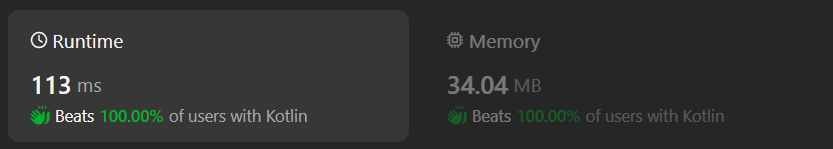

# Kotlin O(n) solution without sorting and priority queue

**Author:** chayangkoon
**Votes:** 0
**Link:** [https://leetcode.com/problems/number-of-distinct-averages/solutions/5091607/](https://leetcode.com/problems/number-of-distinct-averages/solutions/5091607/)

---




# Complexity
- Time complexity:
O(n)

- Space complexity:
O(n)

# Code
```
class Solution {
    fun distinctAverages(nums: IntArray): Int {
        var maxNum = -1
        var minNum = 101

        for (num in nums) {
            maxNum = max(num, maxNum)
            minNum = min(num, minNum)
        }

        if (maxNum == minNum) return 1

        val frequencies = IntArray(maxNum - minNum + 1)
        for (num in nums) {
            frequencies[num - minNum]++
        }

        val sumsSet = hashSetOf<Int>()
        var left = 0
        var right = frequencies.size - 1
        while (left < right) {
            while (left < right && frequencies[left] == 0) {
                left++
            }

            while (left < right && frequencies[right] == 0) {
                right--
            }

            if (--frequencies[left] >= 0 && --frequencies[right] >= 0) {
                sumsSet.add(left + right)
            }
        }

        return sumsSet.size
    }
}
```