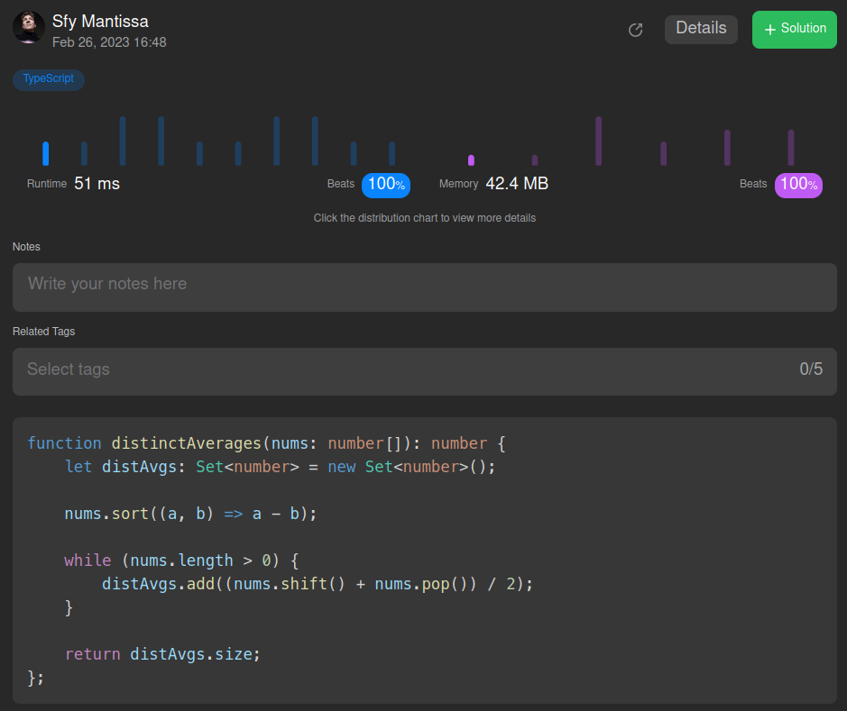

# 🏅 TypeScript, best and easy solution (100% runtime, 100% memory)

**Author:** SfyMantissa
**Votes:** 1
**Link:** [https://leetcode.com/problems/number-of-distinct-averages/solutions/3232582/](https://leetcode.com/problems/number-of-distinct-averages/solutions/3232582/)

---

# Intuition

* Number of distinct values has to be returned, this means that it may be wise to use a `Set` type as a storage for collected average values.
* Minimum and maximum values have to be removed upon each operation, so it may be wise to sort the original array in ascending or descending order to make use of `Array.prototype.shift()` and `Array.prototype.pop()` methods for convenience.

# Approach

1. Initialize `distAvgs` which is going to store the averages.
2. Sort the `nums` array in ascending order.
3. Until the `nums` array is empty, loop over the sorted array:
    * Compute averages and `shift()`, `pop()` the values used in the computation.
    * Add the averages to `distAvgs`.
4. Return the size of `distAvgs`.

# Complexity
- Time complexity: $$o(n)$$

    For `n` elements in the original array of even size, `n / 2` loops are needed. So time complexity is always less than `O(n)`, hence why it is `o(n)`.

- Space complexity: $$o(n)$$

    Only one `Set` data structure is used. For `n` elements in the original array, it would need `n / 2` slots for storage. So space complexity is also always less than `O(n)`, hence why it is also `o(n)`.

# Code
```
function distinctAverages(nums: number[]): number {
    let distAvgs: Set<number> = new Set<number>();

    nums.sort((a, b) => a - b);

    while (nums.length > 0) {
        distAvgs.add((nums.shift() + nums.pop()) / 2);
    }

    return distAvgs.size;
};
```

# Submission

Original submission is [here.](https://leetcode.com/problems/number-of-distinct-averages/submissions/905268337/)



