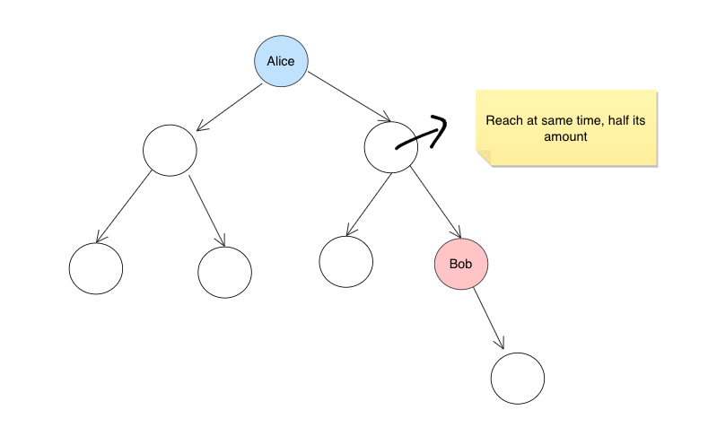
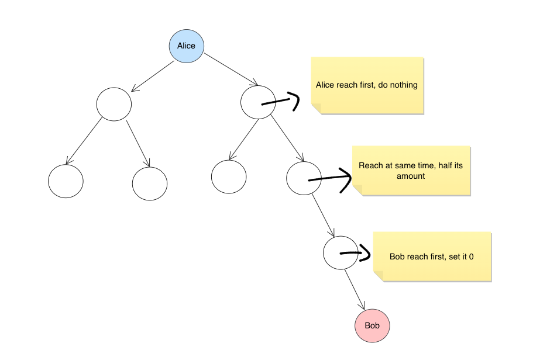
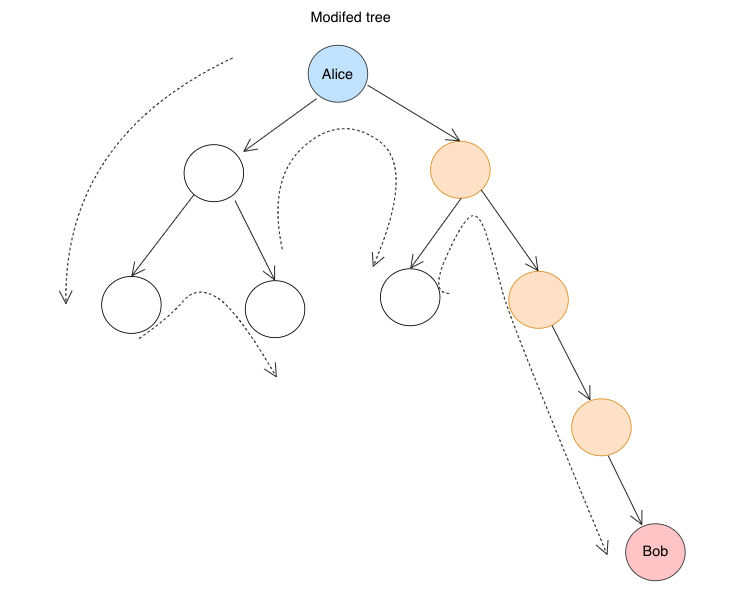

# Java || DFS ( Find Path ) + DFS ( get maxSum ) || Explained

**Author:** cooper--
**Votes:** 11
**Link:** [https://leetcode.com/problems/most-profitable-path-in-a-tree/solutions/2807203/](https://leetcode.com/problems/most-profitable-path-in-a-tree/solutions/2807203/)

---

1. find path `bob -> ... -> alice`
2. modify the `amount` of `node` in the path by rule :
```
left half nodes to 0 (bob reaches first),  if exact middle node exist, make it half (reaching same time)
```
3. backtrack traverse tree to get max path Sum





```java
class Solution {

    List<Integer> b2a = new ArrayList<>();
    int maxSum = Integer.MIN_VALUE;
    
    public int mostProfitablePath(int[][] edges, int bob, int[] amount) {
        int n = amount.length;

        Map<Integer, Set<Integer>> graph = new HashMap<>();
        
        for (int i = 0; i < n; i++) graph.put(i, new HashSet<>());
        
        for (int[] edge : edges) {
            int u = edge[0];
            int v = edge[1];
            graph.get(v).add(u);
            graph.get(u).add(v);
        }
        
        // 1. find path
        dfs(bob, 0, graph, new ArrayList<Integer>(){{add(bob); }}, new HashSet<Integer>(){{add(bob); }});

        // 2. modify tree
        for (int i = 0; i < b2a.size() / 2; i++) {
            amount[b2a.get(i)] = 0;
        }
        if (b2a.size() % 2 != 0) {
            int m = b2a.get(b2a.size() / 2);
            amount[m] /= 2;
        }
        
        // 3. get result
        Set<Integer> visited = new HashSet<>();
        visited.add(0);
        maxPathSum(0, graph, amount, visited, amount[0]);
        return maxSum;
    }
    
    private boolean dfs(int root, int target,  Map<Integer, Set<Integer>> graph, List<Integer> currPath, Set<Integer> visited) {
        if (root == target) {
            b2a = new ArrayList<>(currPath);
            return true;
        }
        
        for (int neighbor : graph.get(root)) {
            if (visited.contains(neighbor)) continue;
            visited.add(neighbor);
            currPath.add(neighbor);
            
            if (dfs(neighbor, target, graph, currPath, visited)) return true;
            
            currPath.remove(currPath.size() - 1);
            visited.remove(neighbor);
        }
        return false;
    }
    
    private void maxPathSum(int root, Map<Integer, Set<Integer>> graph, int[] amount, Set<Integer> visited, int currSum) {
        int cnt = 0;
        for (int child : graph.get(root)) {
            if (visited.contains(child)) continue;
            
            visited.add(child);
            maxPathSum(child, graph, amount, visited, currSum + amount[child]);
            visited.remove(child);
            cnt++;
            
        }
        // leafNode
        if (cnt == 0) maxSum = Math.max(maxSum, currSum);
        return;
    }
    
    /*

}
```