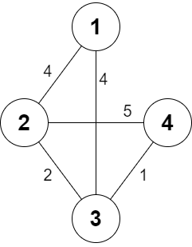
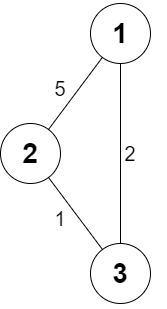

# [2473. Minimum Cost to Buy Apples](https://leetcode.com/problems/minimum-cost-to-buy-apples/)

| Category | Difficulty | Likes | Dislikes |
| :------: | :--------: | :---: | :------: |
| Algorithms | Medium | 117 | 27 |

**Tags:** [`array`](https://leetcode.com/tag/array), [`graph`](https://leetcode.com/tag/graph), [`heap-priority-queue`](https://leetcode.com/tag/heap-priority-queue), [`shortest-path`](https://leetcode.com/tag/shortest-path)

**Companies:** `directi`, `medianet`

## Description

You are given a positive integer `n` representing `n` cities numbered from `1` to `n`. You are also given a **2D** array `roads`, where `roads[i] = [a_i, b_i, cost_i]` indicates that there is a **bidirectional **road between cities `a_i` and `b_i` with a cost of traveling equal to `cost_i`.

You can buy apples in **any** city you want, but some cities have different costs to buy apples. You are given the 1-based array `appleCost` where `appleCost[i]` is the cost of buying one apple from city `i`.

You start at some city, traverse through various roads, and eventually buy **exactly** one apple from **any** city. After you buy that apple, you have to return back to the city you **started** at, but now the cost of all the roads will be **multiplied** by a given factor `k`.

Given the integer `k`, return *a 1-based array *`answer`* of size *`n`* where *`answer[i]`* is the **minimum** total cost to buy an apple if you start at city *`i`.

 

**Example 1:**


```

Input: n = 4, roads = [[1,2,4],[2,3,2],[2,4,5],[3,4,1],[1,3,4]], appleCost = [56,42,102,301], k = 2
Output: [54,42,48,51]
Explanation: The minimum cost for each starting city is the following:
- Starting at city 1: You take the path 1 -&gt; 2, buy an apple at city 2, and finally take the path 2 -&gt; 1. The total cost is 4 + 42 + 4 * 2 = 54.
- Starting at city 2: You directly buy an apple at city 2. The total cost is 42.
- Starting at city 3: You take the path 3 -&gt; 2, buy an apple at city 2, and finally take the path 2 -&gt; 3. The total cost is 2 + 42 + 2 * 2 = 48.
- Starting at city 4: You take the path 4 -&gt; 3 -&gt; 2 then you buy at city 2, and finally take the path 2 -&gt; 3 -&gt; 4. The total cost is 1 + 2 + 42 + 1 * 2 + 2 * 2 = 51.

```

**Example 2:**


```

Input: n = 3, roads = [[1,2,5],[2,3,1],[3,1,2]], appleCost = [2,3,1], k = 3
Output: [2,3,1]
Explanation: It is always optimal to buy the apple in the starting city.

```

 

**Constraints:**

	- `2 <= n <= 1000`

	- `1 <= roads.length <= 2000`

	- `1 <= a_i, b_i <= n`

	- `a_i != b_i`

	- `1 <= cost_i <= 10^5`

	- `appleCost.length == n`

	- `1 <= appleCost[i] <= 10^5`

	- `1 <= k <= 100`

	- There are no repeated edges.

---

**Links:** [Submissions](https://leetcode.com/problems/minimum-cost-to-buy-apples/) | [Solutions](https://leetcode.com/problems/minimum-cost-to-buy-apples/)
