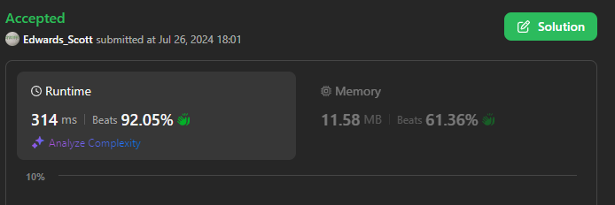

# 💢☠💫Easiest👾Faster✅💯 Lesser🧠 🎯 C++✅Python3🐍✅Java✅C✅Python🐍✅C#✅💥🔥💫Explained☠💥🔥 Beats 💯

**Author:** Edwards310
**Votes:** 2
**Link:** [https://leetcode.com/problems/number-of-unequal-triplets-in-array/solutions/5538953/](https://leetcode.com/problems/number-of-unequal-triplets-in-array/solutions/5538953/)

---

# Intuition


These are the almost same questions which are similar to this one which are as follows :-

---


***Q - 1460 -->*** https://leetcode.com/problems/make-two-arrays-equal-by-reversing-subarrays/solutions/5538697/easiestfaster-lesser-cpython3javacpythoncexplained-beats

***Q - 1534 -->*** https://leetcode.com/problems/count-good-triplets/solutions/5538845/easiestfaster-lesser-cpython3javacpythoncexplained-beats

***Q - 2367 -->*** https://leetcode.com/problems/number-of-arithmetic-triplets/solutions/5539085/easiestfaster-lesser-cpython3javacpythoncexplained-beats

***Q - 2908 -->*** https://leetcode.com/problems/minimum-sum-of-mountain-triplets-i/solutions/5539207/easiestfaster-lesser-cpython3javacpythoncexplained-beats

---


```C++ []
// Start Of Anuj Bhati aka Edwards310's Template...
#include <bits/stdc++.h>
using namespace std;
#define FOR(a, b, c) for (int a = b; a < c; a++)
#define FOR1(a, b, c) for (int a = b; a <= c; ++a)
#define Rep(i, n) FOR(i, 0, n)

// end of Anuj Bhati's aka Edwards310's Template
class Solution {
public:
    int unequalTriplets(vector<int>& nums) {
        int n = nums.size();
        int cnt = 0;
        Rep(i, n - 2){
            FOR(j, i + 1, n - 1){
                if(nums[i] != nums[j]){
                    FOR(k, j + 1, n){
                        if(nums[j] != nums[k] and nums[k] != nums[i])
                            ++cnt;
                    }
                }
            }
        }
        return cnt;
    }
};
```
```python3 []
class Solution:
    def unequalTriplets(self, nums: List[int]) -> int:
        n = len(nums)
        cnt = 0
        for i in range(n - 2):
            for j in range(i + 1, n - 1):
                if nums[i] != nums[j]:
                    for k in range(j + 1, n):
                        if nums[j] != nums[k] and nums[k] != nums[i]:
                            cnt += 1

        return cnt
```
```C# []
public class Solution {
    public int UnequalTriplets(int[] nums) {
        int n = nums.Length;
        int cnt = 0;
        for (int i = 0; i < n - 2; ++i)
            for (int j = i + 1; j < n - 1; ++j)
                if (nums[i] != nums[j])
                    for (int k = j + 1; k < n; ++k)
                        if (nums[j] != nums[k] && nums[k] != nums[i])
                            ++cnt;

        return cnt;
    }
}
```
```Java []
class Solution {
    public int unequalTriplets(int[] nums) {
        int n = nums.length;
        int cnt = 0;
        for (int i = 0; i < n - 2; ++i)
            for (int j = i + 1; j < n - 1; ++j)
                if (nums[i] != nums[j])
                    for (int k = j + 1; k < n; ++k)
                        if (nums[j] != nums[k] && nums[k] != nums[i])
                            ++cnt;

        return cnt;
    }
}
```
```python []
class Solution(object):
    def unequalTriplets(self, nums):
        """
        :type nums: List[int]
        :rtype: int
        """
        n = len(nums)
        cnt = 0
        for i in range(n - 2):
            for j in range(i + 1, n - 1):
                if nums[i] != nums[j]:
                    for k in range(j + 1, n):
                        if nums[j] != nums[k] and nums[k] != nums[i]:
                            cnt += 1

        return cnt
```
```C []
int unequalTriplets(int* nums, int numsSize) {
    int n = numsSize;
    int cnt = 0;
    for (int i = 0; i < n - 2; ++i)
        for (int j = i + 1; j < n - 1; ++j)
            if (nums[i] != nums[j])
                for (int k = j + 1; k < n; ++k)
                    if (nums[j] != nums[k] && nums[k] != nums[i])
                        ++cnt;

    return cnt;
}
```
<!-- Describe your first thoughts on how to solve this problem. -->

# Approach
<!-- Describe your approach to solving the problem. -->

# Complexity
- Time complexity:
<!-- Add your time complexity here, e.g. $$O(n)$$ -->
    O(N^3)
- Space complexity:
<!-- Add your space complexity here, e.g. $$O(n)$$ -->
    O(1)
# Code
```
class Solution(object):
    def unequalTriplets(self, nums):
        """
        :type nums: List[int]
        :rtype: int
        """
        n = len(nums)
        cnt = 0
        for i in range(n - 2):
            for j in range(i + 1, n - 1):
                if nums[i] != nums[j]:
                    for k in range(j + 1, n):
                        if nums[j] != nums[k] and nums[k] != nums[i]:
                            cnt += 1

        return cnt
```


