# Python Hashmap O(n) with diagrams

**Author:** cheatcode-ninja
**Votes:** 36
**Link:** [https://leetcode.com/problems/number-of-unequal-triplets-in-array/solutions/2834169/](https://leetcode.com/problems/number-of-unequal-triplets-in-array/solutions/2834169/)

---

You can refer to this https://youtu.be/d_CHEvI9gQU


Let's first try to understand the properties of the triplets.


# Connected
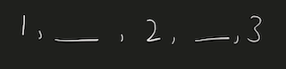


If we have these 3 numbers with multiple numbers between them, they will still be a triplet. 

So, they don't have to be connected.


# Ordering


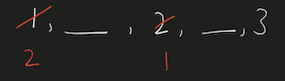


If we rearrange them, they will actually be the same triplet. 

So, we can get a hint that ordering doesn't affect the number of triplets.


# Repetition of Numbers

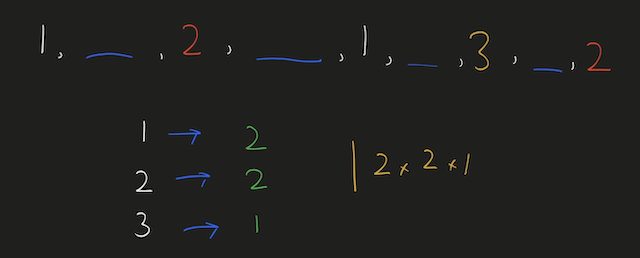

Let's take the case where there is repetition of numbers.

You can again count that there are 4 valid triplets.

The ordering or the spacing/distance between the elements don't affect the answer.

The count of the triplets can also be calculated by multiplying the product of their frequencies `2*2*1`.

# More than 4 distinct numbers


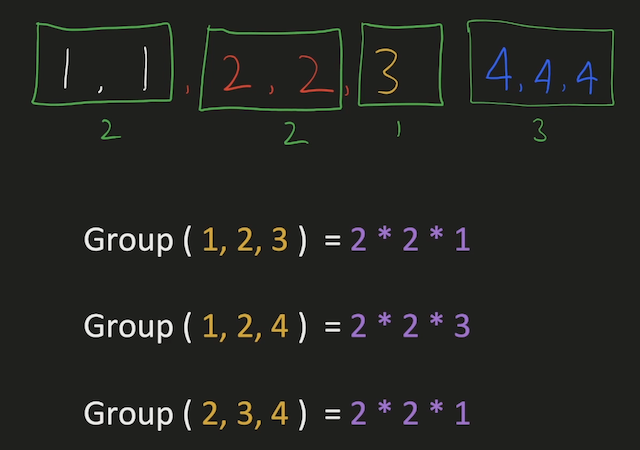

Let's take a scenario where there are more than 3 distinct numbers to form triplets.

Here, since we have to take 3 elements together, we can choose either of 
1. `1,2,3`
2. `1,2,4`
3. `2,3,4`

The count of these triplets would be the product of their individual frequencies.

The total count would be the addition of all these group.

# Avoid Repetitive Counting 

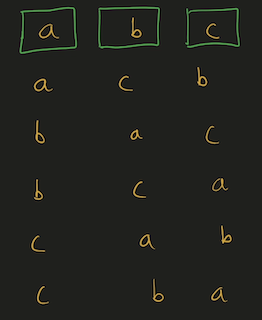

These are all the permutations for 3 elements.

We have to avoid counting repetitions of the same triplet.

# Middle Element


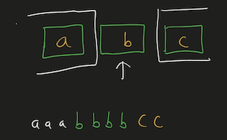

This can be avoided by fixing `b` as middle element and making sure that arrangement `c, a, b` never happens.

It can be a good idea to keep same elements contiguous. 
This will make sure that we never consider palindromic triplets.

# Left, Mid, Right


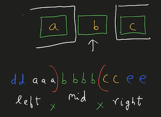

This will work even for more distinct elements on the left and right, as long as there are no same elements both on left & right.

This can't be the case since we already are keeping same elements together to avoid palindromic triplets.

The total number of triplets in this case, with the middle element `b` would be ```left * mid * right ```
Here, 
1. `mid` would be the frequency of `b`
2. `left` would be the number of elements on the left.
3. `right` would be the number of elements on the right.

We can store the frequencies of elements in a HashMap.

# Example

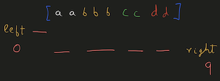

We can initialize `left=0, right=(no. of elements)` as shown in the diagram.

# Iteration 1

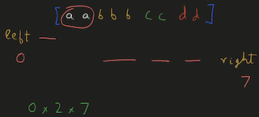

Each time, we chose an element we decrement `right -= (frequency of element)`.

And after we are done with that element, we will increment `left += (frequency of element)`.

We'll have to add the product of `left * freq * right` to result.

# Iteration 2


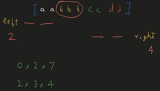

When we choose `b` to be the middle element, `left=2, right=4`.

# Iteration 3


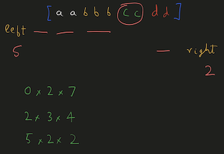

When we choose `c` to be the middle element, `left=5, right=2`.

At the end, we will have to add all these products to our result.

# Iteration 4


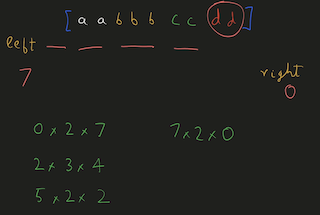

When we choose `d` to be the middle element, `left=7, right=0`.

Note: 
1. The first element will always have left-->0 
2. The last element will have right-->0.

# Time, Space Complexity

`Time: O(n)`  We are creating frequency map by iterating over the array.
`Space: O(n)`  We are using a HashMap to store the frequency of the elements.

If this was helpful, please leave a like, upvote, or even subscribe to the channel.

Cheers


```
class Solution:
    def unequalTriplets(self, nums: List[int]) -> int:
        c = Counter(nums)
        res = 0
        
        left = 0
        right = len(nums)
        
        for _, freq in c.items():
            right -= freq
            res += left * freq * right
            left += freq
        
        return res
