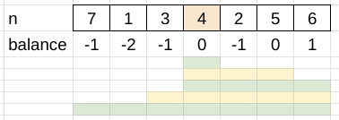

# Balance

**Author:** votrubac
**Votes:** 190
**Link:** [https://leetcode.com/problems/count-subarrays-with-median-k/solutions/2851940/](https://leetcode.com/problems/count-subarrays-with-median-k/solutions/2851940/)

---

A subarray has a median `k` if:
- It includes `k`
- Count `n[i] < k` is equal to count `n[i] > k` (odd-size subarrays).
- Count `n[i] < k` is one less than count `n[i] > k` (even-size subarrays).
  
Or, in other words, the balance between the count of smaller and larger elements is zero or one.
    
Since integers are distinct, we have only one `k` element in the array. So, we find it first.
    
Then, we go right from `k`, tracking the ballance and counting balances using a hash map.
    
Finally, we go left from `k`, tracking the balance, and counting complimentary balances in the hash map.
    
> Say the ballance is `-3` (more smaller elements). We look for value `3` and `4` in the hash map to count valid subarrays.
> This is how our balances look for `[7, 1, 3, 4, 2, 5 ,6], 4`, resulting in 5 valid subarrays.
    


    
**C++**
```cpp
int countSubarrays(vector<int>& n, int k) {
    unordered_map<int, int> cnt;
    int p = find(begin(n), end(n), k) - begin(n), res = 0;
    for(int i = p, bal = 0; i < n.size(); ++i) {
        bal += n[i] == k ? 0 : n[i] < k ? -1 : 1;
        ++cnt[bal];
    }
    for(int i = p, bal = 0; i >= 0; --i) {
        bal += n[i] == k ? 0 : n[i] < k ? -1 : 1;
        res += cnt[-bal] + cnt[-bal + 1];
    }
    return res;
}
```