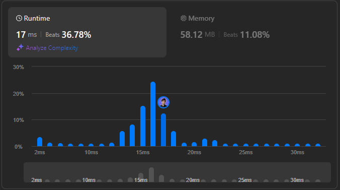

# 🌟 Step-by-Step Guide to Divide Players into Perfect Teams 💯🔥

**Author:** withaarzoo
**Votes:** 79
**Link:** [https://leetcode.com/problems/divide-players-into-teams-of-equal-skill/solutions/5866469/](https://leetcode.com/problems/divide-players-into-teams-of-equal-skill/solutions/5866469/)

---


Explore a collection of solutions to LeetCode problems in multiple programming languages. Each solution includes a detailed explanation and step-by-step approach to solving the problem efficiently. Whether you're a beginner looking to learn or an experienced coder seeking optimized solutions, this repository aims to provide clear and insightful approaches to tackling challenging LeetCode problems.

### **Access daily LeetCode Solutions Repo :** [click here](https://github.com/withaarzoo/LeetCode-Solutions)

---



---

# Intuition
<!-- Describe your initial thoughts and strategy to solve this problem. -->

We are given an array of players' skills, and we need to form teams of two players such that:
- All teams have the same total skill.
- The chemistry of each team (product of skills) is maximized.
  
The challenge is to check if it's possible to form such teams and then calculate the total chemistry.

## Key observations:
- Sorting the array will help us form teams easily.
- Pair the smallest player with the largest player.
- Check if the sum of skills in each pair is the same.

---

# Approach
<!-- Detail the specific method and steps you used to solve the problem. -->

1. **Sort the array**: Sorting the skills helps in easily forming valid pairs.
2. **Two-pointer approach**: Use two pointers\u2014one from the start and one from the end\u2014to pair players. Each pair must have the same total skill.
3. **Check for consistency**: If any pair's skill sum differs from the others, return `-1`.
4. **Calculate chemistry**: For valid pairs, calculate the chemistry as the product of the players' skills.

---

## Complexity

- **Time complexity**:  
  The main operation is sorting the array, which takes \\(O(n \\log n)\\), where \\(n\\) is the length of the array.

- **Space complexity**:  
  The space complexity is \\(O(1)\\), excluding the input array, as we are sorting the array in place and using a constant amount of extra space.

---

## Code
```C++ []
class Solution {
public:
    long long dividePlayers(vector<int>& skill) {
        // Step 1: Sort the skill array
        sort(skill.begin(), skill.end());
        
        int n = skill.size();
        int totalSkill = skill[0] + skill[n - 1]; // Required sum for each pair
        long long chemistrySum = 0;

        // Step 2: Pair players using two pointers
        for (int i = 0; i < n / 2; i++) {
            // Check if the sum of current pair matches the required totalSkill
            if (skill[i] + skill[n - i - 1] != totalSkill) {
                return -1; // Invalid configuration, return -1
            }
            // Calculate the chemistry (product of pair) and add it to the sum
            chemistrySum += (long long)skill[i] * skill[n - i - 1];
        }

        return chemistrySum; // Return total chemistry
    }
};

```
```Java []
import java.util.Arrays;

class Solution {
    public long dividePlayers(int[] skill) {
        // Step 1: Sort the skill array
        Arrays.sort(skill);
        
        int n = skill.length;
        int totalSkill = skill[0] + skill[n - 1]; // Required sum for each pair
        long chemistrySum = 0;

        // Step 2: Pair players using two pointers
        for (int i = 0; i < n / 2; i++) {
            // Check if the sum of current pair matches the required totalSkill
            if (skill[i] + skill[n - i - 1] != totalSkill) {
                return -1; // Invalid configuration, return -1
            }
            // Calculate the chemistry (product of pair) and add it to the sum
            chemistrySum += (long) skill[i] * skill[n - i - 1];
        }

        return chemistrySum; // Return total chemistry
    }
}

```
```JavaScript []
/**
 * @param {number[]} skill
 * @return {number}
 */
var dividePlayers = function(skill) {
    // Step 1: Sort the skill array
    skill.sort((a, b) => a - b);
    
    let totalSkill = skill[0] + skill[skill.length - 1]; // Required sum for each pair
    let chemistrySum = 0;

    // Step 2: Pair players using two pointers
    for (let i = 0; i < skill.length / 2; i++) {
        // Check if the sum of current pair matches the required totalSkill
        if (skill[i] + skill[skill.length - 1 - i] !== totalSkill) {
            return -1; // Invalid configuration, return -1
        }
        // Calculate the chemistry (product of pair) and add it to the sum
        chemistrySum += skill[i] * skill[skill.length - 1 - i];
    }

    return chemistrySum; // Return total chemistry
};

```
```Python []
class Solution:
    def dividePlayers(self, skill: List[int]) -> int:
        # Step 1: Sort the skill array
        skill.sort()
        
        total_skill = skill[0] + skill[-1]  # Required sum for each pair
        chemistry_sum = 0

        # Step 2: Pair players using two pointers
        for i in range(len(skill) // 2):
            # Check if the sum of current pair matches the required total_skill
            if skill[i] + skill[-i - 1] != total_skill:
                return -1  # Invalid configuration, return -1
            # Calculate the chemistry (product of pair) and add it to the sum
            chemistry_sum += skill[i] * skill[-i - 1]

        return chemistry_sum  # Return total chemistry

```
```Go []
import "sort"

func dividePlayers(skill []int) int64 {
    // Step 1: Sort the skill array
    sort.Ints(skill)
    
    totalSkill := skill[0] + skill[len(skill)-1] // Required sum for each pair
    var chemistrySum int64 = 0

    // Step 2: Pair players using two pointers
    for i := 0; i < len(skill)/2; i++ {
        // Check if the sum of current pair matches the required totalSkill
        if skill[i]+skill[len(skill)-i-1] != totalSkill {
            return -1 // Invalid configuration, return -1
        }
        // Calculate the chemistry (product of pair) and add it to the sum
        chemistrySum += int64(skill[i]) * int64(skill[len(skill)-i-1])
    }

    return chemistrySum // Return total chemistry
}

```


---

# Step-by-Step Detailed Explanation

1. **Sorting the array**:
   We sort the `skill[]` array to ensure that the smallest player can be paired with the largest player. Sorting helps us form pairs that are easy to check for total skill consistency.

2. **Two-pointer pairing**:
   We initialize two pointers: 
   - One (`i`) starts from the beginning of the array.
   - The other (`j`) starts from the end of the array. 
   
   These two pointers move toward each other, forming pairs of players.

3. **Checking pair consistency**:
   For each pair of players, we check if their total skill equals the required sum (the total skill of the first and last player). If any pair fails this check, it is impossible to divide the players into valid teams, and we return `-1`.

4. **Calculating chemistry**:
   If all pairs are valid, we compute the "chemistry" of each team as the product of the players' skills. We sum up these chemistry values to get the final result.

5. **Returning the result**:
   If we successfully form all the teams, we return the sum of the chemistry. If not, we return `-1`.

---

# Visualization:

Suppose we are given the following `skill` array:

```
skill = [3, 2, 5, 1, 3, 4]
```

#### Step 1: Sort the array
We begin by sorting the array to simplify pairing the smallest with the largest:

```
Sorted skill array = [1, 2, 3, 3, 4, 5]
```

#### Step 2: Form teams
We use two pointers:
- One pointer starts at the beginning of the array (`i` = 0), 
- The other starts at the end (`j` = length - 1).

We form pairs as follows:

| Pair # | Player 1 (Left Pointer `i`) | Player 2 (Right Pointer `j`) | Total Skill |
|--------|-----------------------------|------------------------------|-------------|
| 1      | 1                           | 5                            | 6           |
| 2      | 2                           | 4                            | 6           |
| 3      | 3                           | 3                            | 6           |

#### Step 3: Verify skill sum
The total skill for each pair is `6`, which is consistent across all pairs. This confirms that we can divide the players into valid teams.

#### Step 4: Chemistry calculation
The "chemistry" of each team is the product of the players' skills. Let's calculate the chemistry for each pair:

| Pair # | Player 1 | Player 2 | Chemistry (Product) |
|--------|----------|----------|---------------------|
| 1      | 1        | 5        | 1 * 5 = 5           |
| 2      | 2        | 4        | 2 * 4 = 8           |
| 3      | 3        | 3        | 3 * 3 = 9           |

The total chemistry sum is:

```
5 + 8 + 9 = 22
```

---

### Visual Representation:

```
Players sorted by skill: [1, 2, 3, 3, 4, 5]

1st Pair: (1, 5) -> Chemistry: 1 * 5 = 5
2nd Pair: (2, 4) -> Chemistry: 2 * 4 = 8
3rd Pair: (3, 3) -> Chemistry: 3 * 3 = 9

Total Chemistry: 5 + 8 + 9 = 22
```

#### Invalid Example:

For the array:

```
skill = [1, 1, 2, 3]
```

After sorting:

```
Sorted skill array = [1, 1, 2, 3]
```

We try to form pairs:

| Pair # | Player 1 | Player 2 | Total Skill |
|--------|----------|----------|-------------|
| 1      | 1        | 3        | 4           |
| 2      | 1        | 2        | 3           |

The total skill for the first pair is `4` and for the second pair is `3`. Since the total skill differs, it is **impossible** to form valid teams. Hence, we return `-1`.

---


