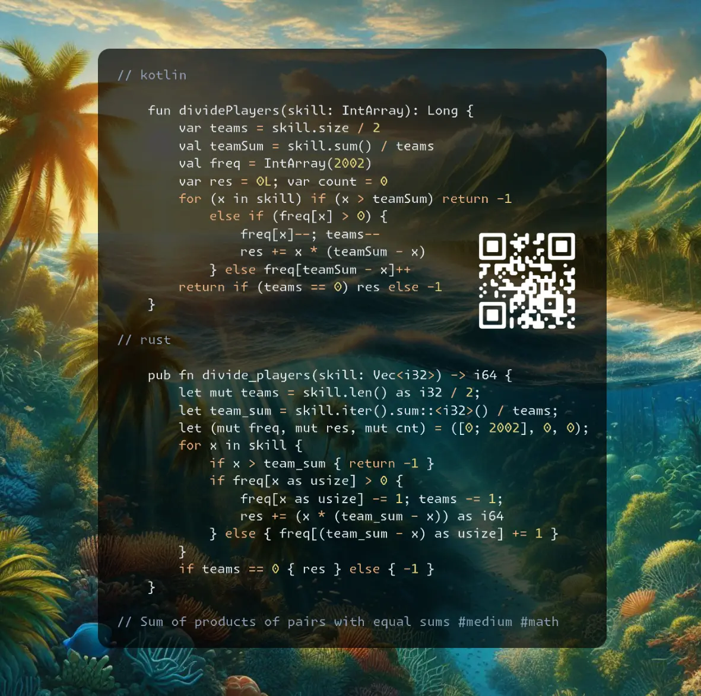

# Kotlin | Rust

**Author:** SamoylenkoDmitry
**Votes:** 2
**Link:** [https://leetcode.com/problems/divide-players-into-teams-of-equal-skill/solutions/5867645/](https://leetcode.com/problems/divide-players-into-teams-of-equal-skill/solutions/5867645/)

---




https://youtu.be/IMtBoyesDc0

#### Join me on Telegram

https://t.me/leetcode_daily_unstoppable/756

#### Problem TLDR

Sum of products of pairs with equal sums #medium #math

#### Intuition

Let's see what can be derived from math arithmetics:

```j

    // 3 2 5 1 3 4  sum = 6 x 3 = 18, teams = size / 2 = 3
    // team_sum = sum / size / 2 = 18 / 6 / 2 = 6
    // 2 1 5 2  sum = 10, teams = 2, teamSum = 5

```

We know: the number of `teams`, each `team sum`. Now just count how many pairs can form the `team sum`.

Another way to solve, is to just sort and use two pointers: the lowest value `should` match with the highest, otherwise pairs can't be formed.


#### Approach

* keep track of the formed pairs count and check them before answer

#### Complexity

- Time complexity:
$$O(n)$$

- Space complexity:
$$O(max)$$, max is 1000 in our case, or 2000 for pair sum

#### Code

```kotlin []

    fun dividePlayers(skill: IntArray): Long {
        var teams = skill.size / 2
        val teamSum = skill.sum() / teams
        val freq = IntArray(2002)
        var res = 0L; var count = 0
        for (x in skill) if (x > teamSum) return -1
            else if (freq[x] > 0) {
                freq[x]--; teams--
                res += x * (teamSum - x)
            } else freq[teamSum - x]++
        return if (teams == 0) res else -1
    }

```
```rust []

    pub fn divide_players(skill: Vec<i32>) -> i64 {
        let mut teams = skill.len() as i32 / 2;
        let team_sum = skill.iter().sum::<i32>() / teams;
        let (mut freq, mut res, mut cnt) = ([0; 2002], 0, 0);
        for x in skill {
            if x > team_sum { return -1 }
            if freq[x as usize] > 0 {
                freq[x as usize] -= 1; teams -= 1;
                res += (x * (team_sum - x)) as i64
            } else { freq[(team_sum - x) as usize] += 1 }
        }
        if teams == 0 { res } else { -1 }
    }

```
```c++ []

    long long dividePlayers(vector<int>& skill) {
        int teams = skill.size() / 2;
        int teamSum = accumulate(skill.begin(), skill.end(), 0) / teams;
        vector<int> freq(2002, 0); long long res = 0;
        for (int x: skill) if (x > teamSum) return -1;
            else if (freq[x] > 0) {
                freq[x]--; teams--;
                res += (long long) x * (teamSum - x);
            } else freq[teamSum - x]++;
        return teams == 0 ? res : -1;
    }

```