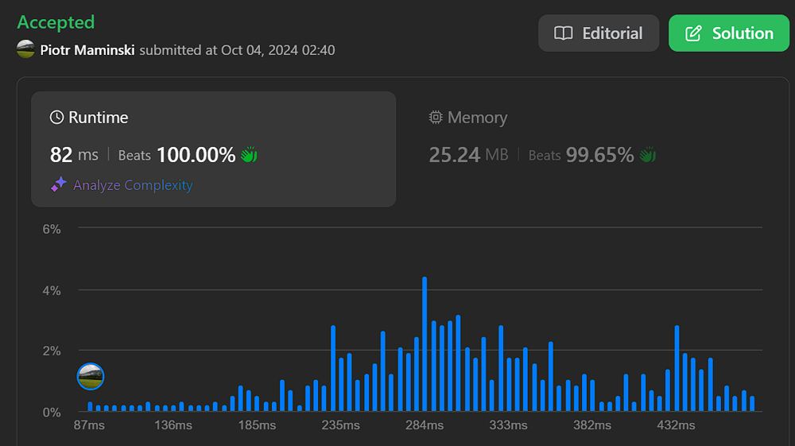

# Beats 100% | ✅ Working 04.10.2024 | Explained in Python

**Author:** Piotr_Maminski
**Votes:** 4
**Link:** [https://leetcode.com/problems/divide-players-into-teams-of-equal-skill/solutions/5866513/](https://leetcode.com/problems/divide-players-into-teams-of-equal-skill/solutions/5866513/)

---

```python3 []
class Solution:
    def dividePlayers(self, skill: List[int]) -> int:
        sum_ = sum(skill)
        n = len(skill)
        if n == 2:
            return skill[0] * skill[1]
        if sum_ % (n//2) != 0:
            return -1
        skill.sort()
        score = skill[0] + skill[-1]
        pairs = []
        result = 0
        for i in range(n // 2):
            l, r = skill[i], skill[n - 1 - i]
            if l + r != score:
                return -1
            result += l * r
        return result

with open("user.out", "w") as f:
    inputs = map(loads, stdin)
    for nums in inputs:
        print(Solution().dividePlayers(nums),file=f)
exit(0)
```
```cpp []
#include <iostream>
#include <vector>
#include <algorithm>
#include <numeric>

class Solution {
public:
    long long dividePlayers(std::vector<int>& skill) {
        long long sum = std::accumulate(skill.begin(), skill.end(), 0LL);
        int n = skill.size();

        if (n == 2) {
            return static_cast<long long>(skill[0]) * skill[1];
        }

        if (sum % (n / 2) != 0) {
            return -1;
        }

        std::sort(skill.begin(), skill.end());

        int score = skill[0] + skill[n - 1];
        long long result = 0;

        for (int i = 0; i < n / 2; ++i) {
            int l = skill[i], r = skill[n - 1 - i];
            if (l + r != score) {
                return -1;
            }
            result += static_cast<long long>(l) * r;
        }

        return result;
    }
};
```
```java []
import java.util.*;

class Solution {
    public long dividePlayers(int[] skill) {
        long sum = 0;
        for (int s : skill) {
            sum += s;
        }

        int n = skill.length;

        if (n == 2) {
            return (long) skill[0] * skill[1];
        }

        if (sum % (n / 2) != 0) {
            return -1;
        }

        Arrays.sort(skill);

        int score = skill[0] + skill[n - 1];
        long result = 0;

        for (int i = 0; i < n / 2; i++) {
            int l = skill[i], r = skill[n - 1 - i];
            if (l + r != score) {
                return -1;
            }
            result += (long) l * r;
        }

        return result;
    }
}

```
```javascript [JS]
/**
 * @param {number[]} skill
 * @return {number}
 */
var dividePlayers = function(skill) {
    const sum = skill.reduce((a, b) => a + b, 0);
    const n = skill.length;

    if (n === 2) {
        return skill[0] * skill[1];
    }

    if (sum % (n / 2) !== 0) {
        return -1;
    }

    skill.sort((a, b) => a - b);
    const targetSum = sum / (n / 2);
    let result = 0;

    for (let i = 0; i < n / 2; i++) {
        const l = skill[i];
        const r = skill[n - 1 - i];

        if (l + r !== targetSum) {
            return -1;
        }

        result += l * r;
    }

    return result;
};
```
```typescript [TS]
function dividePlayers(skill: number[]): number {
    const sum: number = skill.reduce((a, b) => a + b, 0);
    const n: number = skill.length;

    if (n === 2) {
        return skill[0] * skill[1];
    }

    if (sum % (n / 2) !== 0) {
        return -1;
    }

    skill.sort((a, b) => a - b);
    const targetSum: number = sum / (n / 2);
    let result: number = 0;

    for (let i: number = 0; i < n / 2; i++) {
        const l: number = skill[i];
        const r: number = skill[n - 1 - i];

        if (l + r !== targetSum) {
            return -1;
        }

        result += l * r;
    }

    return result;
}
```
```csharp []
public class Solution {
    public long DividePlayers(int[] skill) {
        long sum = 0;
        foreach (int s in skill) {
            sum += s;
        }
        
        int n = skill.Length;
        
        if (n == 2) {
            return (long)skill[0] * skill[1];
        }
        
        if (sum % (n / 2) != 0) {
            return -1;
        }
        
        Array.Sort(skill);
        long targetSum = sum / (n / 2);
        long result = 0;
        
        for (int i = 0; i < n / 2; i++) {
            int l = skill[i];
            int r = skill[n - 1 - i];
            
            if (l + r != targetSum) {
                return -1;
            }
            
            result += (long)l * r;
        }
        
        return result;
    }
}
```
```rust []
impl Solution {
    pub fn divide_players(mut skill: Vec<i32>) -> i64 {
        let n = skill.len();
        let sum: i64 = skill.iter().map(|&x| x as i64).sum();
        
        if sum % (n as i64 / 2) != 0 {
            return -1;
        }
        
        skill.sort_unstable();
        
        let target = skill[0] + skill[n - 1];
        let mut result = 0i64;
        
        for i in 0..n/2 {
            if skill[i] + skill[n - 1 - i] != target {
                return -1;
            }
            result += skill[i] as i64 * skill[n - 1 - i] as i64;
        }
        
        result
    }
}
```
```golang []
func dividePlayers(skill []int) int64 {
    n := len(skill)
    sum := int64(0)
    for _, s := range skill {
        sum += int64(s)
    }

    if sum%(int64(n)/2) != 0 {
        return -1
    }

    sort.Ints(skill)

    target := skill[0] + skill[n-1]
    result := int64(0)

    for i := 0; i < n/2; i++ {
        if skill[i]+skill[n-1-i] != target {
            return -1
        }
        result += int64(skill[i]) * int64(skill[n-1-i])
    }

    return result
}
```
```ruby []
# @param {Integer[]} skill
# @return {Integer}
def divide_players(skill)
    n = skill.length
    sum = skill.sum

    return -1 if sum % (n / 2) != 0

    skill.sort!

    target = skill[0] + skill[-1]
    result = 0

    (0...n/2).each do |i|
        return -1 if skill[i] + skill[n-1-i] != target
        result += skill[i] * skill[n-1-i]
    end

    result
end
```
```swift []
import Foundation

class Solution {
    func dividePlayers(_ skill: [Int]) -> Int {
        let sum_ = skill.reduce(0, +)
        let n = skill.count
        if n == 2 {
            return skill[0] * skill[1]
        }
        if sum_ % (n / 2) != 0 {
            return -1
        }
        let sortedSkill = skill.sorted()
        let score = sortedSkill[0] + sortedSkill[n - 1]
        var result = 0
        for i in 0..<(n / 2) {
            let l = sortedSkill[i]
            let r = sortedSkill[n - 1 - i]
            if l + r != score {
                return -1
            }
            result += l * r
        }
        return result
    }
}

let input = "[3,2,5,1,3,4]"
let data = input.data(using: .utf8)!
let nums = try! JSONDecoder().decode([Int].self, from: data)
let solution = Solution()
print(solution.dividePlayers(nums))
```

## Complexity
- Time complexity: O(n log n)

- Space complexity: 0(1)





# Explained in Python

**1. First, let's understand the problem:**

You have a list of players with different skill levels

You need to divide them into pairs (teams of 2)

Each team should have the same total skill (sum of both players' skills)

The goal is to maximize the "chemistry" which is the sum of the products of skills in each pair

**2.**
```python3 [Solution]
def dividePlayers(self, skill: List[int]) -> int:
    sum_ = sum(skill)  # Calculate total skill of all players
    n = len(skill)     # Get number of players
    
    # Special case: if only 2 players, return their product
    if n == 2:
        return skill[0] * skill[1]
    
    # Check if players can be evenly divided into pairs with equal sum
    if sum_ % (n//2) != 0:
        return -1
    
    skill.sort()  # Sort skills in ascending order
    score = skill[0] + skill[-1]  # Target sum for each pair
    result = 0
    
    # Match players from opposite ends of sorted list
    for i in range(n // 2):
        l, r = skill[i], skill[n - 1 - i]
        if l + r != score:  # If any pair doesn't match target sum
            return -1
        result += l * r     # Add to chemistry total
    
    return result
```

**3. The algorithm works as follows:**

- First, check if we can even make equal pairs:
    - If there are only 2 players, just return their product
    - Calculate if the total skill can be evenly divided among n/2 pairs

- Sort the skill list
- Find the target sum for each pair (lowest + highest skill)
- Match players from opposite ends of the sorted list
- Verify each pair sums to the target
- Calculate and sum up the chemistry (product) of each pair

**4.**
```python3 [input/output part]
with open("user.out", "w") as f:
    inputs = map(loads, stdin)    # Read inputs from stdin
    for nums in inputs:           # For each test case
        # Call solution and write to output file
        print(Solution().dividePlayers(nums), file=f)
exit(0)
```


