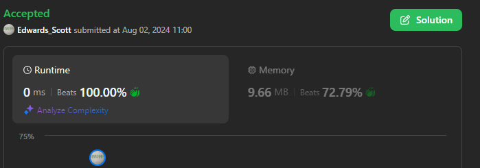
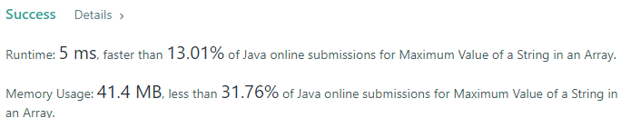
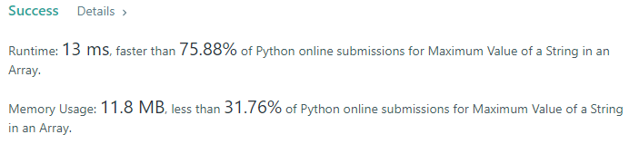
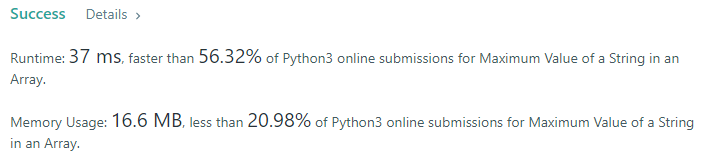
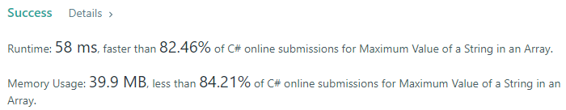
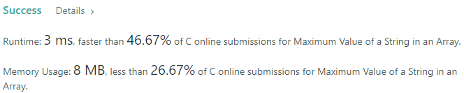
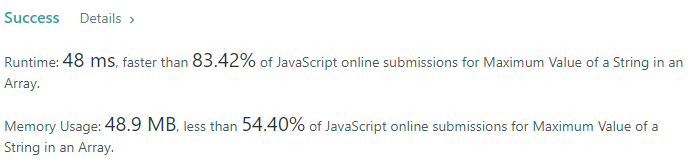

# 💢☠💫Easiest👾Faster✅💯 Lesser🧠 🎯 C++✅Python3🐍✅Java✅C✅Python🐍✅C#✅💥🔥💫Explained☠💥🔥 Beats 💯

**Author:** Edwards310
**Votes:** 2
**Link:** [https://leetcode.com/problems/maximum-value-of-a-string-in-an-array/solutions/5573206/](https://leetcode.com/problems/maximum-value-of-a-string-in-an-array/solutions/5573206/)

---

# Intuition








```javascript []
/**
 * @param {string[]} strs
 * @return {number}
 */
var maximumValue = function(strs) {
    let ans = 0
    for(let str of strs){
        let flag = true
        for(let ch of str){
            if(ch >= 'a' && ch <= 'z'){
                flag = false
                break
            }
        }
        if(flag)
            ans = Math.max(ans, Number(str))
        else
            ans = Math.max(ans, str.length);
    }
    return ans;
};
```
```Python3 []
class Solution:
    def maximumValue(self, strs: List[str]) -> int:
        ans = 0
        for s in strs:
            try:
                n = int(s)
                ans = max(ans, n)
            except Exception as e:
                ans = max(ans, len(s))
        return ans
```
```C++ []
// Start of Edwards310's Template...
#include <bits/stdc++.h>
using namespace std;
#define FOR(a, b, c) for (int a = b; a < c; a++)
#define FOR1(a, b, c) for (int a = b; a <= c; ++a)
#define Rep(i, n) FOR(i, 0, n)
#define Rep1(i, n) FOR1(i, 1, n)
#define RepA(ele, nums) for(auto& ele : nums)
// end Edwards310's Template
class Solution {
public:
    int maximumValue(vector<string>& strs) {
        int ans = 0;
        RepA(str, strs){
            bool flag = true;
            RepA(x, str){
                if(x >= 'a' and x <= 'z'){
                    flag = false;
                    break;
                }
            }
            if(flag)
                ans = fmax(ans, stoi(str));
            else
               ans = fmax(ans, str.length());
        }
        return ans;
    }
};
```
```Java []
class Solution {
    public int maximumValue(String[] strs) {
        int ans = 0;
        for(String str : strs){
            for(char c : str.toCharArray()){
                if(c >= 'a' && c <= 'z'){
                    ans = Math.max(ans, str.length());
                    break;
                }
                else{
                    try{
                        ans = Math.max(ans, Integer.parseInt(str));
                    }
                    catch(Exception e){
                        System.out.println(e);
                    }
                }
            }
        }
        return ans;
    }
}
```
```C []
int strToInt(char* str){
    int ans = 0; 
    int n = strlen(str);
    for(int i = 0; i < n; i++)
        ans = ans * 10 + str[i] - '0';
    return ans;
}
int maximumValue(char ** strs, int strsSize){
    int max = 0;
    for(int i = 0; i < strsSize; i++){
        int n = strlen(strs[i]);
        for(int j = 0; j < n; j++){
            if(strs[i][j] >= 'a' && strs[i][j] <= 'z'){
                max = fmax(max, n);
                break;   
            }
            if(j == n - 1){
                int val = strToInt(strs[i]);
                max = fmax(max, val);
            }
        }
    }
    return max;
}
```
```Python []
class Solution(object):
    def maximumValue(self, strs):
        """
        :type strs: List[str]
        :rtype: int
        """
        ans = 0
        help = "abcdefghijklmnopqrstuvwxyz"
        for string in strs:
            flag = True
            for word in string:
                if word in help:
                    flag = False
                    break
            if flag:
                ans = max(ans, int(string))
            else:
                ans = max(ans, len(string))
            
        return ans
```
```C# []
public class Solution {
    public int MaximumValue(string[] strs) {
        int ans = 0;
        foreach(string str in strs){
            bool flag = true;
            foreach(char ch in str){
                if(ch >= 'a' && ch <='z'){
                    flag = false;
                    break;
                }
            }
            if(flag)
                ans = Math.Max(ans, Convert.ToInt32(str));
            else
                ans = Math.Max(ans, str.Length);
        }
        return ans;
    }
}
```

<!-- Describe your first thoughts on how to solve this problem. -->

# Approach
<!-- Describe your approach to solving the problem. -->

# Complexity
- Time complexity:
<!-- Add your time complexity here, e.g. $$O(n)$$ -->
     O(N * M)
- Space complexity:
<!-- Add your space complexity here, e.g. $$O(n)$$ -->
     O(1)
# Code
```
/**
 * @param {string[]} strs
 * @return {number}
 */
var maximumValue = function(strs) {
    let ans = 0
    for(let str of strs){
        let flag = true
        for(let ch of str){
            if(ch >= 'a' && ch <= 'z'){
                flag = false
                break
            }
        }
        if(flag)
            ans = Math.max(ans, Number(str))
        else
            ans = Math.max(ans, str.length);
    }
    return ans;
};
```


