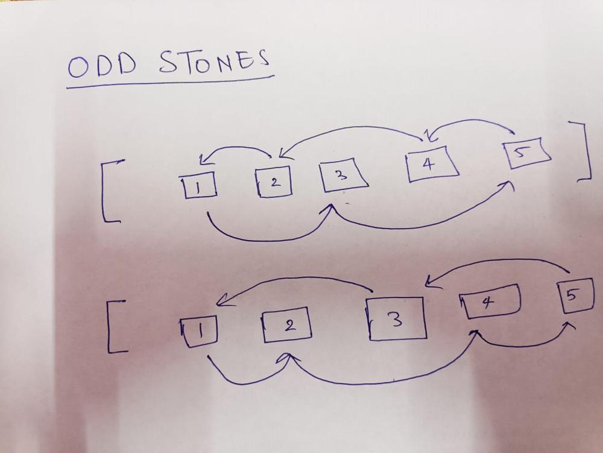
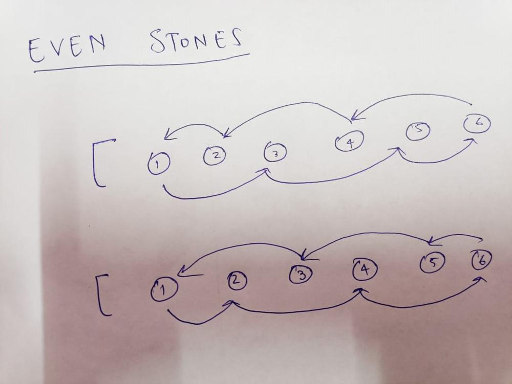

# Decently explained Python3 code O(n) w/ Image

**Author:** alreadyselfish
**Votes:** 22
**Link:** [https://leetcode.com/problems/frog-jump-ii/solutions/2898129/](https://leetcode.com/problems/frog-jump-ii/solutions/2898129/)

---

# Approach
<!-- Describe your approach to solving the problem. -->
No matter how you try, the best approach is always going to be skipping the next stone and going to next stone after that (if this step is possible). 

After drawing all possibilities it can be seen that the biggest steps are always going to be skipping one stone in between of two stones, i.e of length = 2.
There may be other steps as well of length = 1 but there will always be another step of length 2 skipping over the stone involved in jump of length 1, hence making the length 1 jump not worth considering.

Here are examples of possible paths for even and odd number of stones.
Sorry for unclear photos.





As, the images can hopefully show, the optimal path will result in jumps of length 2, and so in the code I have just used two pointers i, j  to iterate through the graph and check what is the maximum cost in jumping this way. 

Hope you understood what I am trying to convey here. Anyways, have a great day and Happy Coding.


# Complexity
- Time complexity:
<!-- Add your time complexity here, e.g. $$O(n)$$ -->O(N)

- Space complexity:
<!-- Add your space complexity here, e.g. $$O(n)$$ -->O(1)

# Code
```
class Solution:
    def maxJump(self, stones: List[int]) -> int:
        if len(stones) == 2:
            return (stones[-1] - stones[0])
        maxjump = 0
        i, j = 0, 2
        while j < len(stones):
            maxjump = max(maxjump, (stones[j] - stones[i]))
            i+= 1; j+= 1
        return maxjump
        
```