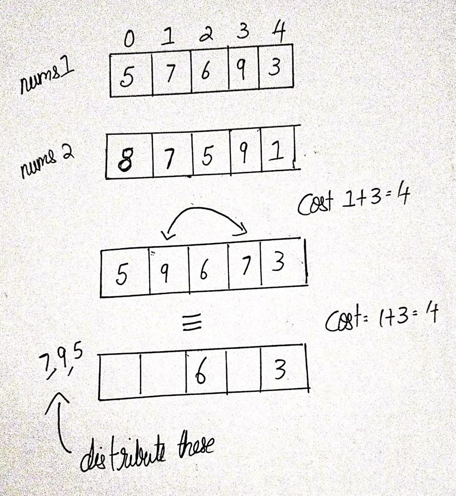

# Simple solution with Diagram and Intuition | C++ | O(n) Time and Space

**Author:** IamVaibhave53
**Votes:** 124
**Link:** [https://leetcode.com/problems/minimum-total-cost-to-make-arrays-unequal/solutions/2897887/](https://leetcode.com/problems/minimum-total-cost-to-make-arrays-unequal/solutions/2897887/)

---

# Intuition
<!-- Describe your first thoughts on how to solve this problem. -->
1. The first position is like a resting place. The cost of moving an element from there is 0 as the index is 0. 
2. Swapping 2 elements can be thought of as swapping both of the elements to position 0 and then swapping them back to desired position.



# Approach
<!-- Describe your approach to solving the problem. -->
1. Lets call an index bad is nums1[index] = nums2[index]. Imagine this, you collect all "**bad indexes**" in the 0th index. The cost to move this index to the 0th index is the index of the element.
2. Now, you can use these collected indexes and distribute them to the desired positions. (note that we don't have to add any extra cost here, we can assume that once an element has come to position 0, it is free to move)
3. The only thing to care is the case where the maximum occuring element occurs more than half the values. In this case we need to collect more indexes even though they aren't "**bad**". 
4. We want to collect indexes which contribute less cost, i.e which occur earlier (smallest index) as well as taking care that the value doesn't equal to the max occuring element (worsening our situation) and also ensuring that nums2[index] != max occurent element

# Complexity
- Time complexity: $$O(n)$$ 
<!-- Add your time complexity here, e.g. $$O(n)$$ -->

- Space complexity: $$O(n)$$ 
<!-- Add your space complexity here, e.g. $$O(n)$$ -->

# Code
```
class Solution {
public:
    long long minimumTotalCost(vector<int>& nums1, vector<int>& nums2) {
        
        const int n=nums1.size();
        long long int ans=0;
        map<int,int> freq;
        int maxFrequency=0,maxFrequencyValue=0,toSwap = 0;
        
        for(int i=0;i<n;i++){
            if(nums1[i]==nums2[i]){
                freq[nums1[i]]++;
                if(freq[nums1[i]]>maxFrequency) maxFrequencyValue=nums1[i];
                maxFrequency=max(maxFrequency,freq[nums1[i]]);
                toSwap++;
                ans+=i;
            }
        }
        
        for(int i=0;i<n;i++){
            if(maxFrequency > toSwap/2 and nums1[i]!=nums2[i] and nums1[i]!=maxFrequencyValue and nums2[i]!=maxFrequencyValue){
                ans+=i;
                toSwap++;
            }
        }
        
        if(maxFrequency > toSwap/2) return -1;
        
        return ans;
    }
};
```