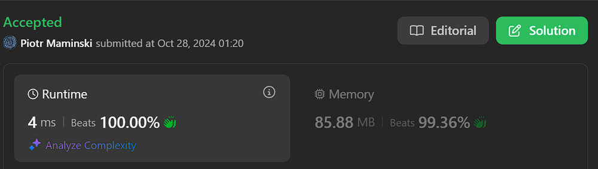
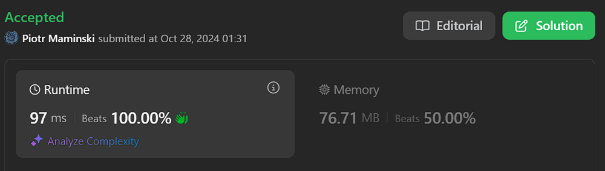

# ✅ Explained step by step | Beats 100% | ✅ Working 28.10.2024

**Author:** Piotr_Maminski
**Votes:** 11
**Link:** [https://leetcode.com/problems/longest-square-streak-in-an-array/solutions/5976355/](https://leetcode.com/problems/longest-square-streak-in-an-array/solutions/5976355/)

---


```python3 []
class Solution:
    def longestSquareStreak(self, nums: List[int]) ->int:
        # Convert nums to a sorted set to remove duplicates and have ordered numbers
        nums = sorted(set(nums))
        
        # Create a set for O(1) lookup time
        num_set = set(nums)
        
        # Track the maximum streak length found
        max_length = 0
        
        # Iterate through each number in sorted order
        for num in nums:
            # Initialize streak length for current number
            length = 0
            # Start with current number
            current = num
            
            # Keep squaring the number while it exists in our set
            while current in num_set:
                length += 1
                current = current ** 2
            
            # Only update max_length if we found a streak of length > 1
            if length > 1:
                max_length = max(max_length, length)
        
        # Return max_length if we found a valid streak, otherwise return -1
        return max_length if max_length > 1 else -1
```
```cpp []
class Solution {
public:
    int longestSquareStreak(vector<int>& nums) {
        // Convert nums to a sorted set to remove duplicates and have ordered numbers
        set<long long> num_set;
        for (int num : nums) {
            num_set.insert(num);
        }
        
        // Track the maximum streak length found
        int max_length = 0;
        
        // Iterate through each number in sorted order
        for (long long num : num_set) {
            // Initialize streak length for current number
            int length = 0;
            // Start with current number
            long long current = num;
            
            // Keep squaring the number while it exists in our set
            while (num_set.find(current) != num_set.end()) {
                length++;
                if (current > 100000) break; // Prevent overflow
                current = current * current;
            }
            
            // Only update max_length if we found a streak of length > 1
            if (length > 1) {
                max_length = max(max_length, length);
            }
        }
        
        // Return max_length if we found a valid streak, otherwise return -1
        return max_length > 1 ? max_length : -1;
    }
};
```
```java []
import java.util.*;

class Solution {
    public int longestSquareStreak(int[] nums) {
        // Convert array to TreeSet to remove duplicates and have ordered numbers
        TreeSet<Integer> sortedSet = new TreeSet<>();
        for (int num : nums) {
            sortedSet.add(num);
        }
        
        // Create HashSet for O(1) lookup time
        HashSet<Integer> numSet = new HashSet<>(sortedSet);
        
        // Track the maximum streak length found
        int maxLength = 0;
        
        // Iterate through each number in sorted order
        for (int num : sortedSet) {
            // Initialize streak length for current number
            int length = 0;
            // Start with current number
            long current = num;
            
            // Keep squaring the number while it exists in our set
            while (current <= Integer.MAX_VALUE && numSet.contains((int)current)) {
                length++;
                current = current * current;
            }
            
            // Only update maxLength if we found a streak of length > 1
            if (length > 1) {
                maxLength = Math.max(maxLength, length);
            }
        }
        
        // Return maxLength if we found a valid streak, otherwise return -1
        return maxLength > 1 ? maxLength : -1;
    }
}
```
```csharp []
public class Solution {
    public int LongestSquareStreak(int[] nums) {
        // Convert nums to a sorted set to remove duplicates and have ordered numbers
        var numSet = new HashSet<int>(nums);
        var sortedNums = numSet.OrderBy(x => x).ToList();
        
        // Track the maximum streak length found
        int maxLength = 0;
        
        // Iterate through each number in sorted order
        foreach (int num in sortedNums) {
            // Initialize streak length for current number
            int length = 0;
            // Start with current number
            long current = num;
            
            // Keep squaring the number while it exists in our set
            while (current <= int.MaxValue && numSet.Contains((int)current)) {
                length++;
                current = current * current;
            }
            
            // Only update maxLength if we found a streak of length > 1
            if (length > 1) {
                maxLength = Math.Max(maxLength, length);
            }
        }
        
        // Return maxLength if we found a valid streak, otherwise return -1
        return maxLength > 1 ? maxLength : -1;
    }
}
```
```golang []
func longestSquareStreak(nums []int) int {
    // Create a map for O(1) lookup time
    numSet := make(map[int]bool)
    
    // Remove duplicates and add to map
    for _, num := range nums {
        numSet[num] = true
    }
    
    // Track the maximum streak length found
    maxLength := 0
    
    // Iterate through each number
    for num := range numSet {
        length := 0
        current := num
        
        // Keep squaring the number while it exists in our map
        for numSet[current] {
            length++
            // Check if squaring would overflow int
            if current > 46340 { // sqrt(MaxInt32) \u2248 46340
                break
            }
            current *= current
        }
        
        // Only update maxLength if we found a streak of length > 1
        if length > 1 {
            maxLength = max(maxLength, length)
        }
    }
    
    // Return maxLength if we found a valid streak, otherwise return -1
    if maxLength > 1 {
        return maxLength
    }
    return -1
}

// Helper function for max
func max(a, b int) int {
    if a > b {
        return a
    }
    return b
}
```
```swift []
class Solution {
    func longestSquareStreak(_ nums: [Int]) -> Int {
        // Convert nums to a sorted set to remove duplicates and have ordered numbers
        let sortedNums = Array(Set(nums)).sorted()
        
        // Create a set for O(1) lookup time
        let numSet = Set(nums)
        
        // Track the maximum streak length found
        var maxLength = 0
        
        // Iterate through each number in sorted order
        for num in sortedNums {
            // Initialize streak length for current number
            var length = 0
            // Start with current number
            var current = num
            
            // Keep squaring the number while it exists in our set
            while numSet.contains(current) {
                length += 1
                // Need to handle potential integer overflow
                let nextSquare = current * current
                if nextSquare > Int.max {
                    break
                }
                current = nextSquare
            }
            
            // Only update maxLength if we found a streak of length > 1
            if length > 1 {
                maxLength = max(maxLength, length)
            }
        }
        
        // Return maxLength if we found a valid streak, otherwise return -1
        return maxLength > 1 ? maxLength : -1
    }
}
```
```javascript [JS]
// JavaScript


/**
 * @param {number[]} nums
 * @return {number}
 */
var longestSquareStreak = function(nums) {
    // Convert nums to a sorted set to remove duplicates and have ordered numbers
    const numSet = new Set(nums);
    
    // Track the maximum streak length found
    let maxLength = 0;
    
    // Iterate through each number in the set
    for (let num of numSet) {
        // Initialize streak length for current number
        let length = 0;
        // Start with current number
        let current = num;
        
        // Keep squaring the number while it exists in our set
        while (numSet.has(current)) {
            length++;
            if (current > 100000) break; // Prevent overflow
            current = current * current;
        }
        
        // Only update maxLength if we found a streak of length > 1
        if (length > 1) {
            maxLength = Math.max(maxLength, length);
        }
    }
    
    // Return maxLength if we found a valid streak, otherwise return -1
    return maxLength > 1 ? maxLength : -1;
};
```
```typescript [TS]
// TypeScript


function longestSquareStreak(nums: number[]): number {
    // Convert nums to a sorted set to remove duplicates and have ordered numbers
    const numSet = new Set(nums);
    const sortedNums = Array.from(numSet).sort((a, b) => a - b);
    
    // Track the maximum streak length found
    let maxLength = 0;
    
    // Iterate through each number in sorted order
    for (const num of sortedNums) {
        // Initialize streak length for current number
        let length = 0;
        // Start with current number
        let current = num;
        
        // Keep squaring the number while it exists in our set
        while (numSet.has(current)) {
            length++;
            current = current ** 2;
            
            // Add safety check for numbers getting too large
            if (current > 100000) break;
        }
        
        // Only update maxLength if we found a streak of length > 1
        if (length > 1) {
            maxLength = Math.max(maxLength, length);
        }
    }
    
    // Return maxLength if we found a valid streak, otherwise return -1
    return maxLength > 1 ? maxLength : -1;
}
```
```rust []
use std::collections::HashSet;

impl Solution {
    pub fn longest_square_streak(nums: Vec<i32>) -> i32 {
        // Convert to HashSet and sort
        let mut unique_nums: Vec<i64> = nums.into_iter()
            .map(|x| x as i64)
            .collect::<HashSet<_>>()
            .into_iter()
            .collect();
        unique_nums.sort_unstable();
        
        // Create HashSet for O(1) lookup
        let num_set: HashSet<i64> = unique_nums.iter().cloned().collect();
        
        // Track maximum streak length
        let mut max_length = 0;
        
        // Check each number
        for &num in &unique_nums {
            let mut length = 0;
            let mut current = num;
            
            // Keep squaring while number exists in set
            while num_set.contains(&current) {
                length += 1;
                // Check if squaring would overflow
                if current > (1i64 << 31) {
                    break;
                }
                current *= current;
            }
            
            // Update max_length if streak length > 1
            if length > 1 {
                max_length = max_length.max(length);
            }
        }
        
        if max_length > 1 {
            max_length
        } else {
            -1
        }
    }
}
```
```ruby []
# @param {Integer[]} nums
# @return {Integer}
def longest_square_streak(nums)
    # Convert nums to a sorted set to remove duplicates and have ordered numbers
    nums = nums.uniq.sort
    
    # Create a set for O(1) lookup time
    num_set = nums.to_set
    
    # Track the maximum streak length found
    max_length = 0
    
    # Iterate through each number in sorted order
    nums.each do |num|
        # Initialize streak length for current number
        length = 0
        # Start with current number
        current = num
        
        # Keep squaring the number while it exists in our set
        while num_set.include?(current)
            length += 1
            current = current ** 2
        end
        
        # Only update max_length if we found a streak of length > 1
        if length > 1
            max_length = [max_length, length].max
        end
    end
    
    # Return max_length if we found a valid streak, otherwise return -1
    max_length > 1 ? max_length : -1
end
```


### Complexity 
- Time complexity: O(n * log m)

- Space complexity: O(n)


## Explained step by step

---

1. Input Processing:
```
nums = sorted(set(nums))
num_set = set(nums)
```

- Converts input array to a sorted set to remove duplicates
- Creates a separate set for O(1) lookups
2. Initialization:
```
max_length = 0
```

- Sets up a variable to track the longest valid streak found
3. Main Logic:
```
for num in nums:
    length = 0
    current = num
    while current in num_set:
        length += 1
        current = current ** 2
```


- Iterates through each number
- For each number, keeps squaring it while the result exists in the set
- Counts the length of the streak
4. Streak Validation:
```
if length > 1:
    max_length = max(max_length, length)
```
- Only considers streaks with length > 1
- Updates max_length if current streak is longer
5. Final Result:
```
return max_length if max_length > 1 else -1
```

- Returns the longest streak if found (> 1)
- Returns -1 if no valid streak exists

---




