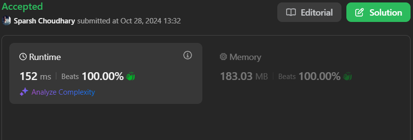

# 🔥BEATS 💯 % 🎯 |✨SUPER EASY BEGINNERS 👏

**Author:** CodeWithSparsh
**Votes:** 2
**Link:** [https://leetcode.com/problems/longest-square-streak-in-an-array/solutions/5977608/](https://leetcode.com/problems/longest-square-streak-in-an-array/solutions/5977608/)

---




---

# Intuition
The task requires finding the longest sequence of numbers where each number is the square of the previous one. By counting such sequences for each number in the sorted list, we aim to identify the longest possible streak.

# Approach
1. **Sort the List**: Sorting `nums` allows binary search to efficiently check for subsequent square values.
2. **Count Sequence for Each Number**: For each `n` in `nums`, call `getCounts` to calculate the streak length, squaring each time until the squared value is not found in the list.
3. **Binary Search**: `binarySearch` locates target values within `nums`, optimizing search time with `O(log n)`.
4. **Result**: Return the maximum count for all numbers or `-1` if no streak exceeds one element.

# Complexity
- **Time Complexity**: \\(O(n \\log n + n \\log m)\\), where \\(n\\) is the number of elements in `nums` and \\(m\\) is the number of streak elements for each number.
- **Space Complexity**: \\(O(1)\\), no additional space is used apart from counters.

---

# Code


```dart []
class Solution {
  int longestSquareStreak(List<int> nums) {
    nums.sort();
    int ans = -1;
    for (int n in nums) {
      int counts = getCounts(n, nums);
      if (counts > 1) {
        ans = max(ans, counts);
      }
    }
    return ans;
  }

  int getCounts(int target, List<int> arrays) {
    int found = 1;
    target = target * target;
    while (binarySearch(target, arrays)) {
      found++;
      target = target * target;
    }
    return found;
  }

  bool binarySearch(int target, List<int> arrays) {
    int start = 0;
    int end = arrays.length - 1;
    while (start <= end) {
      int mid = start + (end - start) ~/ 2;
      if (arrays[mid] == target) return true;
      if (arrays[mid] > target)
        end = mid - 1;
      else
        start = mid + 1;
    }
    return false;
  }
}
```


```java []
import java.util.Arrays;

class Solution {
    public int longestSquareStreak(int[] nums) {
        Arrays.sort(nums);
        int ans = -1;
        for (int n : nums) {
            int counts = getCounts(n, nums);
            if (counts > 1) {
                ans = Math.max(ans, counts);
            }
        }
        return ans;
    }

    private int getCounts(int target, int[] arrays) {
        int found = 1;
        target *= target;
        while (binarySearch(target, arrays)) {
            found++;
            target *= target;
        }
        return found;
    }

    private boolean binarySearch(int target, int[] arrays) {
        int start = 0, end = arrays.length - 1;
        while (start <= end) {
            int mid = start + (end - start) / 2;
            if (arrays[mid] == target) return true;
            if (arrays[mid] > target) end = mid - 1;
            else start = mid + 1;
        }
        return false;
    }
}
```


```javascript []
function longestSquareStreak(nums) {
    nums.sort((a, b) => a - b);
    let ans = -1;
    for (let n of nums) {
        let counts = getCounts(n, nums);
        if (counts > 1) ans = Math.max(ans, counts);
    }
    return ans;
}

function getCounts(target, arrays) {
    let found = 1;
    target = target * target;
    while (binarySearch(target, arrays)) {
        found++;
        target = target * target;
    }
    return found;
}

function binarySearch(target, arrays) {
    let start = 0, end = arrays.length - 1;
    while (start <= end) {
        let mid = Math.floor((start + end) / 2);
        if (arrays[mid] === target) return true;
        if (arrays[mid] > target) end = mid - 1;
        else start = mid + 1;
    }
    return false;
}
```

```python []
from typing import List

class Solution:
    def longestSquareStreak(self, nums: List[int]) -> int:
        nums.sort()
        ans = -1
        for n in nums:
            counts = self.getCounts(n, nums)
            if counts > 1:
                ans = max(ans, counts)
        return ans

    def getCounts(self, target: int, arrays: List[int]) -> int:
        found = 1
        target *= target
        while self.binarySearch(target, arrays):
            found += 1
            target *= target
        return found

    def binarySearch(self, target: int, arrays: List[int]) -> bool:
        start, end = 0, len(arrays) - 1
        while start <= end:
            mid = (start + end) // 2
            if arrays[mid] == target:
                return True
            elif arrays[mid] > target:
                end = mid - 1
            else:
                start = mid + 1
        return False
```


```cpp []
#include <vector>
#include <algorithm>

class Solution {
public:
    int longestSquareStreak(std::vector<int>& nums) {
        std::sort(nums.begin(), nums.end());
        int ans = -1;
        for (int n : nums) {
            int counts = getCounts(n, nums);
            if (counts > 1) {
                ans = std::max(ans, counts);
            }
        }
        return ans;
    }

private:
    int getCounts(int target, const std::vector<int>& arrays) {
        int found = 1;
        target *= target;
        while (binarySearch(target, arrays)) {
            found++;
            target *= target;
        }
        return found;
    }

    bool binarySearch(int target, const std::vector<int>& arrays) {
        int start = 0, end = arrays.size() - 1;
        while (start <= end) {
            int mid = start + (end - start) / 2;
            if (arrays[mid] == target) return true;
            if (arrays[mid] > target) end = mid - 1;
            else start = mid + 1;
        }
        return false;
    }
};
```


```go []
import "sort"

func longestSquareStreak(nums []int) int {
    sort.Ints(nums)
    ans := -1
    for _, n := range nums {
        counts := getCounts(n, nums)
        if counts > 1 {
            if counts > ans {
                ans = counts
            }
        }
    }
    return ans
}

func getCounts(target int, arrays []int) int {
    found := 1
    target = target * target
    for binarySearch(target, arrays) {
        found++
        target = target * target
    }
    return found
}

func binarySearch(target int, arrays []int) bool {
    start, end := 0, len(arrays)-1
    for start <= end {
        mid := start + (end - start) / 2
        if arrays[mid] == target {
            return true
        }
        if arrays[mid] > target {
            end = mid - 1
        } else {
            start = mid + 1
        }
    }
    return false
}
```
 {:style='width:250px'}