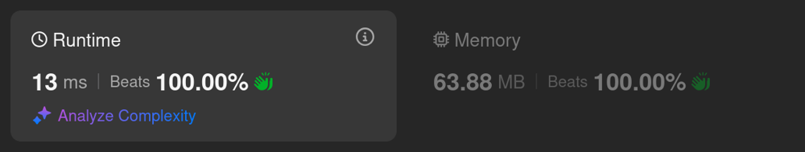
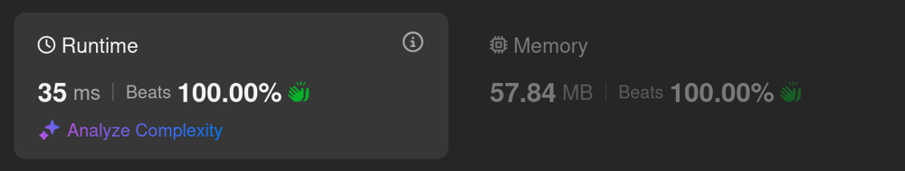

# Kotlin. Beats 100% (13 ms). Static "squares" cache. No sort.

**Author:** mobdev778
**Votes:** 1
**Link:** [https://leetcode.com/problems/longest-square-streak-in-an-array/solutions/5977945/](https://leetcode.com/problems/longest-square-streak-in-an-array/solutions/5977945/)

---



# Code
```kotlin []
class Solution {
    fun longestSquareStreak(nums: IntArray): Int {
        marker++

        for (n in nums) {
            SQUARES[n]?.marker = marker
        }

        var maxChain = -1
        for (i in 1..316) {
            if (SQUARES[i]?.marker == marker) {
                var chain = 1
                var s: Square? = SQUARES[i]
                while (s?.next?.marker == marker) {
                    chain++
                    maxChain = Math.max(maxChain, chain)
                    s.marker = 0
                    s = s.next
                }
            }
        }

        return maxChain
    }

    companion object {
        val SQUARES = Array<Square?>(100_001) { null }
        var marker = 0

        init {
            for (x in 100_000 downTo 1) {
                SQUARES[x] = Square(x, if (x * x >= 0 && x * x < SQUARES.size) SQUARES[x * x] else null)
            }
        }
    }
}

class Square(val number: Int, val next: Square? = null): Comparable<Square> {
    var marker: Int = 0
    override fun compareTo(other: Square): Int = number - other.number
    override fun toString(): String = "$number*$number=${number * number}"
}
```

# Approach

A good algorithm should avoid the situation where the code has to "ride the same rails many times".

Such a situation can be the checking of area strike chains. We can calculate all possible chains in advance to reduce the checking time as much as possible.

Since the nodes in the chains are static, i.e. they are repeated from test to test, I introduce an additional field "marker" indicating that this chain node is included in a specific test. This reduces the time and memory for checking nodes.

# Alternative approach

1. HashSet solution (no sort)



```
class Solution {
    fun longestSquareStreak(nums: IntArray): Int {
        val set = HashSet<Int>()
        for (n in nums) {
            set.add(n)
        }

        var maxChain = -1
        var chain = 0
        for (x in 1..316) {
            if (set.remove(x)) {
                chain = 1
                var x = x
                while (set.remove(x * x)) {
                    x = x * x
                    chain++
                    maxChain = Math.max(maxChain, chain)
                }
            }
        }
        return maxChain
    }
}
```
