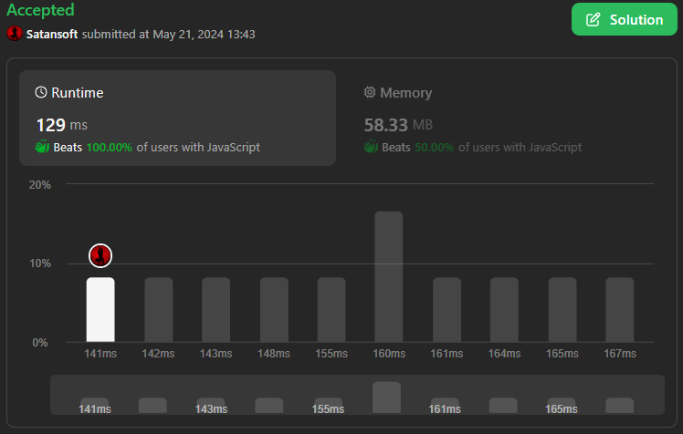

# ✅ Javascript | Optimal Solution | 🏆Array, Hash Table🏆 |🔥Beats 100%🔥

**Author:** Satansoft
**Votes:** 0
**Link:** [https://leetcode.com/problems/design-memory-allocator/solutions/5190648/](https://leetcode.com/problems/design-memory-allocator/solutions/5190648/)

---



# Intuition
Depemding on constraints, staight forward solution will be accepted and any optimizations will make solution better.

# Approach
Set `this.n` as limit of memory, `this.memory` as data structure and 
`this.allocated` for tracking id's, already in `this.memory`;

In `allocate` method set `firstIndex` as -1 (no free memory) and start traverse through the `this.memory`. Set 3 conditions inside: 

- Stop condition on the top, if we filled memory (`!size`) or out of range (`i + size > this.n`);
- If we found first free cell (`this.memory[i] === 0`) and `firstIndex` isn't set yet (`firstIndex === -1`), then traversing from `i` to `i + size - 1` and check, is number of cells are enough for current `size`, if not, break the loop and make offset in main loop to `j`, but if cells are enough, set `firstIndex` and store `mID` to `this.allocated`;
- If `firstIndex` has set, `size` is more than 0 and cell value is 0, fill `this.memory[i]` with `mID` and decrement `size`. At the end return `firstIndex`;

In `free` method check if `mID` in `this.allocated` first and return 0 if not. Otherwise traversing through the `this.memory.length` and if `this.memory[i] === mID`, set it to 0 and increment `count` (number of freed memory). Return `count` at the end.


# Complexity
- Time complexity:
O(n * m)

- Space complexity:
O(n)

# Code
```
/**
 * @param {number} n
 */
var Allocator = function(n) {
    this.n = n;
    this.memory = Array(n).fill(0);
    this.allocated = new Set();
};

/** 
 * @param {number} size 
 * @param {number} mID
 * @return {number}
 */
Allocator.prototype.allocate = function(size, mID) {
    let firstIndex = -1;

    for (let i = 0; i < this.memory.length; i++) {
        if (!size || i + size > this.n) break;

        if (this.memory[i] === 0 && firstIndex === -1) {
            for (let j = i; j < i + size; j++) {

                if (this.memory[j] !== 0) {
                    i = j;
                    break;
                }

                if (j === i + size - 1) {
                    firstIndex = i;
                    this.allocated.add(mID);
                }
            } 
        }

        if (this.memory[i] === 0 && firstIndex !== -1 && size) {
            this.memory[i] = mID;
            size--;
        }
    }

    return firstIndex;
};

/** 
 * @param {number} mID
 * @return {number}
 */
Allocator.prototype.free = function(mID) {
    if (!this.allocated.has(mID)) return 0;
    let count = 0;

    for (let i = 0; i < this.memory.length; i++) {
        if (this.memory[i] === mID) {
            this.memory[i] = 0;
            count++;
        }
    }

    this.allocated.delete(mID);

    return count;
};

/** 
 * Your Allocator object will be instantiated and called as such:
 * var obj = new Allocator(n)
 * var param_1 = obj.allocate(size,mID)
 * var param_2 = obj.free(mID)
 */
```