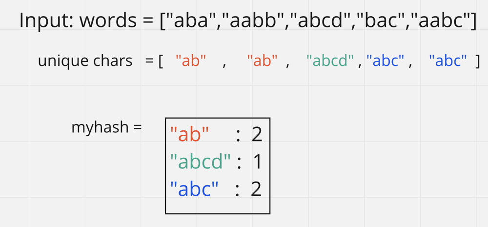
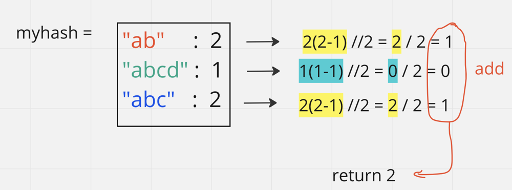
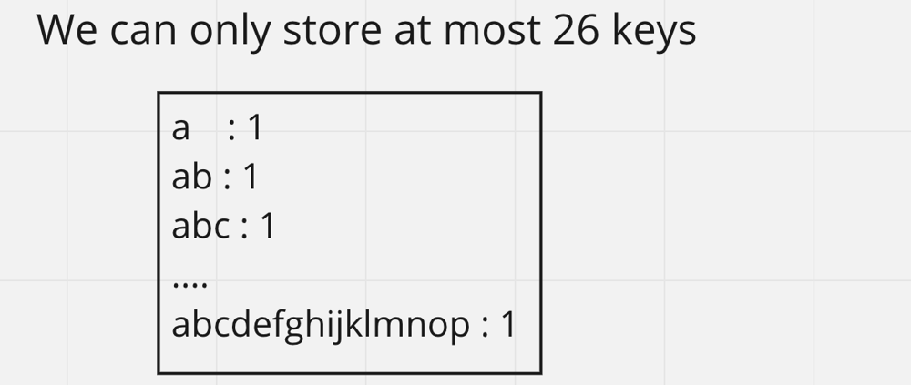

# O(1) space, O(n*k) Time || Hashmap approach [Python3]

**Author:** Ferb7o2
**Votes:** 51
**Link:** [https://leetcode.com/problems/count-pairs-of-similar-strings/solutions/3166484/](https://leetcode.com/problems/count-pairs-of-similar-strings/solutions/3166484/)

---

Bear with me, answer isn't hard at all
just follow the intuition
> Please Leave a like if you liked the approach

# Intuition
<!-- Describe your first thoughts on how to solve this problem. -->
Analyzing the input array `words` and the problem description `Two strings are similar if they consist of the same characters.` we can see that words can be broken down into their unique characters. For example: *abba* is just 'ab' and *acab* is just 'acb'

with that, I realized that we could store all of the unique chars as keys for a hash and the corresponding values would be the **counts of similar strings**
{ KEY (unique value): VALUE (**count of similar strings**) }

For example 
`Example 1: Input: words = ["aba","aabb","abcd","bac","aabc"]`
would look something like this:


Now that we know how many words share the same letters we can find out how many unique pairs there are by using the n(n-1) /2 formula which finds the non-repeating pairs (idk the name of that formula, and YOU'RE NOT EXPECTED TO KNOW THAT FORMULA).

 *Wondering that if I know the number of elements, how would I know how many unique pairs we can form -> I googled that and found that formula.*

anyway, now that we know that formula and how many instances there are for similar strings, we can iterate through every similar string key in the map, apply that formula to the value and add the result to a counter

lastly, we return that counter


# How to convert the word to a key
To convert the word to a key we do this in order:
1. convert string into a set (time complexity of this operation will be K: the average length of word[i])
`This has a flaw,
if words are in order like 'abba' it will work ok since it will store it as 'ab' but if words are not in order like "bac" it will store it out of order, and it will not match with it's corresponding 'abc' key`
2. To "order" the characters we will sort the set (time complexity will be O(26) at most, since the set made sure we only have unique characters and we know the string only contains lowercase characters)
3. Finally we convert this sorted list into a string by using the ".join() operator. This is also constant time since there are max 26 characters.

# Complexity
- Time complexity: O(n * k) where n is the size of `words` and k is the average length of `words[i]`
    - we traverse the whole `words` array : O(n)  
        - inside that traversal, we create create a set for every word: O(k)
        - we sort that set: O(26) -> O(1)
        - we `"".join()` to create sorted array into a string: O(26) -> O(1)

    - we traverse the hashmap: O(26) -> O(1)

- Space complexity: O(1)
    - we create a set but it will have at most (26) characters
  - we create a hash, but since the keys will only be unique chars we know that this takes constant space (see image)

<!-- Add your space complexity here, e.g. $$O(n)$$ -->

> Please Leave a like if you liked the approach

# Code
``` python []
class Solution:
    def similarPairs(self, words: List[str]) -> int:
        wordMap = {}

        #we traverse the input array
        for word in words:
            #convert the word into a (unique characters) hashable key
            #(see notes above for explanation)
            curr = sorted(set(word))
            curr = ''.join(curr)

            #add count of this "similar string" instances
            if curr in wordMap:
                wordMap[curr]+=1
            else:
                wordMap[curr]=1

        pairs = 0
        #traverse through all "similar string" keys
            #and add pairs using the unique combination formula
            #(see notes above for explanation)
        for word in wordMap:
            count = wordMap[word]
            pairs += (count* (count-1))//2

        
        return pairs
        #Time Compelxity: O(N*K)
        #Space Complexity: O(26) -> O(1)


```

> Please Leave a like if you liked the approach