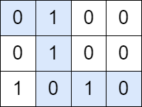
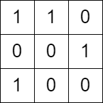

# [2510. Check if There is a Path With Equal Number of 0's And 1's](https://leetcode.com/problems/check-if-there-is-a-path-with-equal-number-of-0s-and-1s/)

| Category | Difficulty | Likes | Dislikes |
| :------: | :--------: | :---: | :------: |
| Algorithms | Medium | 108 | 5 |

**Tags:** [`array`](https://leetcode.com/tag/array), [`dynamic-programming`](https://leetcode.com/tag/dynamic-programming), [`matrix`](https://leetcode.com/tag/matrix)

**Companies:** `google`

## Description

You are given a **0-indexed** `m x n` **binary** matrix `grid`. You can move from a cell `(row, col)` to any of the cells `(row + 1, col)` or `(row, col + 1)`.

Return `true`* if there is a path from *`(0, 0)`* to *`(m - 1, n - 1)`* that visits an **equal** number of *`0`*'s and *`1`*'s*. Otherwise return `false`.

 

**Example 1:**


```

Input: grid = [[0,1,0,0],[0,1,0,0],[1,0,1,0]]
Output: true
Explanation: The path colored in blue in the above diagram is a valid path because we have 3 cells with a value of 1 and 3 with a value of 0. Since there is a valid path, we return true.

```

**Example 2:**


```

Input: grid = [[1,1,0],[0,0,1],[1,0,0]]
Output: false
Explanation: There is no path in this grid with an equal number of 0&#39;s and 1&#39;s.

```

 

**Constraints:**

	- `m == grid.length`

	- `n == grid[i].length`

	- `2 <= m, n <= 100`

	- `grid[i][j]` is either `0` or `1`.

---

**Links:** [Submissions](https://leetcode.com/problems/check-if-there-is-a-path-with-equal-number-of-0s-and-1s/) | [Solutions](https://leetcode.com/problems/check-if-there-is-a-path-with-equal-number-of-0s-and-1s/)
