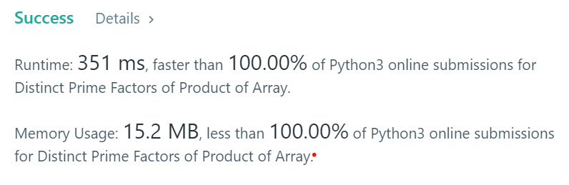

# [ Python ] ✅✅ Simple Python Solution Using Set | 100 % faster🥳✌👍

**Author:** ASHOK_KUMAR_MEGHVANSHI
**Votes:** 13
**Link:** [https://leetcode.com/problems/distinct-prime-factors-of-product-of-array/solutions/2977534/](https://leetcode.com/problems/distinct-prime-factors-of-product-of-array/solutions/2977534/)

---

# If You like the Solution, Don't Forget To UpVote Me, Please UpVote! \uD83D\uDD3C\uD83D\uDE4F
# Runtime: 351 ms, faster than 100.00% of Python3 online submissions for Distinct Prime Factors of Product of Array.
# Memory Usage: 15.2 MB, less than 100.00% of Python3 online submissions for Distinct Prime Factors of Product of Array.

	class Solution:
		def distinctPrimeFactors(self, nums: List[int]) -> int:

			result = []

			for i in range (len(nums)) :

				square_root = int(math.sqrt(nums[i]))

				for prime_num in range(2, square_root + 1) :

					if (nums[i] % prime_num == 0) :

						result.append(prime_num)

						while (nums[i] % prime_num == 0) :
							nums[i] = nums[i] // prime_num

				if (nums[i] >= 2) :
					result.append(nums[i])

			result = set(result)
			return len(result)
			
# Thank You \uD83E\uDD73\u270C\uD83D\uDC4D
