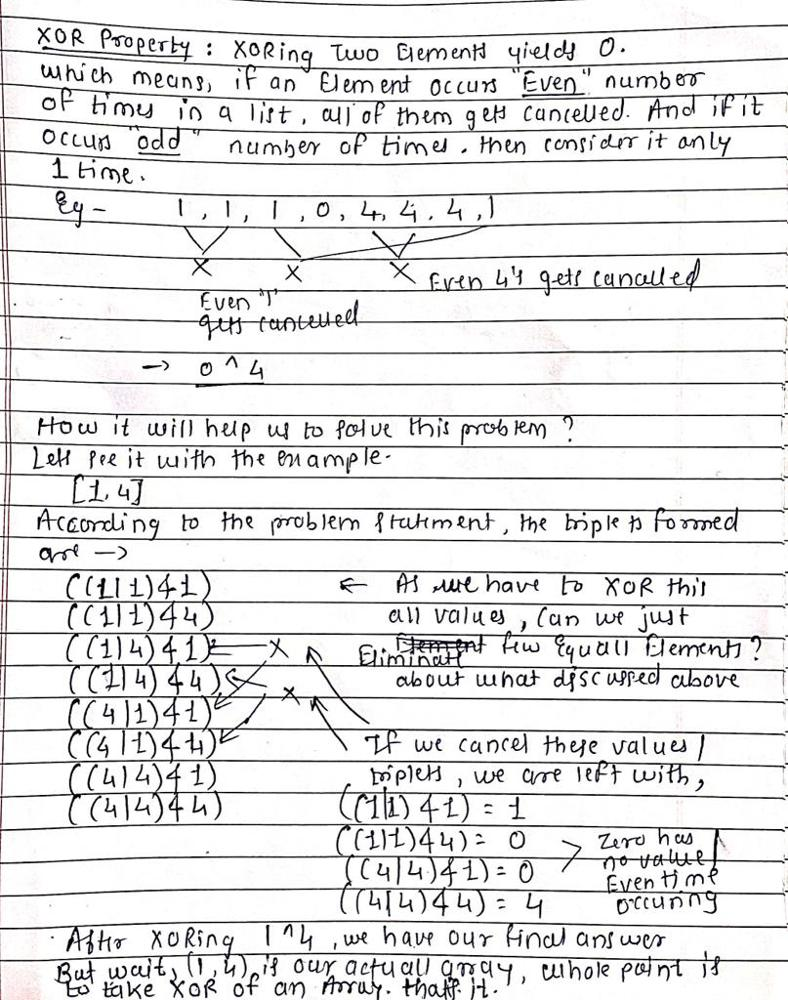

# Handwritten Explanation of Why?

**Author:** akashyeole
**Votes:** 62
**Link:** [https://leetcode.com/problems/find-xor-beauty-of-array/solutions/3014926/](https://leetcode.com/problems/find-xor-beauty-of-array/solutions/3014926/)

---



# Code
```
class Solution {
public:
    int xorBeauty(vector<int>& nums) {
        int ans = 0;
        for(int num: nums) ans ^= num;
        return ans;
    }
};
```

Help others by upvoting. Suggestion are welcome!