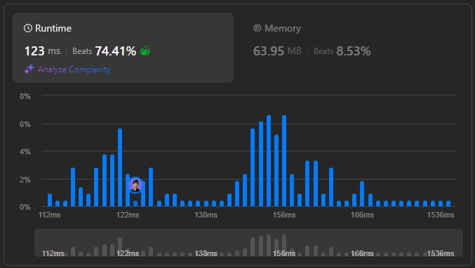

# 🌟 Solve It Like a Pro || Step-by-Step Solutions in 5 Languages 💯🔥

**Author:** withaarzoo
**Votes:** 5
**Link:** [https://leetcode.com/problems/maximal-score-after-applying-k-operations/solutions/5909243/](https://leetcode.com/problems/maximal-score-after-applying-k-operations/solutions/5909243/)

---


## \uD83C\uDF1F **Access Daily LeetCode Solutions Repo :** [click here](https://github.com/withaarzoo/LeetCode-Solutions)

---



---

# Intuition
The problem asks us to maximize the score after performing `k` operations on the array `nums`. In each operation, we can choose the largest available element, add it to our score, and then replace it with its value divided by 3 (rounded up). 

The intuition is simple: always try to choose the largest element, as it will give us the most immediate score benefit. After each selection, the largest element will decrease significantly, so we need a data structure that allows us to efficiently retrieve and update the largest element. A **max-heap (priority queue)** is perfect for this task.

---

# Approach
1. **Use a max-heap**: Insert all elements of the array into a max-heap. This allows us to efficiently extract the largest element.
2. **Perform k operations**: 
   - In each operation, extract the largest element from the heap.
   - Add it to the score.
   - Replace the element with `ceil(element / 3)` and insert it back into the heap.
3. **Continue for k operations**: Repeat the process until we've performed `k` operations.
4. **Return the total score**.

---

# Complexity
- **Time complexity**: 
  - Inserting elements into the heap takes \\(O(n \\log n)\\).
  - Each of the `k` operations involves removing the largest element and re-inserting the updated value, both of which take \\(O(\\log n)\\). 
  - Thus, the total time complexity is \\(O(k \\log n)\\).
  
- **Space complexity**: 
  - The space complexity is \\(O(n)\\), due to the storage required for the heap.

---

# Code
```C++ []
#include <queue>
#include <cmath>
#include <vector>

class Solution {
public:
    long long maxKelements(std::vector<int>& nums, int k) {
        // Max-heap to store the numbers (priority_queue is by default a max-heap)
        std::priority_queue<long long> maxHeap;
        
        // Push all elements into the heap
        for (int num : nums) {
            maxHeap.push(num);
        }
        
        long long score = 0;
        
        // Perform k operations
        for (int i = 0; i < k; ++i) {
            long long maxVal = maxHeap.top();
            maxHeap.pop();
            
            // Add the largest value to the score
            score += maxVal;
            
            // Replace the number with ceil(maxVal / 3)
            maxHeap.push((maxVal + 2) / 3);  // Using (maxVal + 2) / 3 to simulate ceil
        }
        
        return score;
    }
};

```
```Java []
import java.util.PriorityQueue;

class Solution {
    public long maxKelements(int[] nums, int k) {
        // Priority queue as max-heap
        PriorityQueue<Long> maxHeap = new PriorityQueue<>((a, b) -> Long.compare(b, a));
        
        // Insert all elements into the max-heap
        for (int num : nums) {
            maxHeap.add((long) num);
        }
        
        long score = 0;
        
        // Perform k operations
        for (int i = 0; i < k; i++) {
            long maxVal = maxHeap.poll();
            
            // Add the largest value to the score
            score += maxVal;
            
            // Replace the number with ceil(maxVal / 3)
            maxHeap.add((maxVal + 2) / 3);  // Using (maxVal + 2) / 3 to simulate ceil
        }
        
        return score;
    }
}

```
```JavaScript []
/**
 * @param {number[]} nums
 * @param {number} k
 * @return {number}
 */
var maxKelements = function(nums, k) {
    // Max heap using a priority queue simulation
    const maxHeap = new MaxPriorityQueue();
    
    // Insert all elements into the max-heap
    for (let num of nums) {
        maxHeap.enqueue(num);
    }
    
    let score = 0;
    
    // Perform k operations
    for (let i = 0; i < k; i++) {
        let maxVal = maxHeap.dequeue().element;
        
        // Add the largest value to the score
        score += maxVal;
        
        // Replace the number with ceil(maxVal / 3)
        maxHeap.enqueue(Math.ceil(maxVal / 3));
    }
    
    return score;
};

```
```Python []
import heapq
import math

class Solution:
    def maxKelements(self, nums: List[int], k: int) -> int:
        # Max-heap (we negate values to simulate max-heap behavior)
        maxHeap = [-num for num in nums]
        heapq.heapify(maxHeap)
        
        score = 0
        
        # Perform k operations
        for _ in range(k):
            # Get the largest element (by negating to retrieve the max)
            maxVal = -heapq.heappop(maxHeap)
            
            # Add to the score
            score += maxVal
            
            # Replace the element with ceil(maxVal / 3)
            heapq.heappush(maxHeap, -math.ceil(maxVal / 3))
        
        return score

```
```Go []
import (
    "container/heap"
    "math"
)

type MaxHeap []int64

func (h MaxHeap) Len() int           { return len(h) }
func (h MaxHeap) Less(i, j int) bool { return h[i] > h[j] } // Max-heap property
func (h MaxHeap) Swap(i, j int)      { h[i], h[j] = h[j], h[i] }

func (h *MaxHeap) Push(x interface{}) {
    *h = append(*h, x.(int64))
}

func (h *MaxHeap) Pop() interface{} {
    old := *h
    n := len(old)
    x := old[n-1]
    *h = old[0 : n-1]
    return x
}

func maxKelements(nums []int, k int) int64 {
    maxHeap := &MaxHeap{}
    heap.Init(maxHeap)
    
    for _, num := range nums {
        heap.Push(maxHeap, int64(num))
    }
    
    var score int64 = 0
    
    for i := 0; i < k; i++ {
        maxVal := heap.Pop(maxHeap).(int64)
        score += maxVal
        heap.Push(maxHeap, int64(math.Ceil(float64(maxVal) / 3)))
    }
    
    return score
}

```

---

# Step-by-Step Detailed Explanation

1. **Heap Construction**:
   - We first insert all elements of the array into a max-heap. In languages where the heap is by default a min-heap (like Python and Go), we negate the values to simulate a max-heap.

2. **Operations**:
   - We perform `k` operations, where in each operation we extract the largest value from the heap, add it to the score, and replace it with `ceil(value / 3)`.

3. **Heap Management**:
   - Each time we pop and push an element, the heap re-organizes itself to ensure the largest element is always at the top. This guarantees that we are always extracting the largest element in each iteration.

4. **Final Score**:
   - After `k` operations, the accumulated score is returned as the result.

---


