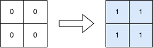

# [2536. Increment Submatrices by One](https://leetcode.com/problems/increment-submatrices-by-one/)

| Category | Difficulty | Likes | Dislikes |
| :------: | :--------: | :---: | :------: |
| Algorithms | Medium | 868 | 81 |

**Tags:** [`array`](https://leetcode.com/tag/array), [`matrix`](https://leetcode.com/tag/matrix), [`prefix-sum`](https://leetcode.com/tag/prefix-sum)

**Companies:** `adobe`, `google`

## Description

You are given a positive integer `n`, indicating that we initially have an `n x n` **0-indexed** integer matrix `mat` filled with zeroes.

You are also given a 2D integer array `query`. For each `query[i] = [row1_i, col1_i, row2_i, col2_i]`, you should do the following operation:

	- Add `1` to **every element** in the submatrix with the **top left** corner `(row1_i, col1_i)` and the **bottom right** corner `(row2_i, col2_i)`. That is, add `1` to `mat[x][y]` for all `row1_i <= x <= row2_i` and `col1_i <= y <= col2_i`.

Return* the matrix* `mat`* after performing every query.*

 

**Example 1:**


```

Input: n = 3, queries = [[1,1,2,2],[0,0,1,1]]
Output: [[1,1,0],[1,2,1],[0,1,1]]
Explanation: The diagram above shows the initial matrix, the matrix after the first query, and the matrix after the second query.
- In the first query, we add 1 to every element in the submatrix with the top left corner (1, 1) and bottom right corner (2, 2).
- In the second query, we add 1 to every element in the submatrix with the top left corner (0, 0) and bottom right corner (1, 1).

```

**Example 2:**


```

Input: n = 2, queries = [[0,0,1,1]]
Output: [[1,1],[1,1]]
Explanation: The diagram above shows the initial matrix and the matrix after the first query.
- In the first query we add 1 to every element in the matrix.

```

 

**Constraints:**

	- `1 <= n <= 500`

	- `1 <= queries.length <= 10^4`

	- `0 <= row1_i <= row2_i < n`

	- `0 <= col1_i <= col2_i < n`

---

**Links:** [Submissions](https://leetcode.com/problems/increment-submatrices-by-one/) | [Solutions](https://leetcode.com/problems/increment-submatrices-by-one/)
