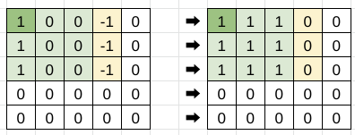
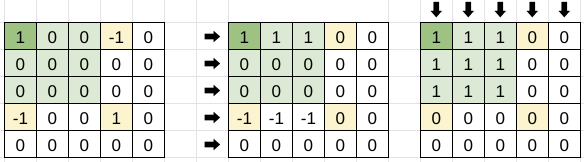

# Area Sweep

**Author:** votrubac
**Votes:** 20
**Link:** [https://leetcode.com/problems/increment-submatrices-by-one/solutions/3177915/](https://leetcode.com/problems/increment-submatrices-by-one/solutions/3177915/)

---

As a refresher, a line sweep is a technique when, instead of adding value to each element, we:
- Add value at the start of the segment,
- Subtract that value after the end of the segment. 

After processing all queries, we use a prefix sum to aggregate all queries in a single "sweep".

Based on the problem contraints, a line sweep solution is accepted.

2D area sweep is more complicated, but signifficantly faster: O(m + n * n) vs. O(m * n + n * n)).

It's useful to place these sulutions side-by-side to highlight the difference.

## 1D Sweep



**C++**
```cpp
vector<vector<int>> rangeAddQueries(int n, vector<vector<int>>& queries) {
    vector<vector<int>> res(n, vector<int>(n));
    for (auto q : queries)
        for (int i = q[0]; i <= q[2]; ++i) {
            res[i][q[1]] += 1;
            if (q[3] + 1 < n)
                res[i][q[3] + 1] -= 1;
        }
    for (int i = 0; i < n; ++i)
        partial_sum(begin(res[i]), end(res[i]), begin(res[i]));
    return res;
}
```

## 2D Sweep
For the area sweep, we:
- Add value to `[r1][c1]`.
- Subtract that value from `[r1][c2 + 1]`,
- Subtract that value from `[r2 + 1][c1]`,
- Add that value again to `[r2 + 1][c2 + 1]`.

Note that we do prefix sum independently for each dimension, so that we do not double-count.



**C++**
```cpp
vector<vector<int>> rangeAddQueries(int n, vector<vector<int>>& queries) {
    vector<vector<int>> res(n, vector<int>(n));
    for (auto q : queries) {
            int r1 = q[0], c1 = q[1], r2 = q[2], c2 = q[3];
            ++res[r1][c1];
            if (r2 + 1 < n)
                --res[r2 + 1][c1];
            if (c2 + 1 < n)
                --res[r1][c2 + 1];
            if (max(r2, c2) + 1 < n)
                ++res[r2 + 1][c2 + 1];
    }
    for (int i = 0; i < n; ++i)
        partial_sum(begin(res[i]), end(res[i]), begin(res[i]));  
    for (int i = 1; i < n; ++i)
        for (int j = 0; j < n; ++j)
            res[i][j] += res[i - 1][j];         
    return res;
}
```